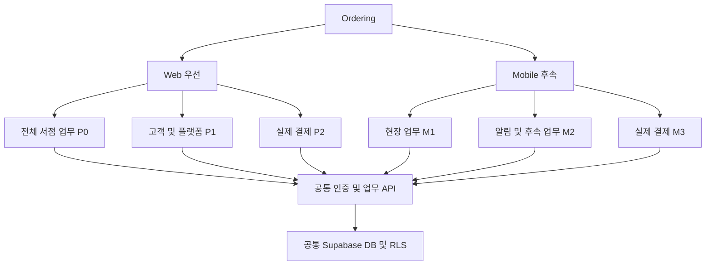
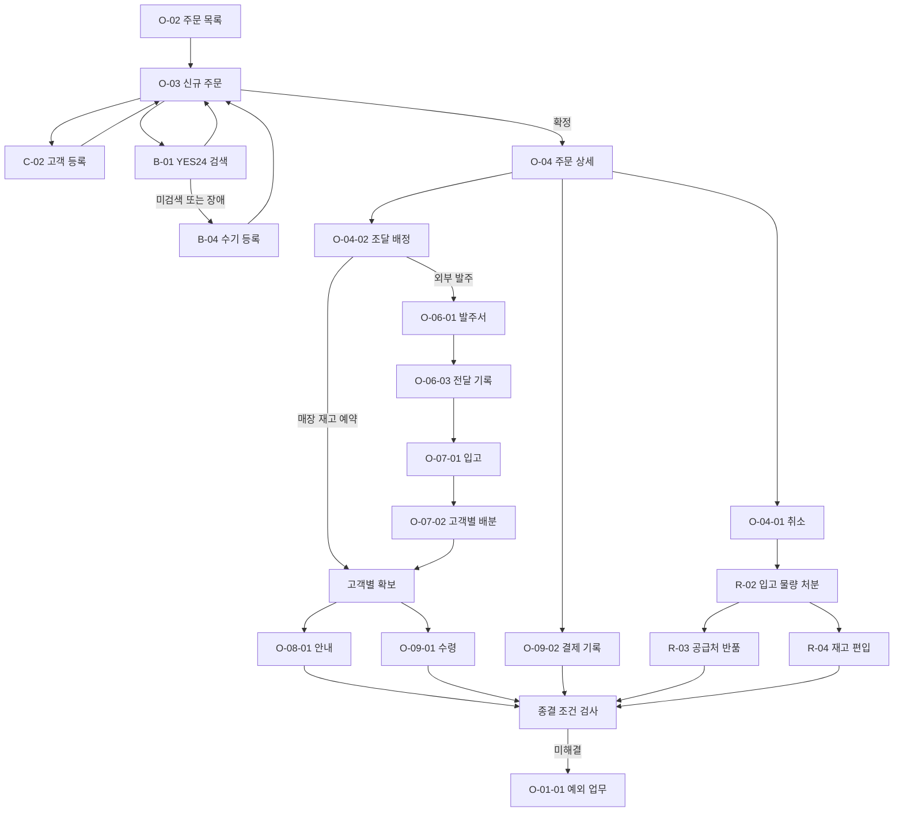
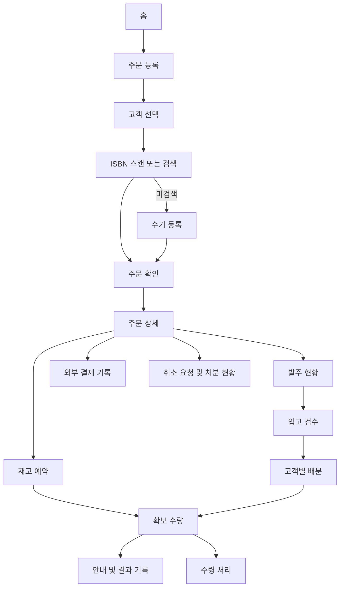

# Ordering IA V1.3 — 웹 우선·모바일 확장 통합 설계서

> **현행 동기화본 V1.3 / OPDS V1.1 (2026-11-22) 승인 정책 우선.** 과거 버전의 미결정 표기는 아래 승인 계약에 의해 해당 18개 ID에 한하여 대체됩니다.

> 현행 개정 V1.2 / STBR V1.1 동기화. 본문에 남은 과거 제안은 하단 동기화 계약 및 정책 등록부 우선.

기준: IA V1.1, Use Case V1.4 및 STBR V1.1. 사용자 확정: 웹 앱 우선, 모바일 앱 후속. 이하 추가 화면 및 모바일 범위는 설계 제안이며 미결정 DEC를 승인하지 않는다.

## 1. 비판적 검토
기존 IA의 실제 P0 행은 55개(이전 답변의 58개는 오류). 확장 13개. 정상 업무는 대부분 연결되지만 인증 예외, 가격 변경, 발주 취소, 재배분, 반품 거절, 운영 장애, 승인·정정 상세가 부족하다. 모바일 하단 메뉴만 있고 독립 앱 화면 ID·카메라·공유·권한·재접속 설계가 없다. 기존 C-01/02는 PRD의 공개 고객 화면 ID와 충돌하므로 내부 고객 C-01/02 유지, 공개 W-01/02로 명시적 매핑한다. 원본 P0/P1/P2는 기능 우선순위로 유지하고 모바일 출시 M1/M2/M3와 구분한다.

## 2. 전체 아키텍처 및 메뉴

웹: 대시보드 / 주문 / 발주·공급처 / 입고 / 도서·재고 / 고객 / 안내 / 수령·결제 / 반품·정정 / 설정. 모바일: 홈 / 주문 / 입고 / 재고 / 더보기(발주·안내·수령·결제 포함). 주문 상세에서 관련 작업 진입 및 복귀. 웹 반응형 지원은 별도 앱 출시와 구별.

## 3. 웹 P0 화면 등록부 (기존 ID 유지)
| ID | 화면 | UC | 형태 / 기능 |
|---|---|---|---|
| A-01 | 로그인 | 01 | 페이지 / 이메일 인증 |
| A-02 | 회원가입 | 01 | 페이지 / 계정 생성 |
| A-03 | 비밀번호 재설정 | 01 | 페이지 / 복구 |
| A-04 | 서점 개설 | 01 | 페이지 / Tenant 및 Owner 생성 |
| A-05 | 서점 선택 | 15 | 선택기 / 활성 소속 |
| A-06 | 직원 초대 수락 | 02 | 페이지 / 초대 검증 |
| O-01 | 대시보드 | 15 | 페이지 / 집계 및 연결 |
| O-01-01 | 예외 업무 큐 | 24 | 페이지 / 담당자·종결 근거 |
| O-02 | 주문 목록 | 16 | 페이지 / 검색·필터 |
| O-03 | 신규 주문 | 03,04,05 | 페이지 / 초안·확정 |
| O-04 | 주문 상세 | 05,06,07,16 | 페이지 / 품목·타임라인 |
| O-04-01 | 주문 변경·취소 | 06 | 폼 / 수량·사유·영향 |
| O-04-02 | 조달 배정 | 07,27 | 폼 / 재고·발주·기타 |
| O-05 | 공급처 관리 | 21 | 페이지 / 활성·비활성 |
| O-06 | 발주 현황 | 08,09 | 페이지 / 대기·전달·회신 |
| O-06-01 | 발주서 작성 | 08 | 페이지 / 합산 발주 |
| O-06-02 | 발주 상세 | 08 | 페이지 / 고객별 배정 |
| O-06-03 | 출력·전달 기록 | 08 | 폼 / 출력과 전달 분리 |
| O-06-04 | 공급처 회신 | 09 | 폼 / 품절·지연·재발주 |
| O-07 | 입고 현황 | 10 | 페이지 / 입고 잔량 |
| O-07-01 | 입고 등록 | 10 | 폼 / 정상·파손·오배송 |
| O-07-02 | 고객별 입고 배분 | 11 | 폼 / 동일 발주 연결 검증 |
| O-07-03 | 입고 이력 | 10,23 | 상세 / 차수·정정 |
| B-01 | YES24 검색 | 04 | 공용 선택기 / ISBN·제목·저자 |
| B-02 | 등록 도서 목록 | 04,30 | 페이지 / 로컬 등록 도서 |
| B-03 | 도서 상세·수정 | 04,30 | 상세 / 출처·가격 |
| B-04 | 수기 등록 | 30 | 폼 / 도서명·판매가 필수 |
| I-01 | 재고 현황 | 26,27 | 페이지 / 보유·예약·가용 |
| I-02 | 재고 등록·조정 | 26 | 폼 / 원장·사유 |
| I-03 | 재고 예약 현황 | 27 | 탭 / 예약·해제 |
| I-04 | 수불 원장 | 26,27,28 | 탭 / 이동 이력 |
| C-01 | 고객 목록 | 03 | 페이지 / 검색 |
| C-02 | 고객 등록·수정 | 03 | 폼 / 중복 후보 |
| C-03 | 고객 상세 | 03,25 | 상세 / 주문 이력 |
| O-08 | 안내 대기 | 12 | 페이지 / 대상 목록 |
| O-08-01 | 안내 작성 | 12 | 폼 / 문구 복사·공유 |
| O-08-02 | 안내 결과 | 12 | 폼 / 시도·결과 기록 |
| O-08-03 | 안내 이력 | 12,24 | 탭 / 재안내 |
| O-09 | 수령·결제 현황 | 13,14 | 페이지 / 독립 업무 탭 |
| O-09-01 | 수령 등록 | 13 | 폼 / 부분 인도 |
| O-09-02 | 결제 기록 | 14,29 | 폼 / 카드·간편결제·계좌이체 |
| O-09-03 | 결제 상세 | 14,29 | 상세 / 잔액·증빙 |
| O-09-04 | 환급 필요 업무 | 29 | 탭 / 원거래·미해결 |
| R-01 | 취소 도서 처분 목록 | 28 | 페이지 / 미인도 물량 |
| R-02 | 처분 경로 선택 | 28 | 폼 / 반품 또는 재고 편입 |
| R-03 | 공급처 반품 | 28 | 상세 / 요청·수락·출고·완료 |
| R-04 | 매장 재고 편입 | 28 | 폼 / 중복 전환 방지 |
| R-05 | 거래 정정 | 23 | 폼 / 원거래·사유 |
| R-06 | 정정 승인·이력 | 23 | 탭 / 권한·영향 검증 |
| S-01 | 서점 기본정보 | 01 | 페이지 / 설정 |
| S-02 | 직원 관리 | 02 | 페이지 / 초대·비활성화 |
| S-03 | 역할 및 권한 | 02,25 | 페이지 / 접근 제어 |
| S-04 | 안내 템플릿 | 22 | 페이지 / 변수·버전 |
| S-05 | 감사 이력 | 16,25 | 페이지 / 변경·내보내기 |
| S-06 | 개인정보 보호 설정 | 25 | 페이지 / 필드 접근 |

### 3.1 추가 웹 화면 단위
| ID | 화면 | UC | 형태 / 기능 |
|---|---|---|---|
| A-07 | 이메일 인증 결과 | 01 | 페이지; 재발송·만료 |
| A-08 | 초대 만료·거절 | 02 | 상태; 재초대 요청 |
| A-09 | 내 계정·로그아웃 | 01,02 | 페이지; 세션 종료 |
| A-10 | 세션 만료·접근 거부 | 25 | 공통 상태; 재인증 |
| O-01-02 | 예외 업무 상세 | 24 | 담당·근거·종결 검증 |
| O-02-01 | 초안·보류 주문 | 05 | 목록 필터; 재개 |
| O-04-03 | 가격 변경·동의 | 05,06,14 | 폼; 스냅샷 보존; 승인 미정 |
| O-04-04 | 종결 조건 검사 | 15,24 | 패널; 수령·결제·미해결 업무 |
| O-04-05 | 변경·취소 이력 | 06,16 | 탭; 요청과 확정 구분 |
| O-05-01 | 공급처 상세·편집 | 21 | 폼; 비활성·재활성 |
| O-05-02 | 공급처 발주 이력 | 08,21 | 탭 |
| O-06-05 | 전달 후 변경·취소 요청 | 06,08,09 | 폼; 회신 별도 |
| O-06-06 | 발주 버전·회신 이력 | 08,09 | 탭 |
| O-07-04 | 미배분 입고 목록 | 10,11 | 필터; 정상 수량만 |
| O-07-05 | 배분 해제·재배분 | 11,23 | 폼; 승인 조건 미정 |
| O-07-06 | 초과입고 승인 | 10 | 다이얼로그; Owner·사유 |
| B-05 | 중복 후보·외부정보 매칭 | 04,30 | 폼; 자동 병합 금지 |
| I-05 | 도서별 재고 상세 | 26,27 | 페이지; 보유·예약·가용 및 이력 |
| C-04 | 고객 변경 이력 | 03,25 | 탭; 민감 필드 권한 |
| O-08-04 | 안내 미리보기·재시도 | 12,22 | 폼; 최신 수량 검증 |
| O-09-05 | 수령 이력·정정 진입 | 13,23 | 탭 |
| O-09-06 | 미확인 결제 목록 | 14,29 | 필터; 입금 확인 전 완료 금지 |
| R-07 | 반품 거절·재처리 | 28 | 폼; 재고 편입 또는 예외 큐 |
| R-08 | 반품 상태별 목록 | 28 | 필터; 요청·수락·출고·완료 |
| S-07 | 운영 정책 설정 | 15,24 | 페이지; 승인 정책만 활성화 |
| S-08 | YES24 연동 상태 | 04,30 | 페이지; 키 비노출·장애 안내 |
| S-09 | 내보내기 요청·결과 | 16,25 | 폼; 권한·만료·감사 |
| G-01 | 공통 오류·빈 결과·오프라인 | 전체 | 상태 컴포넌트; 재조회 |
| G-02 | 저장 충돌·중복 요청 | 전체 | 상태 컴포넌트; 결과 확인 후 재시도 |

## 4. 모바일 앱 전용 화면 등록부
| ID | 화면 | 웹 대응 ID | UC | 출시 단계 |
|---|---|---|---|---|
| M-A01 | 로그인·가입·계정 복구 | A-01~03,A-07 | 01 | M1 |
| M-A02 | 서점 선택·전환 | A-05 | 15 | M1 |
| M-A03 | 초대 수락·만료 | A-06,A-08 | 02 | M1 |
| M-A04 | 내 계정·로그아웃 | A-09,A-10 | 01,25 | M1 |
| M-01 | 현장 업무 홈 | O-01 | 15 | M1 |
| M-02 | 내 업무·예외 목록 | O-01-01~02 | 24 | M1 |
| M-03 | 주문 목록·검색 | O-02,O-02-01 | 16 | M1 |
| M-04 | 신규 주문·초안 | O-03 | 03,04,05 | M1 |
| M-05 | 고객 검색·등록·수정 | C-01~03 | 03 | M1 |
| M-06 | ISBN 카메라 스캔 | B-01 | 04 | M1 |
| M-07 | YES24 검색·도서 선택 | B-01~02 | 04 | M1 |
| M-08 | 독립출판물 수기 등록 | B-04,B-05 | 30 | M1 |
| M-09 | 주문 확인·확정 | O-03 | 05 | M1 |
| M-10 | 주문 상세·타임라인 | O-04,O-04-05 | 05,16 | M1 |
| M-11 | 조달 배정·재고 예약 | O-04-02,I-03 | 07,27 | M1 |
| M-12 | 주문 변경·취소 요청 | O-04-01 | 06 | M1 |
| M-13 | 발주 목록·상세 | O-06,O-06-02 | 08,09 | M1 |
| M-14 | 공급처 회신 기록 | O-06-04 | 09 | M1 |
| M-15 | 입고 대기·발주 선택 | O-07 | 10 | M1 |
| M-16 | 입고 검수·스캔·수량 | O-07-01 | 10 | M1 |
| M-17 | 고객별 입고 배분 | O-07-02 | 11 | M1 |
| M-18 | 매장 재고 조회 | I-01,I-05 | 26,27 | M1 |
| M-19 | 재고 등록·조정 | I-02 | 26 | M1 |
| M-20 | 고객 안내 대기·미리보기 | O-08,O-08-01 | 12 | M1 |
| M-21 | OS 공유·발송 결과 기록 | O-08-02 | 12 | M1 |
| M-22 | 수령 대상 검색·부분 인도 | O-09,O-09-01 | 13 | M1 |
| M-23 | 결제 확인·수동 기록 | O-09-02~03 | 14,29 | M1 |
| M-24 | 취소 물량 처분 요청·현황 | R-01~04 | 28 | M1 |
| M-25 | 환급 필요 업무 조회 | O-09-04 | 29 | M1 |
| M-26 | 더보기·웹 관리 연결 | S-01~09 | 25 | M1 |
| M-27 | 카메라 권한·설정 안내 | B-01 | 04 | M1 |
| M-28 | 오프라인·충돌·재접속 | G-01~02 | 전체 | M1 |
| M-29 | 앱 버전·업데이트 안내 | 신규 | 전체 | M1 |
| M-30 | 업무 알림함·딥링크 | O-01-01 | 24 | M2 |
| M-31 | 푸시 권한·수신 설정 | 신규 | 24 | M2 |
| M-32 | 승인·환급·배송 상세 | X-02~04,R-06 | 20,23,29 | M2 |
| M-33 | 실제 결제·결과 확인 | X-06~08 | 29 | M3 |

M1은 웹 P0 안정화 후 현장 앱 출시 제안. M2의 P1 업무와 M3의 P2 업무는 해당 서버 기능 출시 이후만 활성화. 대량 발주 생성·출력, 직원 권한, 공급처 등록, 감사 내보내기 등은 M1에서 웹 전용이며 모바일에 미구현 버튼 노출 금지. 고위험 처분·정정은 웹에서 완료하고 모바일은 요청·조회 중심. 카메라 거부 시 ISBN 직접 입력. OS 공유 성공은 실제 발송 증거가 아니다. 네트워크 장애 중 확정·입고·배분·예약·인도·결제는 성공 표시 금지; 재연결 후 서버 결과 확인 및 동일 요청 키 재시도. 오프라인 확정은 범위 제외.

## 5. 웹 업무 화면 이동

수령·결제·안내는 고정 순서가 아니다. 발주 전달 이후 취소 요청과 공급처 취소 확정을 분리한다. 취소 후 환급 필요 업무는 물량 처분과 별도로 추적한다.

## 6. 모바일 업무 화면 이동

## 7. 확장 웹 등록부
| ID | 단계 | 화면 | UC |
|---|---|---|---|
| W-01 | P1 | 고객 공개 주문 | 17 |
| W-02 | P1 | 고객 본인 확인·주문 조회 | 18 |
| W-03 | P1 | 변경·취소 요청 | 18 |
| P-01 | P1 | 플랫폼 테넌트·장애·구독 지원 | 25 / 행위자 정의 |
| X-01 | P1 | 공식 알림톡·SMS 설정 및 발송 현황 | 19 |
| X-02 | P1 | 부분·복수 결제 | 20,29 |
| X-03 | P1 | 환급 처리 | 20,29 |
| X-04 | P1 | 배송·송장 관리 | 20 |
| X-05 | P1 | 개인정보 삭제·익명화 요청 | 25 |
| X-06 | P2 | 실제 결제 승인 | 14,20,29 |
| X-07 | P2 | 승인 취소·환불 | 20,29 |
| X-08 | P2 | 거래 대사·오류 복구 | 20,29 |
| X-09 | P2 검토 | 계좌이체 자동 입금 확인 | 29 |
| W-04 | P1 | 공개 주문 제출 결과·오류 | 17 |
| W-05 | P1 | OTP 입력·만료·재전송 | 18 |
| W-06 | P1 | 고객 주문 상세·요청 처리 결과 | 18 |
| P-02 | P1 제안 | 테넌트 목록·상세·상태 | 25 / 행위자 정의 |
| P-03 | P1 제안 | 장애·지원 이력 | 25 / 행위자 정의 |
| P-04 | P1 제안 | 구독 현황·정책 | 25 / 행위자 정의 |
| X-10 | P1 | 메시지 실패·재처리 | 19 |
| X-11 | P2 | 결제 인증·승인 결과·타임아웃 | 29 |
| X-12 | P2 | 결제사업자 설정·연동 상태 | 29 |

## 8. 공통 규칙 및 권한
헤더: 주문번호(부여 시점 미정), 고객, 출처, 수령방법, 주문 총액, 미결제액, 독립 업무 상태. 탭: 품목/조달, 발주, 입고·배분, 안내, 수령, 결제, 변경·감사 이력. 각 탭에서 관련 업무 폼으로 이동 후 상세로 복귀. 품목별 주문·취소·유효·발주·확보·현재 수령가능·누적 수령·미확보를 분리 표시. 확보되지 않은 수량 인도 금지. 미해결 필수 업무가 있으면 완료 차단(DEC-10 승인 필요).

Owner: 재고 초기 등록·조정, 직원 권한, 설정 및 민감 승인. Staff: 주문·발주·입고·배분·안내·수령·결제 기록; 재고 조정 위임·재배분·정정 승인 조건은 미결정. 모든 API에서 활성 Membership 및 tenant 검증. 메뉴 숨김만으로 접근통제하지 않는다.

- YES24 검색 실패 시 수기 등록 허용, 다른 외부 API 자동 전환 금지. 기존 주문 스냅샷 불변.
- 재고 등록·조정은 원장 기록, 보유 >= 예약 >= 0. 예약 및 인도 중복 차단.
- 반품 완료와 재고 편입 중복 귀속 금지. 반품 거절 시 재판단.
- P0 결제는 실제 외부 거래 확인 기록이며 승인 API가 아니다. 미확인 입금은 완료 금지. 현금 및 기타 수단 제외.
- 모든 폼은 로딩·빈 결과·권한 오류·검증 실패·동시 변경·재시도 상태를 제공한다. 금액·수량 원거래 물리 삭제 금지.
- DEC-01~20의 미결정 및 승인 필요 항목 유지. 특히 표시 주문번호, 부분입고 안내, 고객 최소정보, Staff 재고 위임, 승인 권한, 환급 시점 및 절차, 반품 비용, P0 복수 결제 범위를 확정할 필요가 있다.
- 추적성: UC → 화면 ID → FRD → API → DB/RLS → TC. P0/P1 구분은 원문 정책 승인 상태에 종속된다.

## 9. 출시 검증
- 웹: UC-01~16,21~30 중 P0 범위와 TC-01~97 중 P0 항목에 대해 화면→API→DB 테스트 연결. P1/P2 테스트는 기능 출시 시 수행. 모든 화면에서 로딩/빈 결과/권한/검증 실패/충돌 검증.
- 모바일: 카메라 거부, 스캔 오류, 앱 백그라운드 복귀, 테넌트 전환, 네트워크 단절 중 제출, 공유 취소, 중복 탭, 웹·앱 동시 마지막 재고 예약, 직원 권한 회수, 앱 업데이트 테스트 추가 제안.
- 웹과 앱은 동일 업무 API를 통해 성공 커밋 후 화면 갱신; 독립 DB나 독립 권한 정책 금지.
- 웹 출시→실사용 검증→M1→M2/M3. 고객 앱 별도 출시 여부는 미확정이며 P1 고객 웹으로 우선 설계.
- 미결정: 모바일 OS 및 프레임워크 최종 선택, 푸시 도입, 모바일 승인 범위, 실제 결제 연동 방식. PRD/FRD 동기화 및 상태 전이 정의 후 상세 UI 개발.

## 동기화 적용 계약 (2026-11-21)
기준 STBR V1.1 §3~6 및 §11~13. 아래 개정 규칙은 이 문서의 과거 축약 표현보다 우선한다. 기존 역사적 검토 기록은 보존한다. 사용자 확정 정책: YES24 단일 외부 검색(계약 확인 필요), 미검색/장애/ISBN 없는 도서 수기 등록, 점주 재고 관리, 카드·간편결제·계좌이체만, 미인도 입고 취소 도서 반품 또는 재고 편입, P2 실제 카드·간편결제 승인·취소·환불, 웹 우선 후 별도 모바일. P0 외부 결제 사실 확인, P1 복수결제·환급 UI, P2 계좌 자동 확인은 검토. P0 최소 외부 환급 결과 기록은 미승인 출시 게이트. P0~2와 M1~3은 별도 축. 상세 상태 코드·권한·회계 비용 정책은 승인 전 설계안이다.

### 업무별 개정 및 추적성
| FRD | UC | 웹 | 모바일 | STBR | 적용 내용 | TC |
|---|---|---|---|---|---|---|
| ORD-004/008/012 | 05,06,23 | O-04-01/03/04/05,R-05/06 | M-10/12 | BR-O05~08 | 변경 요청과 적용 분리, 적용 시 version 및 미인도량 E-F 재검증. 부분취소 CONFIRMED 유지, 전량취소 CANCELLING. 승인 정정으로 종결 조건 불충족 시 재개; 일반 수정 금지. | 75,76,88 |
| PO-007/008/009/010 | 08,09,10,28 | O-06-04/05/06,O-07-01/06,R-01 | M-14/16/24 | BR-P01~06 | 실제 전달량에서 공급처 수락 축소만 차감. 회신 수락·거절·미응답 별도 수량 기록. 늦은 입고는 취소 고객 배분 금지, 처분 대기 귀속. 초과 승인 별도; 재조달 시 외부 의무 보존. | 77~80 |
| REC-001/004/007/008/009,INV-001 | 07,10,11,26,27,28 | O-07-02/05,I-01~05,R-04 | M-11/17/19/24 | BR-Q16~22 | 예약/배분 잔량=생성-해제-인도; OPEN/CLOSED. 정상 검수 순량 8개 배타 귀속, 매장 풀만 on_hand. 취소 배분은 처분 대기로 직접 이동. 원장·버킷 원자 이동, 인도/편입 침해 정정 금지. | 81,82,89 |
| ORD-008,REC-005,RET-001 | 28 | R-02/03/04/07/08 | M-24 | BR-C01~04 | 부분 수락·출고·완료 수량별 기록(분할 승인 필요). 반송/분실 예외, 실물 회수 확인 전 편입 금지. 외부 비용 의무 별도 추적. | 83,84 |
| MSG-005/006/008/009/010,FUL-003/004 | 12,13,19,23 | O-08-04,O-09-05,R-05 | M-20~22 | BR-M01~03,BR-F01~03 | 안내 대상과 시도 분리, 발송 스냅샷 보존 및 재안내 후보. 실제 고객 반품을 수령 오기록 정정으로 처리 금지. 배송 중량 별도 잠금(P1 정책 승인). | 85,86 |
| PAY-001~006 | 14,20,29 | O-09-02/03/04/06,X-02/03/06~09/11 | M-23/25/32/33 | BR-Y07~13 | 결제 시도·원장·환급 업무·환급 시도 분리. UNKNOWN 조회 전 재실행 금지, 진행 환급 예약액 포함 상한 검증, 외부 ID 중복 검증. P0 최소 환급 기록 승인 필요. 할인/배송비 배분 미결정. | 87,90~93 |
| DASH-008,OPS-001,SEC-001~003,QA-001 | 15,16,24,25 | O-01-02,G-01/02,A-10 | M-02/28,M-A02 | BR-E01~03,BR-T01~07 | 원인별 예외 키 및 증빙 종결, 업무 유일성+요청 키/hash, 원장 잠금과 감사 원자 처리, 외부 호출 분리. 앱 종료/전환 후 원 서점 권한 검증 및 결과 조회, 화면 혼합 금지. | 88,94~97 |

### 기존 화면에 추가할 패널 및 상태 (신규 페이지 ID 없음)
| 화면 | 표시/행동 및 차단 조건 |
|---|---|
| O-04-01/04/05, M-10/12 | 요청/승인/적용/STALE, 취소 가능량, 종결 차단 사유 및 재검증; 모바일 민감 작업 요청 중심 |
| O-06-04/05/06,M-14 | 전달량·수락·거절·미응답·외부 의무 및 재발주 위험 |
| O-07-01/02/03/06,M-16/17 | 늦은 입고 처분 대기, 초과 승인 한도, 8개 귀속 표시; 미승인 초과 차단 |
| I-01~05,M-11/18/19 | 매장 풀 및 예약 잔량, 권한 없는 조정 차단 |
| R-03/07/08,M-24 | 부분 반품 및 반송 회수 증빙; 미회수 편입 버튼 금지 |
| O-08-04,M-20/21,X-10 | 오래된 안내 경고, 최신 버전 재생성, UNKNOWN 조회 |
| O-09-05,R-05/06,M-22 | 오인도 정정과 실제 반품 구별, 승인 경로 |
| O-09-03/04/06,X-03/06~08/11,M-23/25/32/33 | 결제 시도/원장/환급업무/시도 별도 탭, 잔액·진행 예약·UNKNOWN 조회; P0 환급 기록은 승인 후, M1 조회만 |
| G-01/02,M-28,M-A02 | 미확정 명령 결과 조회, 재접속, 충돌 재검토, 서점 전환 응답 격리 |
| O-01-02,M-02 | 예외 유형별 증빙·담당·차단 사유, 승인 없는 종결 금지 |

기존 화면 등록부 84 웹 P0 / 22 확장 / 37 모바일 유지(패널 추가). 최종 신규 화면 ID는 상세 기능명세에서 확정.

### 공통 상태·거래 계약
### 11.1 상태 모델 분리 및 전이 계약
- 저장 생명주기(주문/요청/업무), 계산 상태(수량/금액), 불변 거래 이벤트, 외부 시도, 경고 플래그를 구분한다. 계산 상태 캐시가 있더라도 원장 재산출 가능해야 한다.
- 모든 명령은 대상 ID, tenant context, 예상 version, request key, payload, 권한을 검증한다. 전이표의 연쇄 화살표는 별개 명령을 뜻하며 중간 상태를 건너뛰지 않는다. 동일 상태 전이는 거래 추가를 뜻한다. 미정의 전이는 기본 거부한다.
- 권한 표의 O/S는 무조건 허용이 아니라 각 명령 권한 및 승인 정책을 충족한 경우다. 승인 정책 미확정 고위험 명령은 기본 차단한다.

### 11.2 주문 및 취소 요청 (BR-O05~08)
- BR-O05: 변경 요청은 REQUESTED→APPROVED/REJECTED/WITHDRAWN, APPROVED→APPLIED 또는 STALE(대상 version 변경), STALE은 새 요청으로 재검토한다. 적용 시점에 미인도량·금액·권한 재검증. 승인 자체가 수량 변경은 아니다. 승인·적용을 한 트랜잭션으로 합칠 수 있다.
- BR-O06: 취소 가능량=E-F. 요청 수량은 확정 수량과 구분한다. 승인 대기 중 인도와 충돌 시 적용 거부/재승인; 해당 물량의 임시 잠금 여부는 D27 결정. 확정 취소는 출처별 예약 해제, 입고 처분, 미전달 발주 수정, 전달 발주 외부 의무 잔존을 원자적으로 기록한다.
- BR-O07: 전량 취소만 CANCELLING; 부분 취소는 CONFIRMED 유지, 품목별 후속 업무를 표시한다. 완료 후 일반 수정 금지. 승인 정정으로 조건 불충족 시 COMPLETED→CONFIRMED, CANCELLED→CANCELLING (전량 취소 유지), 취소 자체 철회로 유효 주문을 되살리는 기능은 별도 승인 전 금지. 조건 충족 유지 시 기존 종결 상태 보존. 재종결 이력 기록.
- BR-O08: 종결 검사와 실제 종결 사이 타 거래가 끼어들지 않게 주문 루트 잠금 및 version 검사. 종결된 주문에 신규 중요 거래를 추가하려면 정정/재개 경로 사용.

### 11.3 발주 의무·늦은 입고 (BR-P01~06)
| 변수 | 뜻 |
|---|---|
| Qsend | 실제 전달된 발주 수량 및 확인된 추가 변경량 |
| Qreduce | 공급처 수락한 축소·품절 확정 수량 (중복 차감 금지) |
| Qvalid | Qsend-Qreduce |
| Qreceived | 정상 검수 누적량-검수 정정량; 반품 차감 없음 |
| Qopen | max(0,Qvalid-Qreceived) |
| Qexcess | max(0,Qreceived-Qvalid) |
- BR-P01: Qreduce≤Qsend, 축소 결정 시 기입고량 침해 금지(이미 승인된 초과입고 및 정정은 별도 검토). 단순 고객 취소·품절 예상·지연은 Qreduce에 넣지 않는다.
- BR-P02: 공급처 회신은 수량 단위 분할 기록. 요청량=수락+거절+미응답; 부분 응답 뒤 추가 응답 가능. 중복 회신은 원 요청 참조로 차단. 최종 응답 완료 전 요청 CLOSED 금지. 발주 상태 SENT/ACKNOWLEDGED와 변경 요청 상태 독립.
- BR-P03: 정상 입고가 확인 회신보다 먼저 와도 SENT 발주에 검수 등록 가능. 미전달 발주 입고는 기본 차단/증빙 복구. 승인 초과한도는 정상 발주 의무와 별도 기록; 초과 승인량만큼 발주 원본을 자동 증가시키지 않는다.
- BR-P04: 고객 취소 후 도착한 도서는 기존 취소 고객에게 배분하지 않는다. 해당 외부 의무 참조와 취소 처분 대기 버킷으로 귀속하고 반품/편입 절차 적용(기존 UC-28 확장 제안). 수락된 발주 취소 이후 오배송은 정상 의무 입고로 자동 인정하지 않는다.
- BR-P05: 미응답/거절 발주를 다른 공급처로 재조달할 경우 이전 외부 의무를 보존하고 잉여 도서 처리 계획·승인 기록. 고객에게 이중 배분 금지. 취소 후 외부 구매 의무가 남으면 관련 주문의 종결 차단 업무 생성.
- BR-P06: 발주 종결에는 Qopen=0뿐 아니라 관련 미처리 초과/파손/오배송/외부 의무 해결 필요. 반품에 따른 재납품 약속은 새 의무로 기록한다.

### 11.4 입고·배분·예약 원장 (BR-Q16~22)
- BR-Q16: 원 배분/예약 단위의 생성량 G, 순해제량 L, 순인도량 Fsrc, 잔량 B=G-L-Fsrc; 모두 0 이상, OPEN iff B>0, CLOSED iff B=0. 순효과는 승인된 역거래 포함. 부분 해제 후 잔량 인도 가능. 소진 후 복원은 원거래 정정 시에만 허용.
- BR-Q17: 각 입고 품목별 정상 검수 순량을 UNALLOCATED, ALLOCATED_OPEN, DELIVERED_NET, DISPOSITION_PENDING, RETURN_HELD, RETURN_DISPATCHED, RETURNED_FINAL, STOCK_TRANSFERRED로 배타적으로 귀속. 모든 버킷 음수 금지. 반환/정정 시 원 버킷 차감과 대상 버킷 증가의 합은 0. RETURNED_FINAL과 STOCK_TRANSFERRED는 누적 귀속이지 매장 실물 재고가 아니다.
- BR-Q18: 매장 관리 on_hand는 일반 매장 풀(예약 포함)만 의미; 고객 직접 입고·별도 반품 보관 물량 제외. 실물 매장 수량 조회가 필요하면 별도 집계로 표시하고 가용재고 계산에 합산 금지. 예약량은 활성 예약 잔량 합과 일치.
- BR-Q19: 조달 미확보 계획량에서 예약/입고 배분으로 전환된 양을 동시에 차감. 발주 고객 배정은 유효 인도 이력과 미이행 배정량을 함께 보존; 취소 해제 후 원 연결 삭제 금지.
- BR-Q20: 입고 정정은 실제 취소 가능한 원 버킷을 특정한다. 이미 인도·반품 완료·재고 편입된 양을 단순 검수 차감할 수 없음. 연쇄 역거래는 실물 근거 및 승인 필요.
- BR-Q21: 주문 취소 배분 해제는 일반 UNALLOCATED가 아니라 DISPOSITION_PENDING으로 직접 이동한다. 관계된 주문 의무·원 입고 참조를 보존. 동일 원 요청/수량의 편입과 반품 중복 금지.
- BR-Q22: 입고·인도·수불 원장은 양수 수량의 명령과 명시적 방향/이벤트 종류로 기록. 이동량 0, 소수 권수, 무근거 음수 및 직접 잔량 수정 금지. 초기 재고 등록 중복은 도서별 재고 키로 방지.

### 11.5 공급처 반품 세분화 (BR-C01~04)
- 요청 단위 및 수량별 자식 처분 단위를 분리. 부분 응답의 경우 미응답 수량은 RETURN_PENDING, 수락 수량 ACCEPTED, 거절 수량 REJECTED로 분리. 부분 출고/완료도 수량별 기록. 분할 처분 허용 여부는 DEC-18 승인 필요.
- 추가 전이 ST-C08: DISPATCHED→RETURN_EXCEPTION (반송/분실/거절 통보), ST-C09: RETURN_EXCEPTION→REJECTED (실물 회수 및 검수 확인), 또는 →RETURNED (공급처 최종 확인). 미회수 상태 편입 금지. 출고 전 철회도 공급처 약속 해소 검증 후 PENDING 복귀(제안). 비용 의무 별도 추적.
- 종결은 각 처분 수량이 최종 귀속되었고 필수 외부 비용 업무가 해결되었을 때만 가능. 비용 범위와 책임은 미결정. 공급처 반품과 고객 환급은 서로 독립.

### 11.6 안내 및 수령 정정 (BR-M01~03, BR-F01~03)
- 안내 대상과 발송 시도는 별도 객체. 발송 당시 수량·문구·연락처 스냅샷 보존. 확보량 변경 후 기존 발송 상태는 덮어쓰지 않고 대상 obsolete 표시 및 새 재안내 후보 생성. 발송 전 최신 version 재검증.
- 공식 메시지 P1 결과 불명확(UNKNOWN) 시 사업자 조회 후 재시도; 중복·역순 웹훅은 이벤트 ID 및 사업자 상태 규칙으로 처리. 고객 수신/읽음은 확인된 경우만 표시.
- 수령 오기록 정정(실제 인도가 없었음)과 고객 실제 반품(교환/환불 정책 필요)을 구분. 후자는 P0 일반 취소나 수령 역거래로 처리 금지. 인도 오류 정정 시 실물 확인·원 출처별 복원·종결 재검증. 원 재고 예약/입고 배분으로 복원 가능한지 검증 후에만 반영.
- P1 배송 중 수량은 별도 예약 버킷으로 관리하여 매장 인도 중복 방지. 발송과 인도확정 기준, 반송 처리 정책은 D23 승인 전 비활성.

### 11.7 결제 시도·원장·환급 업무 분리 (BR-Y07~13)
| 객체 | 상태/규칙 |
|---|---|
| 결제 시도 | P0 PENDING_VERIFICATION→CONFIRMED/VOIDED; P2 INITIATED→AUTHORIZING→CONFIRMED/FAILED/UNKNOWN; UNKNOWN→CONFIRMED/FAILED는 검증 결과만 |
| 결제 원장 | 확인된 거래 POSTED, 정정은 원거래 참조 보정 이벤트; 원금 직접 수정 금지 |
| 환급 업무 | REFUND_REQUIRED→IN_PROGRESS→PARTIAL/REFUNDED; 잔여 필요량 재산출, 필요액 변경 시 별도 재검증 |
| 환급 시도 | INITIATED→IN_PROGRESS→CONFIRMED/FAILED/UNKNOWN; UNKNOWN→CONFIRMED/FAILED는 실제 조회 결과만 |
- BR-Y07: 환급 업무 PARTIAL은 남은 금액의 신규 시도를 허용하되 원 결제별 상한 검증 필수. FAILED 시도는 종료 기록, 재시도는 새 시도 ID. UNKNOWN 시도는 예약 해제 금지. 환급 업무는 실제 완료액으로만 종료.
- BR-Y08: 원 결제별 가용 환급액=유효 결제액-확정 환급액-미확정 진행/UNKNOWN 환급 예약액. 주문 전체 환급 필요액=max(0,-잔액); 새 환급 요청은 기존 진행액을 포함해 이 한도를 초과하지 않도록 잠금 검증. 승인된 별도 배상 정책은 범위 외.
- BR-Y09: 미확정 결제 시도는 순결제에서 제외하되 중복 승인 방지용 진행 금액으로 표시. 주문 변경으로 승인 금액이 달라지면 기존 요청 version 보존 및 결과 확정 후 별도 조정/환급; 승인 성공 사실을 버리지 않는다.
- BR-Y10: 수동 결제 참조 중복 검사 범위는 tenant+수단+거래 출처+안정적 외부 거래 ID(있는 경우). 은행 입금 참조가 없는 경우 자동 유일성 추정 금지; 확인자·일시·금액 중복 후보 및 권한 검토. 증빙 접근 제한.
- BR-Y11: 수동 오기록 정정은 실제 환급과 구별. 이미 환급한 원 결제의 보정은 유효 결제액이 완료/진행 환급액보다 작아지지 않도록 제한. P0 최소 외부 환급 증빙 기록은 DEC-06 승인 후 구현하며 승인 전 선결제 취소 출시 차단 조건으로 유지.
- BR-Y12: P2 사업자 요청 ID·외부 거래 ID·웹훅 이벤트 ID를 분리. 중복·역순 결과 검증, UNKNOWN 상태의 승인/환급 재요청 금지, 대사 예외 큐. 외부 호출 중 DB 잠금을 유지하지 않는다; 요청 저장→외부 실행→검증 결과 반영의 단계로 분리한다.
- BR-Y13: 할인은 유효 품목별 확정 배분액, 배송비는 실제 서비스 정책에 따라 계산할 것을 제안. 단가 조정과 별도 가격 조정을 중복 적용 금지. 원화 정수, 주문총액 음수 금지. 할인/배송비의 부분 취소 재배분 정책(D28) 승인 전 임의 계산 금지. 전량 취소 잔존 배송비/비용 여부 별도 결정.

### 11.8 예외 업무 종결 조건 (BR-E01~03)
| 유형 | 해결 근거 | 종결 차단 제안 |
|---|---|---|
| 미배정/품절 | 조달 확정 또는 고객 취소 | 예 |
| 공급처 지연 | 입고/재조달/취소 및 외부 의무 해결 | 예 |
| 미배분/초과입고 | 적법 배분 또는 승인된 귀속 처리 | 관련 주문만 |
| 발송 실패 | 새 시도 결과 또는 승인된 대체 안내 | DEC-05/10 |
| 장기 미수령 | 실제 인도 또는 적법 취소 | 예 |
| 미확인 결제 | 증빙 확인 또는 실제 거래 없음 확인 | 예 |
| 환급 필요 | 실제 환급 확인 및 잔액 조건 | 예 |
| 반품 거절/반송 | 실물 귀속 및 외부 의무 해결 | 예 |
| 거래 정정 | 적용 완료 또는 근거 있는 기각, 원 문제 별도 해결 | 관련 주문만 |
| 승인/대사 불명확 | 외부 결과 확정 및 원장 일치 | 예 |
- 원인별 안정적 업무 키로 중복 방지; 담당자 변경은 감사. 해결 증빙과 필수 여부는 서버 검증하며 사용자가 임의로 필수 플래그를 끌 수 없다. WAITING→IN_PROGRESS 재개 지원, 재발 시 재개 이력. 기각된 요청과 실제 문제 해결을 구분.

### 11.9 트랜잭션·복구·웹/모바일 (BR-T01~07)
- BR-T01: 요청 키 외 실제 업무 유일성도 검증(원거래 ID, 발주 전달 버전, 입고 외부 참조가 있는 경우, 결제 시도 ID, 원 처분 단위). 서로 다른 요청 키의 중복도 검증. 같은 ISBN/수량만으로 별개 정상 거래를 합치지 않는다.
- BR-T02: tenant+command+request_key 고유 제약, 정규화 payload hash 및 결과 저장. 요청 키 조회도 현재 활성 소속과 권한 확인. 키 보존기간과 민감 결과 보존 정책 D29.
- BR-T03: 주문 루트 및 관련 발주/입고/재고/결제 행을 업무별 일관된 잠금 순서로 처리; 교착/직렬화 실패는 전체 롤백 후 같은 요청 키로 제한적 재시도. 종결/취소/인도와 새 거래 간 경합 검증.
- BR-T04: 외부 작업은 DB 원자성 밖에 있다. 외부 실행 전 영속 시도 기록, 결과 수신 후 검증 및 원장 반영을 별도 트랜잭션으로 수행. P1/P2 서버 발송은 영속 이벤트 작업함(outbox) 및 수신 중복 방지(inbox) 권장. 수동 발주/반품의 불명확 결과는 담당자 확인.
- BR-T05: 모바일 앱 종료/통신 단절 시 미확정 명령 키·tenant·대상·상태만 안전하게 보존하고 재접속 시 원 서점 권한을 확인해 결과 조회. 오프라인 거래 확정 및 자동 중복 실행 금지. 로그아웃/서점 전환 시 화면 캐시·민감 초안 제거; 이미 커밋된 거래는 취소되지 않음. 전환 후 이전 응답을 새 서점 화면에 표시 금지.
- BR-T06: 직원 비활성화 후 새 요청과 재시도 모두 차단. 플랫폼 지원 권한은 명시적 별도 정책, 기본 고객 원문 접근 금지. 마지막 활성 Owner 제거/강등은 차단 제안. 감사 기록은 업무 거래와 함께 커밋하고 민감정보 마스킹.
- BR-T07: 오류별 복구: VERSION_CONFLICT→재조회/재검토, IDEMPOTENCY_CONFLICT→새 명령 확인(자동 반복 금지), EXTERNAL_RESULT_UNKNOWN→조회/대사, APPROVAL_REQUIRED→승인 요청, ACCESS_DENIED→재인증/권한 확인, LIMIT 오류→수량 재조회. HTTP/API 계약은 후속 설계에서 확정.

### 11.10 신규/보완 규칙 화면·명령 추적 (명령명 후보, API 경로 미확정)
| 규칙 | UC | 웹 IA | 모바일 IA | 명령 후보 | TC |
|---|---|---|---|---|---|
| O05~08 | 05,06,23 | O-04-01/03/04/05,R-05/06 | M-12,10 (요청·조회) | apply_change,close_order,correct_trade | 75,76,88 |
| P01~06 | 08~10,28 | O-06-04/05/06,O-07-01/06,R-01 | M-14,16,24 | record_reply,post_receipt | 77~80 |
| Q16~22 | 07,11,26~28 | O-07-02/05,I-02/03,R-04 | M-11,17,19,24 | release_allocation,fulfill,convert_stock | 81,82,89 |
| C01~04 | 28 | R-02/03/04/07/08 | M-24 조회·요청 | record_return_reply,confirm_recovery | 83,84 |
| M01~03,F01~03 | 12,13,19,23 | O-08-04,O-09-05,R-05 | M-20~22 | record_notice,correct_fulfillment | 85,86 |
| Y07~13 | 14,20,29 | O-09-02/04/06, P1/P2 결제 화면 | M-23/25, M3 | record_payment,request_refund,reconcile | 87,90~93 |
| E01~03,T01~07 | 15,16,24,25 | O-01-02,G-01/02,A-10 | M-02,28,M-A02 | resolve_task,get_command_result | 88,94~97 |
IA V1.1에 늦은 입고 귀속, 환급 UNKNOWN, 반송 회수, 미확정 명령 결과 조회를 기존 상세 패널/공통 상태에 추가할 것을 요청한다. 신규 화면 ID 확정은 화면 기능명세서에서 수행.

### 정책 등록부 (STBR 기준, 승인 상태 유지)
| DEC | 항목 | 권장안/현황 |
|---|---|---|
| 01 | 공개 주문 | P1 권장, 승인 필요 |
| 02 | 점주 재고 | 확정, 예약 원장 적용 |
| 03 | 입고 고객 배분 | P0 필수 권장, 승인 필요 |
| 04 | 전달 발주 취소 | 요청/회신/의무 분리 권장 |
| 05 | 부분입고 안내 | 직원 선택, 기본값 미정 |
| 06 | 결제·환급 | 수단/P2 방향 확정, P0 환급 결과 기록·시점 승인 필요 |
| 07 | 장기 미수령 | 경고, 자동취소 없음 권장 |
| 08 | 가격 변경 | 고객 동의·사유 기록 권장, 할인 배분도 결정 |
| 09 | 민감 작업 승인 | Owner 승인 조건 확정 필요 |
| 10 | 종결 | 수량·금전·필수 업무 조건 승인 필요 |
| 11 | 수령/결제 순서 | 독립 처리 권장, 후불 허용 별도 |
| 12 | 고객 최소정보 | 연락처·보존·삭제 미정 |
| 13 | 주문번호 | 확정 시 발급 권장 |
| 14 | P0 복수 결제 | 선결제 후 잔액·부분결제 범위 승인 |
| 15 | 재배분 | 승인 범위 확정 |
| 16 | 예외 종결 | 유형별 증빙·필수 여부 승인 |
| 17 | YES24 및 수기 | 확정, API 계약/검색 범위 검증 |
| 18 | 반품/재고 | 확정, 비용·거절·부분 처분·결정권 미정 |
| 19 | 재고 권한 | 점주 확정, 직원 위임·실사 미정 |
| 20 | 기타 결제 금지 | 확정 |
추가 설계 결정: D21 종결 후 정정 재개 정책, D22 기타 조달 물량 검증 및 고객 외 입고의 재고 편입, D23 P0 배송 기록 한계/P1 배송 인도 기준, D24 계좌 자동 확인 및 PG/VAN 계약, D25 모바일 OS·프레임워크 및 승인 범위, D26 테넌트 중지·해지/지원 권한. 모두 제안/검토 대상.

| ID | 항목 | 권장안 (미승인) |
|---|---|---|
| D27 | 취소 승인 대기 중 인도 | 대상량 임시 인도 제한 또는 적용 시 재검증; 제한 만료/철회 필요 |
| D28 | 할인·배송비·취소 비용 | 품목별 할인 배분, 원화 정수 배분 잔차, 배송비 반환 조건·비용 책임 확정 |
| D29 | 요청 키 및 감사 보존 | 재시도 가능 기간과 외부 거래 중복 방지 기간 분리, 개인정보 최소화 |
| D30 | 늦은 입고·초과입고 귀속 | 취소 물량 별도 처분 버킷, 초과 승인한도 별도 관리 |
| D31 | 반송·분할 반품 | 수량별 처리, 실물 회수 후 재귀속 |
| D32 | P0 정정·환급 최소 UI | 외부 환급 결과 증빙, 일반 고객 반품 차단, 승인 후 정정 |
P0 출시 전 최소 승인: DEC-03/04/06/08/09/10/11/12/13/14/15/16/18/19 및 P0 관련 D21/22/27~32; YES24 실제 이용권한 검증. P1/P2/M1~3 기능은 각각 선행 정책·계약·테스트 충족 시 활성화. 승인 미완료 정책은 가정으로 코딩하지 않는다.

### 추가 검증 기준 (STBR TC-61~97, 실행 전)
예시 A: 주문 3권, 매장 보유5 예약1, 외부 발주2. 입고1 배분1이면 E3,F0,R1,A1,Ready2,Need1,미확보 계획1. 매장 예약 1권 인도 후 보유4 예약0, F1,R0,A1,Ready1,Secured2,Need1. 누적 확보2가 유지되어야 한다.
예시 B: 외부 입고 배분2권 주문 전량 취소. 배분 해제 후 처분대기2; 반품1/편입1 분할 승인 시 반품 버킷1, 재고+1, 미배분0. 공급처 완료 전 취소 종결 불가. 분할 미승인 시 한 경로만 사용.
예시 C: 3권×15,000원 전액 외부 결제 확인. 미인도 1권 취소 후 주문총액30,000, 순결제45,000, 잔액-15,000. 실제 환급15,000 확인 후 잔액0; 나머지 2권 인도 및 물량 처리 완료 시 종결.

| 신규 제안 TC | 시나리오 | 기대 결과 |
|---|---|---|
| TC-61 | 예약 인도 후 누적 확보 계산 | Ready 감소, F 증가, Secured 유지 |
| TC-62 | 입고 취소 재고 편입 재시도 | 원 입고 버킷 차감 및 재고 증가 1회 |
| TC-63 | 발주 전달 후 고객 취소, 공급처 거절 | 고객 취소와 외부 의무 분리, 종결 차단 |
| TC-64 | 반품 출고 후 편입 요청 | 차단, 실제 회수 필요 |
| TC-65 | 선결제 후 부분 취소 | 음수 잔액 및 환급 필요 큐, 실제 환급 전 종결 금지 |
| TC-66 | 동일 결제 동시 환급 | 원거래 상한 초과 금지 |
| TC-67 | 웹·모바일 마지막 재고 동시 예약 | 한 건만 커밋 |
| TC-68 | 모바일 응답 유실 후 같은 키 재시도 | 기존 결과, 중복 인도 없음 |
| TC-69 | 다른 payload에 같은 요청 키 | 충돌, 변경 없음 |
| TC-70 | 취소/정정으로 완료 조건 변경 | 권한·영향 검증 후 재평가 |
| TC-71 | 반품 완료 후 입고 잔량 계산 | 자동 재발주 없음 |
| TC-72 | 안내 공유 취소/권한 철회 | 발송완료 미표시, 서버 접근 차단 |
| TC-73 | 모바일 테넌트 전환 중 저장 | 이전 테넌트 요청 차단 또는 명시적 원 요청 검증, 화면 데이터 혼합 금지 |
| TC-74 | P2 승인 타임아웃 후 사용자 재결제 | 조회·대사 전 재승인 차단 |
기존 TC-01~60 유지. 추가 테스트는 번호 연속성을 위한 제안이며 테스트 실행 완료를 의미하지 않는다.

| ID | 입력/행위 | 기대 결과 |
|---|---|---|
| TC-75 | 승인 대기 중 대상 1권 인도 후 취소 적용 | 버전/수량 충돌, 취소 적용 차단 |
| TC-76 | 완료 주문 1권 오인도 정정 승인 | F 감소, 조건 미충족 시 CONFIRMED 복귀, 이력 유지 |
| TC-77 | 발주 10권, 취소 요청 4, 수락 2·거절 1·미응답 1 | 유효 발주 8, 요청 미응답 1 유지 |
| TC-78 | 고객 취소 후 미취소 외부 발주 2권 도착 | 취소 처분 대기 2, 고객 확보 0 |
| TC-79 | 발주 5권에 승인된 초과 1권 입고 | 정상검수 6, 미입고 0, 초과 1 별도 |
| TC-80 | 공급처 회신 없이 실제 전달 발주 입고 | SENT 유지 가능, 입고 사실만 기록 |
| TC-81 | 예약 3권 중 해제1·인도1 | 잔량1 OPEN, 보유 1 감소 |
| TC-82 | 배분 2권 취소, 두 번 편입 요청 | 처분 버킷 2 감소 및 매장 +2 한 번 |
| TC-83 | 반품 3권 중 수락2·거절1, 수락분 1 출고 | 수량별 상태 합 3 유지 |
| TC-84 | 출고 뒤 반송 통보, 실제 미회수 | 편입 불가; 회수 확인 뒤만 재처리 |
| TC-85 | 안내 발송 후 확보량 감소 | 과거 발송 보존, 새 재안내 후보 |
| TC-86 | 실제 고객 반품을 수령 오기록 정정으로 시도 | 일반 정정 차단 |
| TC-87 | 15000원 환급 필요, 5000원 완료 | 잔여 10000, PARTIAL |
| TC-88 | 종결과 새 필수 예외 생성 동시 요청 | 잠금 검증, 미해결 상태 종결 불가 |
| TC-89 | 검수 정정이 편입된 물량 침해 | 직접 정정 차단 |
| TC-90 | 10000원 환급 UNKNOWN 후 재환급 | 예약 유지, 중복 금지 |
| TC-91 | 승인 성공 응답 뒤 오래된 실패 웹훅 | 확정 원장 유지, 검증/대사 |
| TC-92 | 다른 키로 동일 외부 결제 ID 등록 | 중복 원장 차단 |
| TC-93 | 원 결제 30000, 환급 10000 후 결제액 5000으로 보정 | 거부 |
| TC-94 | 모바일 저장 응답 유실 후 앱 종료/재시작 | 동일 키 결과 조회, 중복 없음 |
| TC-95 | 서점 A 저장 중 B로 전환 | A 거래 독립 보존, B 화면에 A 응답 미표시 |
| TC-96 | 권한 회수 후 이전 키 결과 조회 | 접근 차단 |
| TC-97 | 교착으로 거래 중간 실패 | 전체 롤백, 제한 재시도 후 단일 결과 |
기존 TC-01~74 유지. 총 97개 번호의 검증 시나리오이며 실제 실행 결과는 없다.

### 개정 이력
V1.2: STBR V1.1 동기화, 기존 ID 및 역사 보존. 신규 제안 정책은 승인 후 활성화.

---

## OPDS V1.1 승인 정책 동기화 — 공통 적용 계약

> **2026-11-22 적용 / 최우선 개정 조항.** 본문에 남은 `승인 필요`, `미결정`, `권장` 등의 과거 표현 중 아래 18개 ID와 충돌하는 문구는 이 조항으로 대체한다. 다른 미승인 항목의 표현은 그대로 유지한다. **OPDS V1.1 > 이 개정 조항 > 기존 문서 본문 및 이전 STBR 정책 상태** 순서로 해석한다. 원본 이력과 식별자는 삭제하지 않았다.

- **신규 확정(18개):** DEC-03, DEC-04, DEC-05, DEC-06, DEC-07, DEC-09, DEC-10, DEC-11, DEC-13, DEC-14, DEC-18, DEC-19, D21, D27, D28, D30, D31, D32. 2026-11-22 사용자 명시 승인.
- **기존 확정 유지:** DEC-02(점주 재고), DEC-17(YES24 및 수기 도서), DEC-20(카드·간편결제·계좌이체 한정). 해당 항목의 부수 제안이나 법률·계약 검증까지 승인된 것은 아니다.
- **승인 보류(11개):** DEC-01, DEC-08, DEC-12, DEC-15, DEC-16, D22, D23, D24, D25, D26, D29. 세부 승인 없이 기능을 활성화하거나 개인정보 보존기간·고객 동의·PG 계약·모바일 기술 스택을 임의 확정하지 않는다.
- **단계:** P0 웹 주문관리 및 외부 확인 결제·환급 **기록**, P1 공개 주문/공식 메시지/복수결제 고급 UI/배송 후보, P2 실제 PG/VAN 승인·취소·환불 후보. P0에서 PG 직접 승인·자동 계좌조회는 금지. M1~M3는 모바일 출시 축이며 기술 스택 D25는 미결정.
- **승인과 구현 구분:** 승인=업무 정책 확정, 구현·운영 출시·외부 법적/계약 검증 완료가 아니다. 결제수단 적용 법규와 YES24 이용권한은 별도 확인한다.

### 승인 결정별 필수 구현 규칙

| 결정 ID | 확정 규칙 | 서버/화면의 강제 조건 | 테스트 추적 |
|---|---|---|---|
| DEC-03 | 입고 검수와 고객별 배분 별도 | 배분 전 고객/도서/서점·미확보량·입고 잔량 확인; 자동 배분 금지 | UC10~11 |
| DEC-04 | 고객 취소와 공급처 발주 취소 별도 | 실제 공급처 수락 수량만 외부 발주 의무 차감; 미응답/거절 추적 | UC08~10 |
| DEC-05 | 부분입고 안내 직원 선택, 전체 확보 기본값 | 발송/공유/복사와 실제 결과 기록 구분; 실패 재안내 | UC12 |
| DEC-06·D32 | P0 외부 확인 결제 및 환급 완료 사실 기록 | 외부 거래 증빙·원결제·환급 상한·중복 검사; Owner 환급 확인 승인; 실제 PG 호출 금지 | UC14/29, TC86~93 |
| DEC-07 | 확보 안내 후 7일 미수령 경고 | 서점별 기본 7일; 자동 취소·자동 비용 부과 없음 | UC12/15/24 |
| DEC-09·DEC-19 | 민감 업무 Owner 승인, Staff 재고 조정은 명시 위임 | 서버 권한·승인자·시각·사유·버전 검사, Owner 직접 승인 기록 허용 | UC02/23/25~27 |
| DEC-10 | 유효 주문 전량 인도·잔액 0·필수 업무 종료 시 완료 | 서버 종결 가드; 전량 취소는 외부 발주·물량·환급 종결 후 | UC05/24 |
| DEC-11 | 선결제/수령 시 결제, 후불 인도 기본 금지 | 인도 대상 금액의 확인 결제액 검증; 부분 인도 금액 배분은 추가 상세 승인 필요 | UC13~14 |
| DEC-13 | 확정 시 서점별 표시 주문번호 | 초안 UUID 별도, 번호 중복·재사용 차단, 결번 허용 | UC05 |
| DEC-14 | P0 최소 복수 결제·추가 수납 기록 | 외부 실제 확인 거래별 별도 원장·증빙·중복 검사; P1 전용 고급 UI와 구분 | UC14/29 |
| DEC-18·D30·D31 | 취소 도서 반품/재고 편입, 늦은 입고·초과입고, 부분 반품/반송 | 취소 고객 자동 배분 금지, 초과량 Owner 승인, 8개 귀속 버킷 합계, 미회수 반품 재고 편입 금지 | UC10/23/28, TC78~84 |
| D21 | 완료 후 정정은 Owner 승인 역거래 | 원거래 보존, 정정 후 종결 재검증, 실제 고객 반품을 오기록 정정으로 대체 금지 | UC23, TC76/86 |
| D27 | 취소 요청 대상 수량 임시 인도 제한 | 요청·철회·거절·적용 시 수량 및 버전 재검증; 자동 만료 시간은 미결정 | UC06/13, TC75 |
| D28 | P0 할인·배송비 자동 계산 제외 | 확정 판매가 스냅샷, P1 할인·배송비 배분/반환 계산은 별도 승인 | UC05/14 |

### 불변식 및 동시성

- 주문 유효량 = 주문량 − 확정 취소량; 인도 순량 + 미인도 예약 + 미인도 배분 ≤ 유효량. 매장 예약 ≤ 보유량, 가용재고 = 보유 − 예약.
- 발주 유효량 = 실제 전달량 − 공급처 확인 축소량. 고객 주문 취소가 외부 발주 취소 확정은 아니다.
- 정상 검수 입고 순량은 `UNALLOCATED`, `ALLOCATED_OPEN`, `DELIVERED_NET`, `DISPOSITION_PENDING`, `RETURN_HELD`, `RETURN_DISPATCHED`, `RETURNED_FINAL`, `STOCK_TRANSFERRED` 8개 **상호배타 귀속 버킷**의 합과 일치해야 한다.
- 주문 잔액 = 유효 주문금액 − 확정 결제액 + 확정 환급액. 결제·환급의 미확정 시도는 확정 원장에 반영하지 않는다.
- 모든 민감 거래는 tenant/RLS, 활성 직원 소속·권한, 낙관 버전/잠금, 멱등 요청키와 업무 중복키, 원자적 원장, 감사 이력을 서버에서 검증한다. 모바일 오프라인 거래 확정은 금지한다.
- **추가 결정 보류:** DEC-08 확정 가격 변경의 고객 동의 상세, DEC-12 개인정보 보존, DEC-15 타 고객 재배분, DEC-16 예외 종결 상세, D22 기타 조달, D23 배송, D24 PG/자동 계좌확인, D25 모바일 기술, D26 플랫폼 운영, D29 감사 보존기간. 미승인 고위험 명령은 기본 차단한다.

### IA V1.3 — 승인 정책 UI 계약(기존 화면 ID 보존)

| 화면 ID | UI 필드·동작 변경 | 권한/상태 조건 | 승인 정책 |
|---|---|---|---|
| O-03 / O-04 | 초안 UUID와 확정 주문번호 구분, 할인·배송비 자동계산 없음 | 확정 시 서버 번호 발급 | DEC-13,D28 |
| O-04-01 / O-04-04 | 취소 요청량 인도 제한 표시, 종결 조건 검사 결과 | 적용 시 서버 버전 재검증, 미충족 완료 버튼 차단 | D27,DEC-10 |
| O-06-05 / O-06-06 | 공급처 취소 요청·회신·실제 수락량 구분 | 실제 수락 전 발주 의무 유지, Staff 요청/Owner 승인 | DEC-04,DEC-09 |
| O-07-01 / O-07-02 | 검수 입고와 고객별 배분 별도 버튼·이력 | 미배분량/미확보량 초과 차단 | DEC-03 |
| O-07-04 / O-07-06 | 미배분·늦은 입고·초과입고 대기 및 Owner 승인 | 취소 고객 자동 배분 금지 | D30 |
| O-08-01 / O-08-02 / O-08-04 | 부분 안내 선택, 기본값 전체 확보, 실제 결과 기록 | 공유/복사와 전달 완료 구분 | DEC-05 |
| O-01 / O-01-01 | 확보 안내 후 7일 미수령 경고 카드 | 자동 취소 버튼/동작 없음 | DEC-07 |
| O-09-01 | 취소 요청량 잠금, 인도 대상 결제 충족 표시 | 후불 인도 차단 | DEC-11,D27 |
| O-09-02 / O-09-03 | P0 최소 복수 거래 입력/목록/증빙/잔액 | 카드·간편·계좌 한정, 외부 확인만 기록 | DEC-06,DEC-14 |
| O-09-04 / O-09-06 | 외부 환급 결과 기록·원결제 참조·부분 잔액·Owner 확인 | 중복/상한/미확인 차단, P2 PG 실행 없음 | DEC-06,D32 |
| I-02 / S-03 | 직원 재고 조정 명시 위임 및 취소 | 기본 Owner, 서버 위임 확인 | DEC-19 |
| R-01~04 / R-07~08 | 부분 반품 수락·출고·반송·회수, 재고 편입 분리 | Owner 처분 결정, 미회수 편입 차단 | DEC-18,D30,D31 |
| R-05 / R-06 | 정정 승인 요청·역거래 이력·종결 재검증 | Staff 요청/Owner 승인, 원거래 보존 | DEC-09,D21 |
| M-03 / M-04 / M-09 / M-10 | 모바일 주문번호·취소 요청·잔액 동일 정책 표시 | 웹과 같은 서버 검증; 모바일 기술 D25 미결정 | DEC-13,D27 |
| M-16 / M-17 / M-20 / M-22 / M-23 / M-24 / M-25 | 모바일 입고 배분·안내·수령·복수 결제·환급 대기·취소 처분 연계 | 민감 승인 기본 웹 연결, 오프라인 확정 금지 | DEC-03/05/06/09/11/14/18 |

**새 화면 ID 증설 없음:** 기존 웹 P0 84, 웹 확장 22, 모바일 37 화면 단위(페이지·탭·모달·공통 상태 포함) 유지. `O-09-04`는 P0 최소 외부 환급 **기록**이며 `X-03`의 P1 상세 환급 UI 및 `X-06~08`의 P2 실제 PG 처리와 혼동 금지. `O-09-02`는 P0 최소 복수 거래 기록이고 `X-02`는 P1 고급 분할 결제 UI. DEC-08/15 등의 미승인 고위험 버튼은 기본 비활성/승인 대기 표시.

