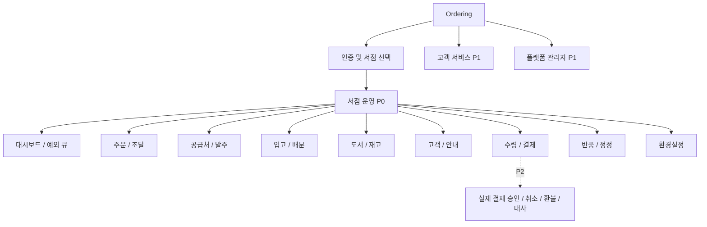
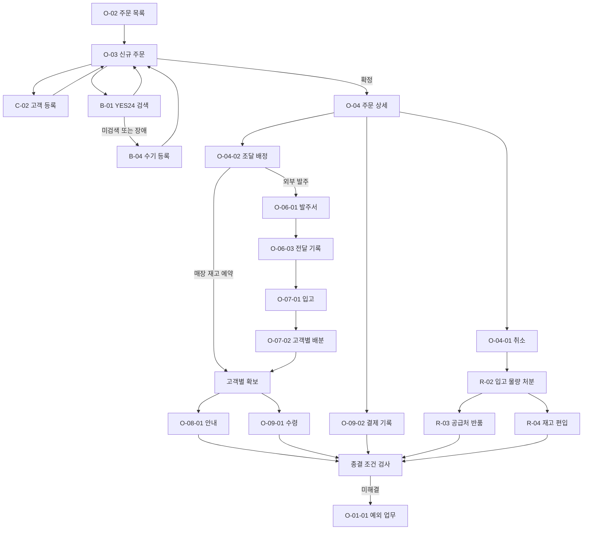

# Ordering 화면 구조도 (IA) V1.0

기준: 첨부 Ordering Use Case V1.3(2026-11-21), UC-01~30. V1.3 부록 우선. 아래 화면 번호·경로·배치는 설계 제안이며 미결정 업무 정책을 승인하지 않는다.

## 1. 전체 구조

PC: 좌측 메뉴, 상단 서점 선택 및 사용자 메뉴. 모바일: 홈·주문·발주·입고·더보기. 모든 상세 화면은 원 주문으로 복귀 가능. 테넌트 전환 시 기존 조회·입력 컨텍스트 초기화.

## 2. 화면 목록 및 추적성

| ID | 화면 | UC | 형태 / 기능 |
|---|---|---|---|
| A-01 | 로그인 | 01 | 페이지 / 이메일 인증 |
| A-02 | 회원가입 | 01 | 페이지 / 계정 생성 |
| A-03 | 비밀번호 재설정 | 01 | 페이지 / 복구 |
| A-04 | 서점 개설 | 01 | 페이지 / Tenant 및 Owner 생성 |
| A-05 | 서점 선택 | 15 | 선택기 / 활성 소속 |
| A-06 | 직원 초대 수락 | 02 | 페이지 / 초대 검증 |
| O-01 | 대시보드 | 15 | 페이지 / 집계 및 연결 |
| O-01-01 | 예외 업무 큐 | 24 | 페이지 / 담당자·종결 근거 |
| O-02 | 주문 목록 | 16 | 페이지 / 검색·필터 |
| O-03 | 신규 주문 | 03,04,05 | 페이지 / 초안·확정 |
| O-04 | 주문 상세 | 05,06,07,16 | 페이지 / 품목·타임라인 |
| O-04-01 | 주문 변경·취소 | 06 | 폼 / 수량·사유·영향 |
| O-04-02 | 조달 배정 | 07,27 | 폼 / 재고·발주·기타 |
| O-05 | 공급처 관리 | 21 | 페이지 / 활성·비활성 |
| O-06 | 발주 현황 | 08,09 | 페이지 / 대기·전달·회신 |
| O-06-01 | 발주서 작성 | 08 | 페이지 / 합산 발주 |
| O-06-02 | 발주 상세 | 08 | 페이지 / 고객별 배정 |
| O-06-03 | 출력·전달 기록 | 08 | 폼 / 출력과 전달 분리 |
| O-06-04 | 공급처 회신 | 09 | 폼 / 품절·지연·재발주 |
| O-07 | 입고 현황 | 10 | 페이지 / 입고 잔량 |
| O-07-01 | 입고 등록 | 10 | 폼 / 정상·파손·오배송 |
| O-07-02 | 고객별 입고 배분 | 11 | 폼 / 동일 발주 연결 검증 |
| O-07-03 | 입고 이력 | 10,23 | 상세 / 차수·정정 |
| B-01 | YES24 검색 | 04 | 공용 선택기 / ISBN·제목·저자 |
| B-02 | 등록 도서 목록 | 04,30 | 페이지 / 로컬 등록 도서 |
| B-03 | 도서 상세·수정 | 04,30 | 상세 / 출처·가격 |
| B-04 | 수기 등록 | 30 | 폼 / 도서명·판매가 필수 |
| I-01 | 재고 현황 | 26,27 | 페이지 / 보유·예약·가용 |
| I-02 | 재고 등록·조정 | 26 | 폼 / 원장·사유 |
| I-03 | 재고 예약 현황 | 27 | 탭 / 예약·해제 |
| I-04 | 수불 원장 | 26,27,28 | 탭 / 이동 이력 |
| C-01 | 고객 목록 | 03 | 페이지 / 검색 |
| C-02 | 고객 등록·수정 | 03 | 폼 / 중복 후보 |
| C-03 | 고객 상세 | 03,25 | 상세 / 주문 이력 |
| O-08 | 안내 대기 | 12 | 페이지 / 대상 목록 |
| O-08-01 | 안내 작성 | 12 | 폼 / 문구 복사·공유 |
| O-08-02 | 안내 결과 | 12 | 폼 / 시도·결과 기록 |
| O-08-03 | 안내 이력 | 12,24 | 탭 / 재안내 |
| O-09 | 수령·결제 현황 | 13,14 | 페이지 / 독립 업무 탭 |
| O-09-01 | 수령 등록 | 13 | 폼 / 부분 인도 |
| O-09-02 | 결제 기록 | 14,29 | 폼 / 카드·간편결제·계좌이체 |
| O-09-03 | 결제 상세 | 14,29 | 상세 / 잔액·증빙 |
| O-09-04 | 환급 필요 업무 | 29 | 탭 / 원거래·미해결 |
| R-01 | 취소 도서 처분 목록 | 28 | 페이지 / 미인도 물량 |
| R-02 | 처분 경로 선택 | 28 | 폼 / 반품 또는 재고 편입 |
| R-03 | 공급처 반품 | 28 | 상세 / 요청·수락·출고·완료 |
| R-04 | 매장 재고 편입 | 28 | 폼 / 중복 전환 방지 |
| R-05 | 거래 정정 | 23 | 폼 / 원거래·사유 |
| R-06 | 정정 승인·이력 | 23 | 탭 / 권한·영향 검증 |
| S-01 | 서점 기본정보 | 01 | 페이지 / 설정 |
| S-02 | 직원 관리 | 02 | 페이지 / 초대·비활성화 |
| S-03 | 역할 및 권한 | 02,25 | 페이지 / 접근 제어 |
| S-04 | 안내 템플릿 | 22 | 페이지 / 변수·버전 |
| S-05 | 감사 이력 | 16,25 | 페이지 / 변경·내보내기 |
| S-06 | 개인정보 보호 설정 | 25 | 페이지 / 필드 접근 |

## 3. 핵심 화면 이동

수령·결제·안내는 고정 순서가 아니다. 발주 전달 이후 취소 요청과 공급처 취소 확정을 분리한다. 취소 후 환급 필요 업무는 물량 처분과 별도로 추적한다.

## 4. 주문 상세 중심 설계
헤더: 주문번호(부여 시점 미정), 고객, 출처, 수령방법, 주문 총액, 미결제액, 독립 업무 상태. 탭: 품목/조달, 발주, 입고·배분, 안내, 수령, 결제, 변경·감사 이력. 각 탭에서 관련 업무 폼으로 이동 후 상세로 복귀. 품목별 주문·취소·유효·발주·확보·수령 잔량 표시. 확보되지 않은 수량 인도 금지. 미해결 필수 업무가 있으면 완료 차단(DEC-10 승인 필요).

## 5. 권한 및 확장 화면
Owner: 재고 초기 등록·조정, 직원 권한, 설정 및 민감 승인. Staff: 주문·발주·입고·배분·안내·수령·결제 기록; 재고 조정 위임·재배분·정정 승인 조건은 미결정. 모든 API에서 활성 Membership 및 tenant 검증. 메뉴 숨김만으로 접근통제하지 않는다.

| ID | 단계 | 화면 | UC |
|---|---|---|---|
| W-01 | P1 | 고객 공개 주문 | 17 |
| W-02 | P1 | 고객 본인 확인·주문 조회 | 18 |
| W-03 | P1 | 변경·취소 요청 | 18 |
| P-01 | P1 | 플랫폼 테넌트·장애·구독 지원 | 25 / 행위자 정의 |
| X-01 | P1 | 공식 알림톡·SMS 설정 및 발송 현황 | 19 |
| X-02 | P1 | 부분·복수 결제 | 20,29 |
| X-03 | P1 | 환급 처리 | 20,29 |
| X-04 | P1 | 배송·송장 관리 | 20 |
| X-05 | P1 | 개인정보 삭제·익명화 요청 | 25 |
| X-06 | P2 | 실제 결제 승인 | 14,20,29 |
| X-07 | P2 | 승인 취소·환불 | 20,29 |
| X-08 | P2 | 거래 대사·오류 복구 | 20,29 |
| X-09 | P2 검토 | 계좌이체 자동 입금 확인 | 29 |

## 6. 공통 검증 및 미결정 사항
- YES24 검색 실패 시 수기 등록 허용, 다른 외부 API 자동 전환 금지. 기존 주문 스냅샷 불변.
- 재고 등록·조정은 원장 기록, 보유 >= 예약 >= 0. 예약 및 인도 중복 차단.
- 반품 완료와 재고 편입 중복 귀속 금지. 반품 거절 시 재판단.
- P0 결제는 실제 외부 거래 확인 기록이며 승인 API가 아니다. 미확인 입금은 완료 금지. 현금 및 기타 수단 제외.
- 모든 폼은 로딩·빈 결과·권한 오류·검증 실패·동시 변경·재시도 상태를 제공한다. 금액·수량 원거래 물리 삭제 금지.
- DEC-01~20의 미결정 및 승인 필요 항목 유지. 특히 표시 주문번호, 부분입고 안내, 고객 최소정보, Staff 재고 위임, 승인 권한, 환급 시점 및 절차, 반품 비용, P0 복수 결제 범위를 확정할 필요가 있다.
- 추적성: UC → 화면 ID → FRD → API → DB/RLS → TC. P0/P1 구분은 원문 정책 승인 상태에 종속된다.
