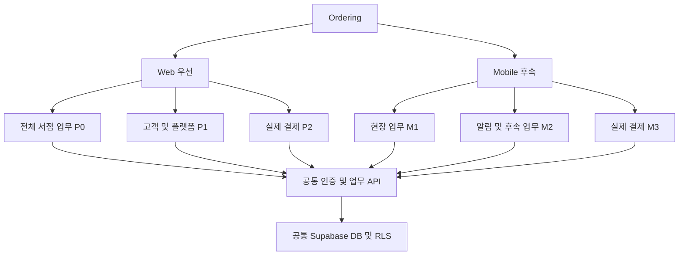
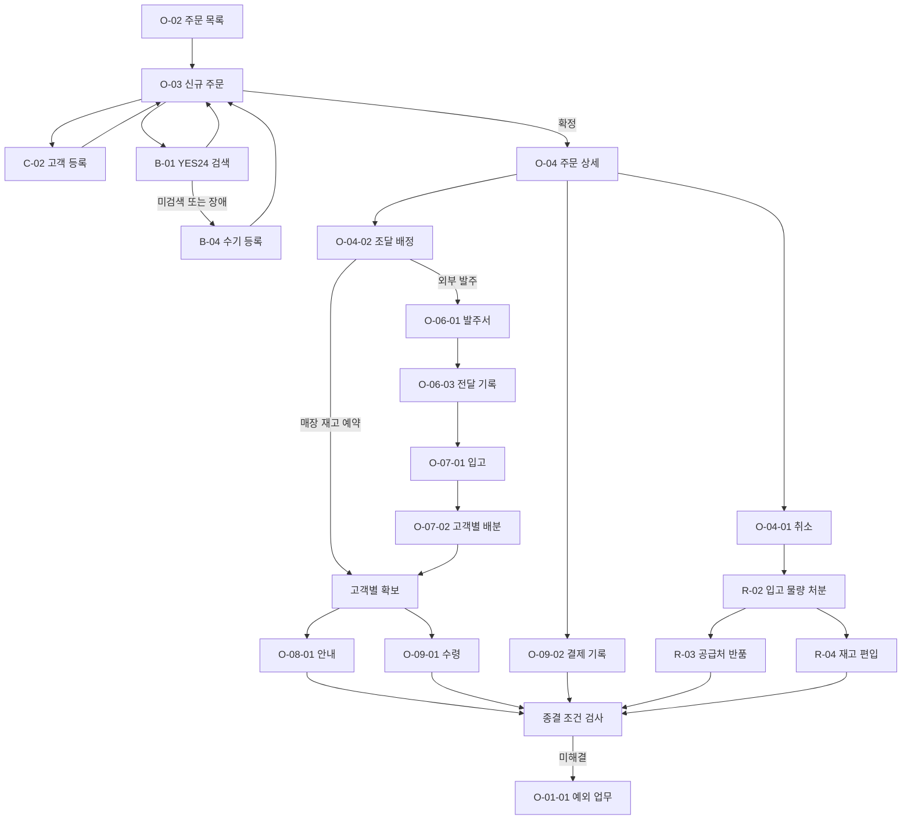
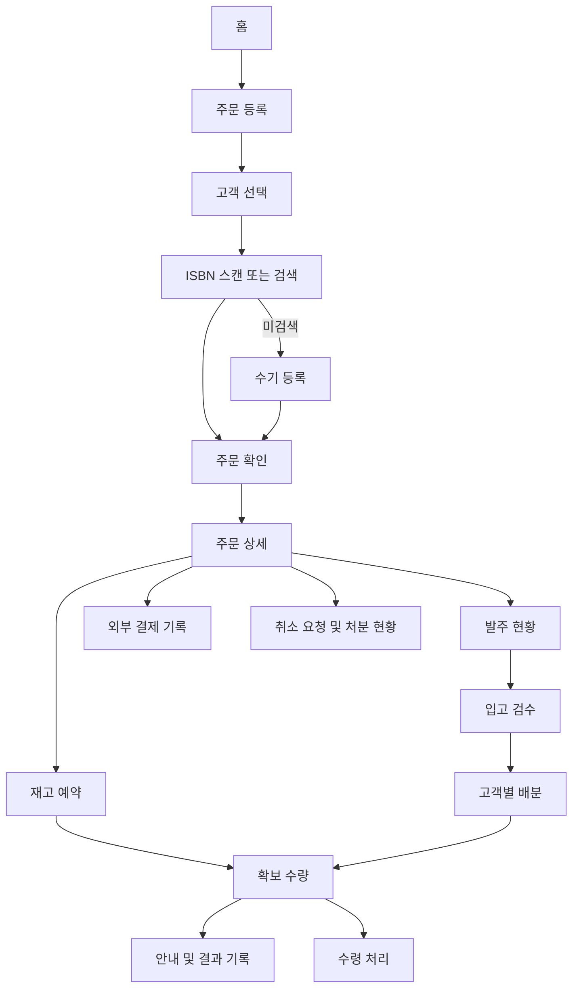

# Ordering IA V1.1 — 웹 우선·모바일 확장 통합 설계서

기준: 실제 IA V1.0 및 Use Case V1.3(부록 우선). 사용자 확정: 웹 앱 우선, 모바일 앱 후속. 이하 추가 화면 및 모바일 범위는 설계 제안이며 미결정 DEC를 승인하지 않는다.

## 1. 비판적 검토
기존 IA의 실제 P0 행은 55개(이전 답변의 58개는 오류). 확장 13개. 정상 업무는 대부분 연결되지만 인증 예외, 가격 변경, 발주 취소, 재배분, 반품 거절, 운영 장애, 승인·정정 상세가 부족하다. 모바일 하단 메뉴만 있고 독립 앱 화면 ID·카메라·공유·권한·재접속 설계가 없다. 기존 C-01/02는 PRD의 공개 고객 화면 ID와 충돌하므로 내부 고객 C-01/02 유지, 공개 W-01/02로 명시적 매핑한다. 원본 P0/P1/P2는 기능 우선순위로 유지하고 모바일 출시 M1/M2/M3와 구분한다.

## 2. 전체 아키텍처 및 메뉴

웹: 대시보드 / 주문 / 발주·공급처 / 입고 / 도서·재고 / 고객 / 안내 / 수령·결제 / 반품·정정 / 설정. 모바일: 홈 / 주문 / 입고 / 재고 / 더보기(발주·안내·수령·결제 포함). 주문 상세에서 관련 작업 진입 및 복귀. 웹 반응형 지원은 별도 앱 출시와 구별.

## 3. 웹 P0 화면 등록부 (기존 ID 유지)
| ID | 화면 | UC | 형태 / 기능 |
|---|---|---|---|
| A-01 | 로그인 | 01 | 페이지 / 이메일 인증 |
| A-02 | 회원가입 | 01 | 페이지 / 계정 생성 |
| A-03 | 비밀번호 재설정 | 01 | 페이지 / 복구 |
| A-04 | 서점 개설 | 01 | 페이지 / Tenant 및 Owner 생성 |
| A-05 | 서점 선택 | 15 | 선택기 / 활성 소속 |
| A-06 | 직원 초대 수락 | 02 | 페이지 / 초대 검증 |
| O-01 | 대시보드 | 15 | 페이지 / 집계 및 연결 |
| O-01-01 | 예외 업무 큐 | 24 | 페이지 / 담당자·종결 근거 |
| O-02 | 주문 목록 | 16 | 페이지 / 검색·필터 |
| O-03 | 신규 주문 | 03,04,05 | 페이지 / 초안·확정 |
| O-04 | 주문 상세 | 05,06,07,16 | 페이지 / 품목·타임라인 |
| O-04-01 | 주문 변경·취소 | 06 | 폼 / 수량·사유·영향 |
| O-04-02 | 조달 배정 | 07,27 | 폼 / 재고·발주·기타 |
| O-05 | 공급처 관리 | 21 | 페이지 / 활성·비활성 |
| O-06 | 발주 현황 | 08,09 | 페이지 / 대기·전달·회신 |
| O-06-01 | 발주서 작성 | 08 | 페이지 / 합산 발주 |
| O-06-02 | 발주 상세 | 08 | 페이지 / 고객별 배정 |
| O-06-03 | 출력·전달 기록 | 08 | 폼 / 출력과 전달 분리 |
| O-06-04 | 공급처 회신 | 09 | 폼 / 품절·지연·재발주 |
| O-07 | 입고 현황 | 10 | 페이지 / 입고 잔량 |
| O-07-01 | 입고 등록 | 10 | 폼 / 정상·파손·오배송 |
| O-07-02 | 고객별 입고 배분 | 11 | 폼 / 동일 발주 연결 검증 |
| O-07-03 | 입고 이력 | 10,23 | 상세 / 차수·정정 |
| B-01 | YES24 검색 | 04 | 공용 선택기 / ISBN·제목·저자 |
| B-02 | 등록 도서 목록 | 04,30 | 페이지 / 로컬 등록 도서 |
| B-03 | 도서 상세·수정 | 04,30 | 상세 / 출처·가격 |
| B-04 | 수기 등록 | 30 | 폼 / 도서명·판매가 필수 |
| I-01 | 재고 현황 | 26,27 | 페이지 / 보유·예약·가용 |
| I-02 | 재고 등록·조정 | 26 | 폼 / 원장·사유 |
| I-03 | 재고 예약 현황 | 27 | 탭 / 예약·해제 |
| I-04 | 수불 원장 | 26,27,28 | 탭 / 이동 이력 |
| C-01 | 고객 목록 | 03 | 페이지 / 검색 |
| C-02 | 고객 등록·수정 | 03 | 폼 / 중복 후보 |
| C-03 | 고객 상세 | 03,25 | 상세 / 주문 이력 |
| O-08 | 안내 대기 | 12 | 페이지 / 대상 목록 |
| O-08-01 | 안내 작성 | 12 | 폼 / 문구 복사·공유 |
| O-08-02 | 안내 결과 | 12 | 폼 / 시도·결과 기록 |
| O-08-03 | 안내 이력 | 12,24 | 탭 / 재안내 |
| O-09 | 수령·결제 현황 | 13,14 | 페이지 / 독립 업무 탭 |
| O-09-01 | 수령 등록 | 13 | 폼 / 부분 인도 |
| O-09-02 | 결제 기록 | 14,29 | 폼 / 카드·간편결제·계좌이체 |
| O-09-03 | 결제 상세 | 14,29 | 상세 / 잔액·증빙 |
| O-09-04 | 환급 필요 업무 | 29 | 탭 / 원거래·미해결 |
| R-01 | 취소 도서 처분 목록 | 28 | 페이지 / 미인도 물량 |
| R-02 | 처분 경로 선택 | 28 | 폼 / 반품 또는 재고 편입 |
| R-03 | 공급처 반품 | 28 | 상세 / 요청·수락·출고·완료 |
| R-04 | 매장 재고 편입 | 28 | 폼 / 중복 전환 방지 |
| R-05 | 거래 정정 | 23 | 폼 / 원거래·사유 |
| R-06 | 정정 승인·이력 | 23 | 탭 / 권한·영향 검증 |
| S-01 | 서점 기본정보 | 01 | 페이지 / 설정 |
| S-02 | 직원 관리 | 02 | 페이지 / 초대·비활성화 |
| S-03 | 역할 및 권한 | 02,25 | 페이지 / 접근 제어 |
| S-04 | 안내 템플릿 | 22 | 페이지 / 변수·버전 |
| S-05 | 감사 이력 | 16,25 | 페이지 / 변경·내보내기 |
| S-06 | 개인정보 보호 설정 | 25 | 페이지 / 필드 접근 |

### 3.1 추가 웹 화면 단위
| ID | 화면 | UC | 형태 / 기능 |
|---|---|---|---|
| A-07 | 이메일 인증 결과 | 01 | 페이지; 재발송·만료 |
| A-08 | 초대 만료·거절 | 02 | 상태; 재초대 요청 |
| A-09 | 내 계정·로그아웃 | 01,02 | 페이지; 세션 종료 |
| A-10 | 세션 만료·접근 거부 | 25 | 공통 상태; 재인증 |
| O-01-02 | 예외 업무 상세 | 24 | 담당·근거·종결 검증 |
| O-02-01 | 초안·보류 주문 | 05 | 목록 필터; 재개 |
| O-04-03 | 가격 변경·동의 | 05,06,14 | 폼; 스냅샷 보존; 승인 미정 |
| O-04-04 | 종결 조건 검사 | 15,24 | 패널; 수령·결제·미해결 업무 |
| O-04-05 | 변경·취소 이력 | 06,16 | 탭; 요청과 확정 구분 |
| O-05-01 | 공급처 상세·편집 | 21 | 폼; 비활성·재활성 |
| O-05-02 | 공급처 발주 이력 | 08,21 | 탭 |
| O-06-05 | 전달 후 변경·취소 요청 | 06,08,09 | 폼; 회신 별도 |
| O-06-06 | 발주 버전·회신 이력 | 08,09 | 탭 |
| O-07-04 | 미배분 입고 목록 | 10,11 | 필터; 정상 수량만 |
| O-07-05 | 배분 해제·재배분 | 11,23 | 폼; 승인 조건 미정 |
| O-07-06 | 초과입고 승인 | 10 | 다이얼로그; Owner·사유 |
| B-05 | 중복 후보·외부정보 매칭 | 04,30 | 폼; 자동 병합 금지 |
| I-05 | 도서별 재고 상세 | 26,27 | 페이지; 보유·예약·가용 및 이력 |
| C-04 | 고객 변경 이력 | 03,25 | 탭; 민감 필드 권한 |
| O-08-04 | 안내 미리보기·재시도 | 12,22 | 폼; 최신 수량 검증 |
| O-09-05 | 수령 이력·정정 진입 | 13,23 | 탭 |
| O-09-06 | 미확인 결제 목록 | 14,29 | 필터; 입금 확인 전 완료 금지 |
| R-07 | 반품 거절·재처리 | 28 | 폼; 재고 편입 또는 예외 큐 |
| R-08 | 반품 상태별 목록 | 28 | 필터; 요청·수락·출고·완료 |
| S-07 | 운영 정책 설정 | 15,24 | 페이지; 승인 정책만 활성화 |
| S-08 | YES24 연동 상태 | 04,30 | 페이지; 키 비노출·장애 안내 |
| S-09 | 내보내기 요청·결과 | 16,25 | 폼; 권한·만료·감사 |
| G-01 | 공통 오류·빈 결과·오프라인 | 전체 | 상태 컴포넌트; 재조회 |
| G-02 | 저장 충돌·중복 요청 | 전체 | 상태 컴포넌트; 결과 확인 후 재시도 |

## 4. 모바일 앱 전용 화면 등록부
| ID | 화면 | 웹 대응 ID | UC | 출시 단계 |
|---|---|---|---|---|
| M-A01 | 로그인·가입·계정 복구 | A-01~03,A-07 | 01 | M1 |
| M-A02 | 서점 선택·전환 | A-05 | 15 | M1 |
| M-A03 | 초대 수락·만료 | A-06,A-08 | 02 | M1 |
| M-A04 | 내 계정·로그아웃 | A-09,A-10 | 01,25 | M1 |
| M-01 | 현장 업무 홈 | O-01 | 15 | M1 |
| M-02 | 내 업무·예외 목록 | O-01-01~02 | 24 | M1 |
| M-03 | 주문 목록·검색 | O-02,O-02-01 | 16 | M1 |
| M-04 | 신규 주문·초안 | O-03 | 03,04,05 | M1 |
| M-05 | 고객 검색·등록·수정 | C-01~03 | 03 | M1 |
| M-06 | ISBN 카메라 스캔 | B-01 | 04 | M1 |
| M-07 | YES24 검색·도서 선택 | B-01~02 | 04 | M1 |
| M-08 | 독립출판물 수기 등록 | B-04,B-05 | 30 | M1 |
| M-09 | 주문 확인·확정 | O-03 | 05 | M1 |
| M-10 | 주문 상세·타임라인 | O-04,O-04-05 | 05,16 | M1 |
| M-11 | 조달 배정·재고 예약 | O-04-02,I-03 | 07,27 | M1 |
| M-12 | 주문 변경·취소 요청 | O-04-01 | 06 | M1 |
| M-13 | 발주 목록·상세 | O-06,O-06-02 | 08,09 | M1 |
| M-14 | 공급처 회신 기록 | O-06-04 | 09 | M1 |
| M-15 | 입고 대기·발주 선택 | O-07 | 10 | M1 |
| M-16 | 입고 검수·스캔·수량 | O-07-01 | 10 | M1 |
| M-17 | 고객별 입고 배분 | O-07-02 | 11 | M1 |
| M-18 | 매장 재고 조회 | I-01,I-05 | 26,27 | M1 |
| M-19 | 재고 등록·조정 | I-02 | 26 | M1 |
| M-20 | 고객 안내 대기·미리보기 | O-08,O-08-01 | 12 | M1 |
| M-21 | OS 공유·발송 결과 기록 | O-08-02 | 12 | M1 |
| M-22 | 수령 대상 검색·부분 인도 | O-09,O-09-01 | 13 | M1 |
| M-23 | 결제 확인·수동 기록 | O-09-02~03 | 14,29 | M1 |
| M-24 | 취소 물량 처분 요청·현황 | R-01~04 | 28 | M1 |
| M-25 | 환급 필요 업무 조회 | O-09-04 | 29 | M1 |
| M-26 | 더보기·웹 관리 연결 | S-01~09 | 25 | M1 |
| M-27 | 카메라 권한·설정 안내 | B-01 | 04 | M1 |
| M-28 | 오프라인·충돌·재접속 | G-01~02 | 전체 | M1 |
| M-29 | 앱 버전·업데이트 안내 | 신규 | 전체 | M1 |
| M-30 | 업무 알림함·딥링크 | O-01-01 | 24 | M2 |
| M-31 | 푸시 권한·수신 설정 | 신규 | 24 | M2 |
| M-32 | 승인·환급·배송 상세 | X-02~04,R-06 | 20,23,29 | M2 |
| M-33 | 실제 결제·결과 확인 | X-06~08 | 29 | M3 |

M1은 웹 P0 안정화 후 현장 앱 출시 제안. M2의 P1 업무와 M3의 P2 업무는 해당 서버 기능 출시 이후만 활성화. 대량 발주 생성·출력, 직원 권한, 공급처 등록, 감사 내보내기 등은 M1에서 웹 전용이며 모바일에 미구현 버튼 노출 금지. 고위험 처분·정정은 웹에서 완료하고 모바일은 요청·조회 중심. 카메라 거부 시 ISBN 직접 입력. OS 공유 성공은 실제 발송 증거가 아니다. 네트워크 장애 중 확정·입고·배분·예약·인도·결제는 성공 표시 금지; 재연결 후 서버 결과 확인 및 동일 요청 키 재시도. 오프라인 확정은 범위 제외.

## 5. 웹 업무 화면 이동

수령·결제·안내는 고정 순서가 아니다. 발주 전달 이후 취소 요청과 공급처 취소 확정을 분리한다. 취소 후 환급 필요 업무는 물량 처분과 별도로 추적한다.

## 6. 모바일 업무 화면 이동

## 7. 확장 웹 등록부
| ID | 단계 | 화면 | UC |
|---|---|---|---|
| W-01 | P1 | 고객 공개 주문 | 17 |
| W-02 | P1 | 고객 본인 확인·주문 조회 | 18 |
| W-03 | P1 | 변경·취소 요청 | 18 |
| P-01 | P1 | 플랫폼 테넌트·장애·구독 지원 | 25 / 행위자 정의 |
| X-01 | P1 | 공식 알림톡·SMS 설정 및 발송 현황 | 19 |
| X-02 | P1 | 부분·복수 결제 | 20,29 |
| X-03 | P1 | 환급 처리 | 20,29 |
| X-04 | P1 | 배송·송장 관리 | 20 |
| X-05 | P1 | 개인정보 삭제·익명화 요청 | 25 |
| X-06 | P2 | 실제 결제 승인 | 14,20,29 |
| X-07 | P2 | 승인 취소·환불 | 20,29 |
| X-08 | P2 | 거래 대사·오류 복구 | 20,29 |
| X-09 | P2 검토 | 계좌이체 자동 입금 확인 | 29 |
| W-04 | P1 | 공개 주문 제출 결과·오류 | 17 |
| W-05 | P1 | OTP 입력·만료·재전송 | 18 |
| W-06 | P1 | 고객 주문 상세·요청 처리 결과 | 18 |
| P-02 | P1 제안 | 테넌트 목록·상세·상태 | 25 / 행위자 정의 |
| P-03 | P1 제안 | 장애·지원 이력 | 25 / 행위자 정의 |
| P-04 | P1 제안 | 구독 현황·정책 | 25 / 행위자 정의 |
| X-10 | P1 | 메시지 실패·재처리 | 19 |
| X-11 | P2 | 결제 인증·승인 결과·타임아웃 | 29 |
| X-12 | P2 | 결제사업자 설정·연동 상태 | 29 |

## 8. 공통 규칙 및 권한
헤더: 주문번호(부여 시점 미정), 고객, 출처, 수령방법, 주문 총액, 미결제액, 독립 업무 상태. 탭: 품목/조달, 발주, 입고·배분, 안내, 수령, 결제, 변경·감사 이력. 각 탭에서 관련 업무 폼으로 이동 후 상세로 복귀. 품목별 주문·취소·유효·발주·확보·수령 잔량 표시. 확보되지 않은 수량 인도 금지. 미해결 필수 업무가 있으면 완료 차단(DEC-10 승인 필요).

Owner: 재고 초기 등록·조정, 직원 권한, 설정 및 민감 승인. Staff: 주문·발주·입고·배분·안내·수령·결제 기록; 재고 조정 위임·재배분·정정 승인 조건은 미결정. 모든 API에서 활성 Membership 및 tenant 검증. 메뉴 숨김만으로 접근통제하지 않는다.

- YES24 검색 실패 시 수기 등록 허용, 다른 외부 API 자동 전환 금지. 기존 주문 스냅샷 불변.
- 재고 등록·조정은 원장 기록, 보유 >= 예약 >= 0. 예약 및 인도 중복 차단.
- 반품 완료와 재고 편입 중복 귀속 금지. 반품 거절 시 재판단.
- P0 결제는 실제 외부 거래 확인 기록이며 승인 API가 아니다. 미확인 입금은 완료 금지. 현금 및 기타 수단 제외.
- 모든 폼은 로딩·빈 결과·권한 오류·검증 실패·동시 변경·재시도 상태를 제공한다. 금액·수량 원거래 물리 삭제 금지.
- DEC-01~20의 미결정 및 승인 필요 항목 유지. 특히 표시 주문번호, 부분입고 안내, 고객 최소정보, Staff 재고 위임, 승인 권한, 환급 시점 및 절차, 반품 비용, P0 복수 결제 범위를 확정할 필요가 있다.
- 추적성: UC → 화면 ID → FRD → API → DB/RLS → TC. P0/P1 구분은 원문 정책 승인 상태에 종속된다.

## 9. 출시 검증
- 웹: UC-01~16,21~30 중 P0 범위와 TC-01~60 중 P0 항목에 대해 화면→API→DB 테스트 연결. P1/P2 테스트는 기능 출시 시 수행. 모든 화면에서 로딩/빈 결과/권한/검증 실패/충돌 검증.
- 모바일: 카메라 거부, 스캔 오류, 앱 백그라운드 복귀, 테넌트 전환, 네트워크 단절 중 제출, 공유 취소, 중복 탭, 웹·앱 동시 마지막 재고 예약, 직원 권한 회수, 앱 업데이트 테스트 추가 제안.
- 웹과 앱은 동일 업무 API를 통해 성공 커밋 후 화면 갱신; 독립 DB나 독립 권한 정책 금지.
- 웹 출시→실사용 검증→M1→M2/M3. 고객 앱 별도 출시 여부는 미확정이며 P1 고객 웹으로 우선 설계.
- 미결정: 모바일 OS 및 프레임워크 최종 선택, 푸시 도입, 모바일 승인 범위, 실제 결제 연동 방식. PRD/FRD 동기화 및 상태 전이 정의 후 상세 UI 개발.
