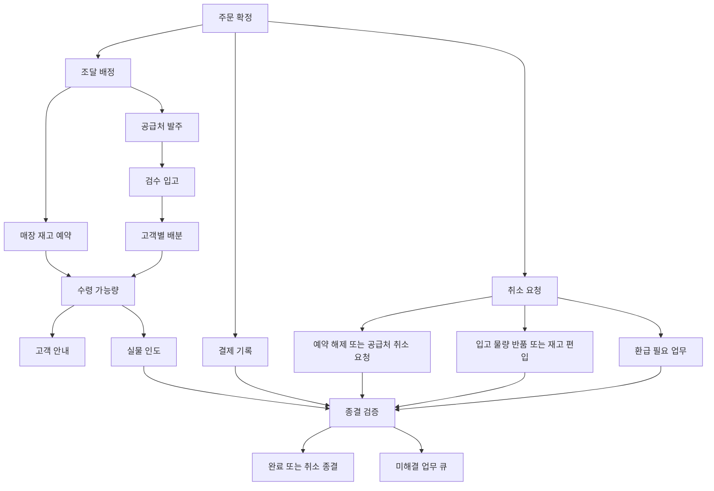

# Ordering 상태 전이 및 업무 규칙 정의서 V1.0

작성일: 2026-11-21 | 상태: 설계안, 미결정 정책 승인 필요 | Web First, Mobile Ready

## 1. 기준 및 적용 범위
시장조사 V2.0(제품 방향), PRD V1.1(§8~10,16), FRD V1.1(§3~6), Use Case V1.3(§5~13 및 V1.3 부록), IA V1.1(§3~9)을 기준으로 한다. 최신 사용자 확정 정책 우선; 하위 문서의 기존 ID는 유지한다. 본 문서의 영문 상태 코드, 계산식 세분화, 오류 코드 및 추가 검증은 구현 제안이며 기존 미결정 정책을 승인하지 않는다.

확정: YES24 단일 외부 검색, 미검색/ISBN 없는 도서 수기 등록, 점주 재고 관리, 카드·간편결제·계좌이체 한정, 입고 후 미인도 취소 물량 공급처 반품 또는 재고 편입, P2 실제 카드·간편결제 승인/취소/환불, 웹 우선 및 별도 모바일 후속. P0 수동 결제 사실 기록; P1 복수결제·환급 UI 등; P2 PG/VAN, 계좌 자동 확인은 검토. P1 공개주문 범위는 DEC-01 승인 필요. 모바일 M1~3은 기능 P0~2와 별도의 출시 축이다.

## 2. 상태 모델 원칙
주문 생명주기, 조달, 발주, 입고, 배분, 재고, 안내, 수령, 결제, 취소, 반품, 환급, 예외를 분리한다. 상태는 거래 결과로 산출하며 수량·금액보다 우선하지 않는다. 상태 변경 API가 아니라 업무 명령 API로 처리한다. 아래 표에 없는 전이는 기본 거부한다. 모든 전이에 공통으로 활성 소속·권한·동일 테넌트·버전·멱등성·트랜잭션·감사 검증을 적용한다. 표의 상태는 구현 후보 코드이다.

안내는 독립 업무이며 필수 안내 여부는 정책에 따름. 결제와 수령의 순서는 독립적이라는 권장안을 유지한다.

## 3. 상태 전이 등록부
형식: 규칙 ID | 현재→다음 | 업무 이벤트 | 조건·결과 | 사용자. O=Owner, S=권한 있는 Staff, SYS=서버/검증된 외부 이벤트. 실패 시 변경 롤백, 오류 또는 예외 큐 반환. 외부 작업은 DB 롤백만으로 취소되지 않으므로 결과 확인 후 재처리한다.

### 3.1 인증·테넌트·기준정보 (UC-01~04,21,22,25,30)
| ID | 전이 | 이벤트 | 조건·결과 | 주체 |
|---|---|---|---|---|
| ST-A01 | UNVERIFIED→VERIFIED | 이메일 인증 | 유효 토큰, 만료/재사용 거부 | SYS |
| ST-A02 | 없음→ACTIVE | 서점 개설 | 인증 계정, Tenant+Owner 소속 원자 생성 | O |
| ST-A03 | INVITED→ACTIVE | 초대 수락 | 이메일·토큰·만료 검증 | SYS |
| ST-A04 | INVITED→EXPIRED/REVOKED | 만료/철회 | 재사용 불가 | SYS/O |
| ST-A05 | ACTIVE→INACTIVE→ACTIVE | 직원 비활성/복구 | 즉시 서버 접근 차단/재검증, 마지막 Owner 보호 제안 | O |
| ST-A06 | ACTIVE→SUSPENDED→ACTIVE | 서점 중지/복구 | P1 정책 승인 후; 데이터 보존 | 플랫폼 |
| ST-A07 | ACTIVE→CLOSED | 해지 | P1 보존·내보내기 정책 확정 후 | 플랫폼 |
| ST-A08 | 인증됨→세션 종료 | 로그아웃/만료 | 토큰 및 캐시 처리, 재인증 | O/S/SYS |
| ST-B01 | 없음→ACTIVE | YES24 결과 선택 | 출처·조회 시각·내부 ID 기록 | O/S |
| ST-B02 | 없음→ACTIVE | 수기 등록 | 도서명·판매가 필수, ISBN 선택, MANUAL·사유 | O/S |
| ST-B03 | ACTIVE→ACTIVE | 수정/외부정보 매칭 | 중복 후보 확인, 자동 병합 금지, 주문 스냅샷 불변 | O/S |
| ST-B04 | ACTIVE→INACTIVE→ACTIVE | 공급처 비활성/복구 | 과거 발주 보존, 신규 발주 차단 | O/위임 S |
| ST-B05 | 템플릿 vN→vN+1 | 문구 변경 | 허용 변수 검증·이전 렌더링 보존 | O/위임 S |
고객 등록·변경은 감사 이벤트로 기록. 전화번호 정규화, 공유 번호 자동 병합 금지. BOOK의 ACTIVE는 서점 취급 상태 제안이며 출처와 분리. 비밀번호 재설정은 인증 제공자의 유효 토큰을 사용. 테넌트 전환 시 캐시 초기화 및 서버 재검증.

### 3.2 주문·취소 (UC-05,06,15,16)
| ID | 전이 | 이벤트 | 조건·결과 | 주체 |
|---|---|---|---|---|
| ST-O01 | 없음→DRAFT | 초안 생성 | 내부 UUID, 테넌트 연결 | O/S |
| ST-O02 | DRAFT↔HELD | 보류/재개 | 사유 기록, 확정 전 조달 금지 | O/S |
| ST-O03 | DRAFT→CONFIRMED | 확정 | 필수정보·가격 스냅샷·버전·주문번호 정책 | O/S |
| ST-O04 | CONFIRMED→CONFIRMED | 가격/품목 변경 | 영향 분석, 변경 이벤트·동의/승인 정책 | O/S |
| ST-O05 | CONFIRMED→CONFIRMED | 부분 취소 확정 | 미인도량만, 조달 해제·처분·환급 작업 생성 | O/S |
| ST-O06 | CONFIRMED→CANCELLING | 전량 취소 확정 | 유효 수량 0, 후속 물량/금전 업무 유지 | O/S |
| ST-O07 | CONFIRMED→COMPLETED | 종결 | 유효수량>0, 전량 인도, 결제 정책 충족, 필수 미해결 없음 | SYS |
| ST-O08 | CANCELLING→CANCELLED | 취소 종결 | 유효수량 0, 외부 의무·처분·환급 등 해결 | SYS |
| ST-O09 | DRAFT/HELD→CANCELLED | 초안 폐기 | 외부 거래 없음, 이력 보존 | O/S |
| ST-O10 | COMPLETED/CANCELLED→재검증 | 정정 | 일반 수정 불가, 승인된 역거래가 종결 조건을 바꾸면 재개(제안) | O/SYS |
취소 요청 객체: REQUESTED→APPROVED/REJECTED/WITHDRAWN→APPLIED(승인된 요청만 적용). 고객 요청은 P1, 직원 자체 요청 P0. 승인과 적용이 동일 트랜잭션일 수 있다. 이미 인도된 물량은 일반 취소 금지. 확정 후 보류는 상태 덮어쓰기 대신 별도 업무 HOLD 플래그 권장. 주문 화면 진행 상태는 아래 §4 계산으로 표시.

### 3.3 조달·공급처 발주 (UC-07~09,21,27)
| ID | 전이 | 업무 이벤트 | 조건·결과 | 주체 |
|---|---|---|---|---|
| ST-P01 | 없음→ACTIVE | 조달 배정 | 유효 미배정량; 재고/발주/기타 경로 | O/S |
| ST-P02 | ACTIVE→RELEASED | 미이행 배정 해제 | 예약 해제; 전달 발주 의무 별도 유지 | O/S |
| ST-P03 | 없음→DRAFT | 발주서 생성 | 활성 공급처, 주문별 수량 연결 | O/S |
| ST-P04 | DRAFT→READY | 전달 준비 | 발주 버전 확정 | O/S |
| ST-P05 | DRAFT/READY→동일 상태 | 파일 출력 | 출력 이력만 기록 | O/S |
| ST-P06 | READY→SENT | 실제 전달 기록 | 담당자·방식·시각·전달 버전 근거 | O/S |
| ST-P07 | SENT→ACKNOWLEDGED | 공급처 회신 | 실제 회신, 품목별 확정/품절/지연 수량 | O/S |
| ST-P08 | SENT/ACKNOWLEDGED→동일 상태 | 변경·취소 요청 | 원본 보존, 별도 요청 및 회신 | O/S |
| ST-P09 | DRAFT/READY→CANCELLED | 미전달 취소 | 외부 의무 없음, 배정 해제 | O/S |
| ST-P10 | SENT/ACKNOWLEDGED→CANCELLED | 공급처 전량 취소 확정 | 수락 근거, 입고/기타 의무 없음 | O/S |
| ST-P11 | SENT/ACKNOWLEDGED→CLOSED | 발주 종결 | 정상 입고+공급처 확정 축소로 잔량 0, 필수 후속 해결 | SYS |
발주 품목 회신은 수량별 확정·품절·지연·취소 및 ETA 로 관리, 부분확정은 집계. 회신 없는 발주 자동 확인 금지. 취소 요청: REQUESTED→ACCEPTED/PARTIALLY_ACCEPTED/REJECTED; 부분 응답마다 요청량·수락량·거절량·미응답량 저장. 공급처 의무가 해소되지 않은 재조달은 중복 위험 승인 및 남는 물량 귀속 업무 필요(제안). 고객 취소로 고객 배정은 해제하되 외부 발주량은 수락 전 감소시키지 않는다.

### 3.4 입고·고객별 배분 (UC-10,11,23)
| ID | 전이 | 이벤트 | 조건·결과 | 주체 |
|---|---|---|---|---|
| ST-R01 | 없음→POSTED | 검수 입고 등록 | 발주 품목·차수·정상/파손/오배송 구분, 정상량만 배분 | O/S |
| ST-R02 | 초과입고 대기→APPROVED/REJECTED | 예외 승인 | Owner·사유·승인한도/귀속 | O |
| ST-R03 | POSTED→POSTED(보정) | 입고 정정 | 원거래 참조, 인도 및 처분 물량 침해 금지 | O/S |
| ST-R04 | 없음→ACTIVE | 고객별 배분 | 같은 발주 품목/도서/테넌트, 순입고 및 고객 배정 잔량 이내 | O/S |
| ST-R05 | ACTIVE→부분/전량 RELEASED | 배분 해제 | 미인도량 한정, 안내 불일치 경고 | O/S |
| ST-R06 | ACTIVE→부분/전량 CONSUMED | 인도 | 수령 거래와 원자적 기록 | O/S |
| ST-R07 | ACTIVE→새 배분 | 재배분 | 해제+신규 생성 원자 처리, 승인 정책 | O/S |
입고 상태 NONE/PARTIAL/FULL은 누적 정상 입고량으로 산출하며 반품은 별도. 파손·오배송은 P0 기록 및 예외 큐, 상세 반품은 P1(고객 취소 정상 도서 반품 P0와 구분).

### 3.5 매장 재고·예약 (UC-26,27,28)
| ID | 전이 | 이벤트 | 조건·결과 | 주체 |
|---|---|---|---|---|
| ST-I01 | 없음→등록 | 초기 재고 | 도서 ID·수량·INITIAL 원장 | O |
| ST-I02 | 등록→등록 | 증감 조정 | 사유·실사, 보유≥예약≥0 | O/위임 S |
| ST-I03 | 없음→ACTIVE | 주문 예약 | 가용량·미확보량·배정량 검증 | O/S |
| ST-I04 | ACTIVE→부분/전량 RELEASED | 예약 해제 | 미인도 예약만 감소, 보유 불변 | O/S |
| ST-I05 | ACTIVE→부분/전량 CONSUMED | 예약 인도 | 보유와 예약 동시 감소 | O/S |
| ST-I06 | 미처분 입고→STOCKED | 취소 도서 재고 편입 | 원 배분·입고 참조, 입고 버킷 감소와 재고 원장 증가 원자 처리 | O/승인 S |
예약·배분의 부분 상태는 잔여량으로 표시; 모두 소진되거나 해제된 혼합 결과는 CLOSED 및 각 수량 표시. 재고 원장 물량은 매장 재고 버킷만 포함하며 고객 전용 입고 물량과 중복 금지.

### 3.6 고객 안내·수령 (UC-12,13,19,20,22)
| ID | 전이 | 이벤트 | 조건·결과 | 주체 |
|---|---|---|---|---|
| ST-M01 | 없음→PENDING | 안내 대상 생성 | 현재 확보량/지연/접수 등 이벤트 | SYS |
| ST-M02 | PENDING→PENDING | 미리보기/복사/공유 | 문구·버전 검증, 발송 간주 금지 | O/S |
| ST-M03 | PENDING→ATTEMPTED | 외부 발송 시도 기록 | 채널·담당·시각·문구 | O/S |
| ST-M04 | ATTEMPTED→MANUAL_RECORDED/FAILED | 직원 결과 | 실제 기록 근거, 수신/읽음 추정 금지 | O/S |
| ST-M05 | FAILED→새 PENDING | 재안내 | 원 시도 보존, 최신 확보량 | O/S |
| ST-M06 | PENDING→SUPERSEDED | 대상 변경 | 이전 안내 보존, 재안내 판단 | SYS |
| ST-M07 | PENDING→PROVIDER_ACCEPTED→DELIVERED | 공식 API P1 | 서명된 실제 결과, 읽음은 지원 시 별도 | SYS |
| ST-F01 | 없음→POSTED | 수령 등록 | 미인도 확보량 이내, 출처별 소진 | O/S |
| ST-F02 | POSTED→POSTED(보정) | 수령 정정 | 원거래·실제 물량 복귀 여부·승인, 재고/배분 복원 | O/S |
| ST-F03 | READY→SHIPPED→DELIVERED | 배송 P1 | 송장·실제 발송/인도 근거, 중복 인도 금지 | O/S |
장기 미수령은 경고 플래그이며 자동 취소 금지 권장. 배송 중 물량은 별도 잠금, 반송은 별도 기록. 고객 안내와 결제는 수령과 독립.

### 3.7 결제·환급 (UC-14,20,29)
| ID | 전이 | 이벤트 | 조건·결과 | 주체 |
|---|---|---|---|---|
| ST-Y01 | 없음→PENDING_VERIFICATION | 거래 입력 | CARD/EASY_PAY/BANK_TRANSFER만, 금액 양수 | O/S |
| ST-Y02 | PENDING_VERIFICATION→CONFIRMED | 외부 증빙 확인 | 카드/간편결제 승인 사실 또는 입금 확인 | O/S |
| ST-Y03 | PENDING_VERIFICATION→VOIDED | 미확인 기록 무효 | 실제 거래 여부 확인 | O/S |
| ST-Y04 | CONFIRMED→보정 거래 | 오기록 정정 | 실제 환급과 구분, 원거래 보존 | O/권한 S |
| ST-Y05 | 없음→REFUND_REQUIRED | 취소/과수납 | 원 결제·환급 필요액, 물량과 독립 | SYS |
| ST-Y06 | REFUND_REQUIRED→IN_PROGRESS→REFUNDED | 외부 환급 확인 | 실제 취소/입금 증빙·원거래 상한; P0 최소 결과 기록 제안, P1 전용 UI | O/권한 S |
| ST-Y07 | IN_PROGRESS→FAILED→IN_PROGRESS | 환급 실패/재시도 | 실패 근거 및 중복 환급 방지 | O/S |
| ST-Y08 | 없음→INITIATED→AUTHORIZING | P2 실제 승인 | 서버 금액 재계산, 시도 ID, 사업자 SDK/API | SYS |
| ST-Y09 | AUTHORIZING→CONFIRMED/FAILED/UNKNOWN | P2 승인 결과 | 검증된 응답, 타임아웃은 UNKNOWN | SYS |
| ST-Y10 | UNKNOWN→CONFIRMED/FAILED | 조회·대사 | 실제 거래 확인 전 재승인 금지 | SYS |
| ST-Y11 | CONFIRMED→환불 거래 | P2 승인 취소/환불 | 원 승인 참조, 검증 결과만 반영 | SYS |
현금·포인트·상품권·기타 금지. P0 복수/부분결제 UI 범위 DEC-14 미확정. 데이터는 복수 거래에 확장 가능하게 설계하되 기능은 승인 전 비활성. P0 외부 환급의 최소 증빙 기록 및 종결 경로가 없으면 선결제 취소 주문을 끝낼 수 없으므로 출시 전 확정 필요. 실제 카드/간편결제 승인과 계좌 입금 확인은 별개. 카드번호 전체·CVC 저장 금지(보안 제안).

### 3.8 취소 물량 처분·공급처 반품 (UC-06,28)
| ID | 전이 | 이벤트 | 조건·결과 | 주체 |
|---|---|---|---|---|
| ST-C01 | 없음→PENDING | 취소 확정 | 미인도 고객 배분 해제 및 처분 버킷 생성 | O/승인 S |
| ST-C02 | PENDING→RETURN_PENDING | 반품 선택 | 원 입고·공급처·수량 참조, 별도 보관 | O/승인 S |
| ST-C03 | RETURN_PENDING→ACCEPTED/REJECTED | 공급처 회신 | 수락/거절 수량 및 근거 | O/S |
| ST-C04 | ACCEPTED→DISPATCHED | 반품 출고 | 실제 출고 수량 및 참조 | O/S |
| ST-C05 | DISPATCHED→RETURNED | 반품 완료 | 공급처 최종 확인, 비용 후속 분리 | O/S |
| ST-C06 | PENDING/REJECTED→STOCKED | 재고 편입 | 미출고 물량만, 원장 1회 증가 | O/승인 S |
| ST-C07 | REJECTED→RETURN_PENDING | 재협의 | 원 요청 보존, 재시도 근거 | O/S |
반품·재고 편입은 동일 물량에 배타적. 부분 반품·부분 편입은 수량별 분할 처분 제안. 출고된 반품이 거절/반송되면 실물 회수 확인 후 별도 역거래, 자동 편입 금지. 매장 예약분 취소는 예약 해제만 하며 편입으로 보유량을 추가 증가시키지 않는다.

### 3.9 운영·정정 (UC-15,16,23~25)
| ID | 전이 | 이벤트 | 조건·결과 | 주체 |
|---|---|---|---|---|
| ST-E01 | 없음→OPEN | 예외 발생 | 원인·원거래·담당·필수 종결 플래그 | SYS/O/S |
| ST-E02 | OPEN→IN_PROGRESS→WAITING | 처리/외부 회신 대기 | 조치 기록 | O/S |
| ST-E03 | OPEN/IN_PROGRESS/WAITING→RESOLVED | 해결 | 유형별 증빙 및 실제 해결 검증 | O/S |
| ST-E04 | RESOLVED→OPEN | 재발/정정 | 원인·이력 보존 | SYS/O/S |
| ST-E05 | REQUESTED→APPROVED/REJECTED | 거래 정정 승인 | 영향 분석·권한·버전 재검증 | O |
| ST-E06 | APPROVED→APPLIED | 정정 적용 | 원거래 역/보정 거래; 후속 집계 재산출 | O/권한 S |
예외 유형: 미배정, 품절·지연, 초과입고, 미배분, 안내 실패, 장기 미수령, 미확인 결제, 환급 필요, 반품 거절, 취소 후 외부 의무, 승인 불명확, 대사 불일치. 단순 숨김 금지. 개인정보 내보내기는 권한 검증, 최소 필드, 만료·감사; 삭제/익명화 요청은 P1 별도 처리.

## 4. 수량 원장 및 계산 규칙 (구현 제안)
모든 수량은 정수 권수, 금액은 원화 정수. 원장 유효 이벤트 집계를 기준으로 다음 식 적용. 정정은 원 이벤트와 연결하고 유효 효과만 반영한다.

| ID | 식/불변식 | 의미 |
|---|---|---|
| BR-Q01 | E=ordered-cancelled; 0≤cancelled≤ordered | 유효 주문량 |
| BR-Q02 | F=순인도량; 0≤F≤E | 이미 인도한 수량 |
| BR-Q03 | R=예약 생성-해제-예약 인도(순효과) | 미인도 매장 예약량 |
| BR-Q04 | A=입고 배분-해제-배분 인도(순효과) | 미인도 입고 확보량 |
| BR-Q05 | Ready=R+A; Secured=F+Ready≤E | 현재 수령 가능량과 누적 유효 확보량 분리 |
| BR-Q06 | Need=E-F-Ready≥0 | 미확보량 |
| BR-Q07 | PlannedOutstanding≤Need | 미확보에 대한 활성 조달 계획량; 확보 전환량 제외 |
| BR-Q08 | Unassigned=Need-PlannedOutstanding≥0 | 미배정량 |
| BR-Q09 | on_hand=sum(stock movements); 0≤reserved≤on_hand | 매장 보유·예약 |
| BR-Q10 | available=on_hand-reserved | 주문 예약 가능량 |
| BR-Q11 | 발주 고객 배정의 유효 합≤발주량 | 원 발주 보존 및 변경 이력 |
| BR-Q12 | 발주 미입고량=유효 발주량-누적 정상 검수 순량 | 공급처 수락 축소 및 승인 초과량 반영, 반품이 자동 재발주를 생성하지 않음 |
| BR-Q13 | 같은 PO/주문 품목의 유효 누적 입고 배분≤해당 유효 배정 상한 | 이미 인도된 배분 포함, 취소 해제는 제외 |
| BR-Q14 | 정상 입고 순량=미배분+미인도 배분+순인도+처분대기+반품대기/출고중+반품완료+재고편입 | 입고 물량 보존; 각 버킷 상호 배타, 반품완료는 누적 처분으로 포함 |
| BR-Q15 | 취소 입고 물량=미결정+반품진행+반품완료+재고편입 | 중복 처분 금지 |
BR-Q14의 순량은 검수 등록-검수 정정(반품을 차감하지 않음)이다. 반품 차감 순재고 개념과 구분한다. 정상 입고의 고객 외 재고 목적 편입도 동일 버킷 이동으로 기록한다(해당 기능 범위 추가 승인). 기타 조달은 검증된 물량 귀속 규칙 확정 전 고객 확보로 계산하지 않는다. 원 발주 연결을 해제해도 공급처 미해결 의무 수량은 별도 기록.

### 4.1 주문 표시 상태 산출
생명주기와 별개로 각 차원 집계: 유효 품목 E>0일 때 F=E이면 수령 완료, 0<F<E이면 부분 수령, F=0이면 미수령. F<E이고 Ready=E-F이면 수령 가능, 0<Ready<E-F이면 일부 준비, Ready=0이면 조달 중/대기(계획에 따라). 품목 E=0은 취소. 여러 품목은 합계와 품목별 조건을 함께 표시. 전체 헤더는 DRAFT/HELD/CANCELLING/CANCELLED/COMPLETED를 먼저 표시하고 CONFIRMED이면 수령 또는 확보 요약을 계산한다. 취소 요청·지연·미결제 등은 독립 배지. 사용자 임의 상태 수정 버튼 금지.

### 4.2 입고 상태 산출
발주 유효 수량 대비 정상 검수 순량 0=미입고, 0<순량<유효량=부분입고, 같으면 입고완료. 유효량 0은 취소/축소 종결 기준 별도. 미배분량은 검수 수량만으로 추정하지 않고 BR-Q14의 버킷 잔량 사용. 입고 후 반품과 공급처 재납품 의무는 별도 업무로 추적.

## 5. 금액·종결 규칙
| ID | 규칙 |
|---|---|
| BR-Y01 | 주문총액=유효 품목별 확정 단가×유효 수량-유효 할인+유효 배송비+승인 가격 조정; 할인/배송비 배분·반올림 정책 승인 필요 |
| BR-Y02 | 순결제=확인된 유효 결제-실제 완료 환급; 보정 이벤트의 순효과 반영. 미확인 거래 제외 |
| BR-Y03 | 잔액=유효 주문총액-순결제; 양수 미결제, 0 정산 충족, 음수 환급 필요 |
| BR-Y04 | 원 결제별 완료 환급+진행 중 예약 환급≤원 유효 결제액; 실패 해제는 실제 실패 확인 후 |
| BR-Y05 | 결제 상태는 UNPAID/PARTIAL/PAID/OVERPAID 등 잔액 기반; 환급 진행/부분완료는 별도 차원 |
| BR-Y06 | 전량 취소와 무결제 주문을 결제완료로 오표시하지 않음; 잔액 0은 금전 의무 없음으로 표시 가능 |
| BR-O01 | 정상 종결: ∑E>0, 모든 품목 F=E, 결제 정책 충족, 필수 미해결 업무 없음 |
| BR-O02 | 취소 종결: ∑E=0, F=0, 반품/편입/외부 의무/환급 및 필수 업무 해결 |
| BR-O03 | 종결 후보는 서버 트랜잭션에서 재검증; 정정 시 종결 재평가. 승인되지 않은 후불 정책은 적용 금지 |
| BR-O04 | 안내 필요 여부/완료 조건은 DEC-05/10 정책으로 분리. 안내 복사·공유만으로 조건 충족 안 됨 |
기본 권장: 잔액 0, 처리 중 결제/환급 없음. 외상/후불 허용 여부 미결정. 공급처 비용 정산은 고객 결제와 별도 외부 의무이며 종합 회계 기능은 P0 제외.

## 6. 트랜잭션·실패 복구·공통 업무 규칙
| ID | 명령 | 원자 처리 단위 |
|---|---|---|
| TX-01 | 주문 확정 | 주문/품목 스냅샷+번호(정책)+조달 큐+감사 |
| TX-02 | 매장 재고 예약 | 재고 잠금+예약+조달 배정+감사 |
| TX-03 | 발주 작성 | 조달 배정 검증+발주 버전+품목 연결 |
| TX-04 | 입고 등록 | 발주 잔량 검증+검수 원장+미배분 버킷 |
| TX-05 | 고객 입고 배분 | 입고/주문/발주 연결 잠금+배분+안내 후보 |
| TX-06 | 수령 | 확보 출처 소진+인도 원장+매장 보유/예약 감소(해당 시) |
| TX-07 | 취소 적용 | 미인도 검증+유효량 감소+예약/배분 해제+처분/공급처/환급 작업 |
| TX-08 | 재고 편입 | 처분량 잠금+입고 버킷 이동+재고 원장 |
| TX-09 | 결제 확인/환급 | 원 거래·금액 잠금+유효 원장+잔액+후속 업무 |
| TX-10 | 거래 정정 | 원거래·하위 영향 잠금+역거래+집계 및 후속 큐 |
공통: 요청 키 범위 tenant+command+key; 같은 키·같은 payload는 기존 결과, 다른 payload는 충돌. 잠금 순서 일관화, 버전 충돌은 재조회. 네트워크 단절/응답 유실 시 서버 결과 조회 후 같은 키 재시도. 화면 성공은 DB 커밋 확인 후. 외부 발주/반품/알림/결제는 별도 실제 결과 기록; P2 외부 연동은 이벤트 중복 처리 및 대사 필요. 웹/모바일 공통 서버 정책, 오프라인 확정 금지. 감사 필드: tenant, actor, action, original reference, reason, before/after 또는 delta, timestamp, request key. 민감정보 최소화.

오류 코드 제안: AUTH_REQUIRED, MEMBERSHIP_INACTIVE, ACCESS_DENIED, NOT_FOUND(타 테넌트 정보 비노출), INVALID_TRANSITION, VALIDATION_FAILED, VERSION_CONFLICT, IDEMPOTENCY_CONFLICT, INSUFFICIENT_STOCK, ALLOCATION_LIMIT, RECEIPT_LIMIT, FULFILLMENT_LIMIT, APPROVAL_REQUIRED, PAYMENT_UNVERIFIED, REFUND_LIMIT, UNRESOLVED_TASKS, EXTERNAL_RESULT_UNKNOWN. 오류별 메시지와 재조회/승인/예외 큐 이동을 UI에서 제공.

## 7. 화면 및 요구사항 추적성
| 규칙군 | FRD/PRD | UC | 웹 IA | 모바일 IA | 기존 TC |
|---|---|---|---|---|---|
| 인증·권한 | AUTH-001~009 | 01,02,25 | A-01~10,S-01~03 | M-A01~04 | 01,14,17,18,33 |
| 고객·도서 | CUS-001~007,BOOK-001~008 | 03,04,30 | B-01~05,C-01~04 | M-05~08 | 15,19,20,50~54 |
| 주문·취소 | ORD-001~013 | 05,06,17,18 | O-02~04 및 하위,W-01~06 | M-03,04,09,10,12 | 02,11,16,21,22 |
| 발주·공급처 | SUP-001~002,PO-001~010 | 07~09,21 | O-05~06 및 하위 | M-11,13,14 | 03,04,24,25,34 |
| 입고·배분 | REC-001~009 | 10,11 | O-07~07-06 | M-15~17 | 05~08,26~28,36 |
| 재고·예약 | INV-001(제안),PO-001 | 26,27 | I-01~05,O-04-02 | M-11,18,19 | 23,37~41 |
| 안내 | MSG-001~010 | 12,19,22 | O-08 및 하위,S-04,X-01,10 | M-20,21 | 12,29,35 |
| 수령·결제 | FUL-001~004,PAY-001~006 | 13,14,20,29 | O-09 및 하위,X-02~04,06~09,11~12 | M-22,23,25,32,33 | 09,13,30,31,47~49,55~60 |
| 취소 후 처분 | ORD-008,PO-010,REC-009 | 28 | R-01~04,07,08 | M-24 | 42~46 |
| 운영·정정 | DASH-001~008,SEC/OPS 제안 | 15,16,23~25 | O-01 및 하위,R-05~06,S-05~09,G-01~02 | M-01,02,26,28~31 | 10,32,33,36 |
M1 모바일 고위험 처분·정정은 요청/조회 중심, 웹에서 완료. 공급처 관리·일괄 발주·직원 설정·감사 내보내기 웹 전용. M2/M3는 서버 P1/P2 기능 활성 후. M-27 카메라 거부 시 직접 ISBN 입력; M-29 앱 업데이트 안내. IA 매핑은 화면 단위 전체가 아니라 업무 규칙군 기준이다.

## 8. 수치 기반 검증 및 추가 테스트
예시 A: 주문 3권, 매장 보유5 예약1, 외부 발주2. 입고1 배분1이면 E3,F0,R1,A1,Ready2,Need1,미확보 계획1. 매장 예약 1권 인도 후 보유4 예약0, F1,R0,A1,Ready1,Secured2,Need1. 누적 확보2가 유지되어야 한다.
예시 B: 외부 입고 배분2권 주문 전량 취소. 배분 해제 후 처분대기2; 반품1/편입1 분할 승인 시 반품 버킷1, 재고+1, 미배분0. 공급처 완료 전 취소 종결 불가. 분할 미승인 시 한 경로만 사용.
예시 C: 3권×15,000원 전액 외부 결제 확인. 미인도 1권 취소 후 주문총액30,000, 순결제45,000, 잔액-15,000. 실제 환급15,000 확인 후 잔액0; 나머지 2권 인도 및 물량 처리 완료 시 종결.

| 신규 제안 TC | 시나리오 | 기대 결과 |
|---|---|---|
| TC-61 | 예약 인도 후 누적 확보 계산 | Ready 감소, F 증가, Secured 유지 |
| TC-62 | 입고 취소 재고 편입 재시도 | 원 입고 버킷 차감 및 재고 증가 1회 |
| TC-63 | 발주 전달 후 고객 취소, 공급처 거절 | 고객 취소와 외부 의무 분리, 종결 차단 |
| TC-64 | 반품 출고 후 편입 요청 | 차단, 실제 회수 필요 |
| TC-65 | 선결제 후 부분 취소 | 음수 잔액 및 환급 필요 큐, 실제 환급 전 종결 금지 |
| TC-66 | 동일 결제 동시 환급 | 원거래 상한 초과 금지 |
| TC-67 | 웹·모바일 마지막 재고 동시 예약 | 한 건만 커밋 |
| TC-68 | 모바일 응답 유실 후 같은 키 재시도 | 기존 결과, 중복 인도 없음 |
| TC-69 | 다른 payload에 같은 요청 키 | 충돌, 변경 없음 |
| TC-70 | 취소/정정으로 완료 조건 변경 | 권한·영향 검증 후 재평가 |
| TC-71 | 반품 완료 후 입고 잔량 계산 | 자동 재발주 없음 |
| TC-72 | 안내 공유 취소/권한 철회 | 발송완료 미표시, 서버 접근 차단 |
| TC-73 | 모바일 테넌트 전환 중 저장 | 이전 테넌트 요청 차단 또는 명시적 원 요청 검증, 화면 데이터 혼합 금지 |
| TC-74 | P2 승인 타임아웃 후 사용자 재결제 | 조회·대사 전 재승인 차단 |
기존 TC-01~60 유지. 추가 테스트는 번호 연속성을 위한 제안이며 테스트 실행 완료를 의미하지 않는다.

## 9. 미결정 정책과 승인 게이트
| DEC | 항목 | 권장안/현황 |
|---|---|---|
| 01 | 공개 주문 | P1 권장, 승인 필요 |
| 02 | 점주 재고 | 확정, 예약 원장 적용 |
| 03 | 입고 고객 배분 | P0 필수 권장, 승인 필요 |
| 04 | 전달 발주 취소 | 요청/회신/의무 분리 권장 |
| 05 | 부분입고 안내 | 직원 선택, 기본값 미정 |
| 06 | 결제·환급 | 수단/P2 방향 확정, P0 환급 결과 기록·시점 승인 필요 |
| 07 | 장기 미수령 | 경고, 자동취소 없음 권장 |
| 08 | 가격 변경 | 고객 동의·사유 기록 권장, 할인 배분도 결정 |
| 09 | 민감 작업 승인 | Owner 승인 조건 확정 필요 |
| 10 | 종결 | 수량·금전·필수 업무 조건 승인 필요 |
| 11 | 수령/결제 순서 | 독립 처리 권장, 후불 허용 별도 |
| 12 | 고객 최소정보 | 연락처·보존·삭제 미정 |
| 13 | 주문번호 | 확정 시 발급 권장 |
| 14 | P0 복수 결제 | 선결제 후 잔액·부분결제 범위 승인 |
| 15 | 재배분 | 승인 범위 확정 |
| 16 | 예외 종결 | 유형별 증빙·필수 여부 승인 |
| 17 | YES24 및 수기 | 확정, API 계약/검색 범위 검증 |
| 18 | 반품/재고 | 확정, 비용·거절·부분 처분·결정권 미정 |
| 19 | 재고 권한 | 점주 확정, 직원 위임·실사 미정 |
| 20 | 기타 결제 금지 | 확정 |
추가 설계 결정: D21 종결 후 정정 재개 정책, D22 기타 조달 물량 검증 및 고객 외 입고의 재고 편입, D23 P0 배송 기록 한계/P1 배송 인도 기준, D24 계좌 자동 확인 및 PG/VAN 계약, D25 모바일 OS·프레임워크 및 승인 범위, D26 테넌트 중지·해지/지원 권한. 모두 제안/검토 대상.

## 10. 후속 산출물 및 출시 조건
PRD/FRD에 최신 재고·수기등록·취소처분·결제 확장 정책을 동기화하고 DEC 승인 후 본 문서의 코드와 규칙을 확정한다. 다음: 화면별 상세 기능명세(버튼 활성 조건, 오류, 필드) → TRD/ERD/데이터 사전 → 서버 권한 및 API 계약 → 테스트 → 웹 P0 → 파일럿 → 모바일 M1 → 확장. 테넌트 침범, 중복·초과수량, 결제 오인, 정정 및 취소 후 물량/환급 미해결, 복구 실패는 출시 차단. 문서만 작성되었으며 구현·테스트 실행은 미수행.
