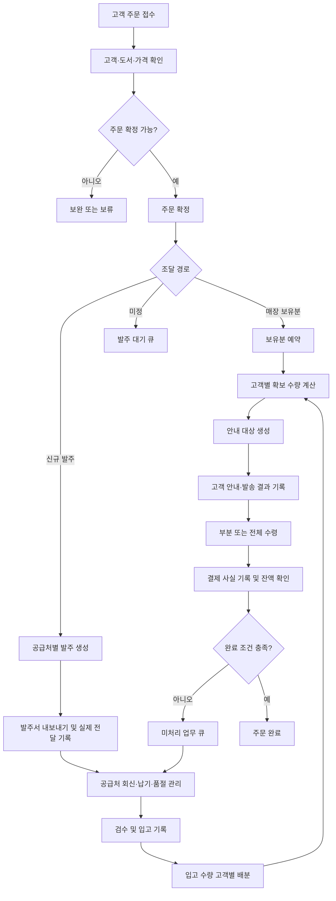

# Ordering Use Case 및 업무 프로세스 정의서 V1.0

- 기준 문서: Ordering PRD V1.1 (2026-11-20)
- 문서 상태: 상세설계 검토안 / 정책 승인 전
- 적용 범위: 독립서점 멀티테넌트 주문관리 SaaS, 내부 운영 MVP(P0) 중심
- 기술 가정: React/PWA + Supabase Auth/PostgreSQL/RLS. 구현 기술은 Use Case의 업무 의미를 변경하지 않는다.

## 1. 목적과 범위
본 문서는 사용자와 시스템 간 상호작용, 사전·사후 조건, 정상·대체·예외 흐름, 권한, 데이터 불변 조건, 인수 테스트를 정의한다. PRD V1.1의 변경 제안은 승인 전 가정으로 표시한다. 고객 공개 주문(P1), 자동 알림톡(P1), PG(P2), 공급처 EDI(P2)는 MVP 정상 흐름에 포함하지 않는다.

### 1.1 행위자
| 행위자 | 책임 | 접근 제약 |
|---|---|---|
| Owner | 서점 생성, 직원/설정 관리, 주문·발주·입고 승인 및 민감 정정 | 소속 테넌트 한정 |
| Staff | 고객·도서·주문·발주·입고·안내·수령·결제 기록 | 부여된 테넌트별 역할에 한정 |
| Customer(P1) | 공개 주문, 본인 주문 조회, 변경 요청 | 본인 확인 및 공개 가능 데이터만 |
| Platform Admin(P1) | 테넌트 상태·운영 지원 | 고객 데이터 기본 접근 불가, 예외 접근 감사 |
| 공급처(외부) | 발주 수신, 재고·납기·품절 회신 | MVP에서 직접 로그인하지 않음 |
| 도서정보 API | 서지정보 제공 | 실패 시 수기 입력 |
| 메시지 채널 | 직원의 수동 발송 수단 | 수신·읽음 확인으로 간주하지 않음 |

### 1.2 표기 및 공통 규칙
- 우선순위 P0=첫 MVP, P1=초기 후속, P2=확장.
- 기본 흐름 `M`, 대체 흐름 `A`, 예외 흐름 `E`.
- 모든 쓰기 요청: 인증, tenant membership/role, tenant_id 교차 참조 검증, 입력 검증, 감사 기록. 중요한 거래는 서버 트랜잭션과 멱등 키를 사용.
- 성공 상태는 화면 표시만으로 확정하지 않고 DB 커밋 결과로 판단.
- '수동 발송 기록'은 외부 서비스의 실제 전달·수신·읽음 증명이 아니다.
- 매장 보유분 예약은 간이 수량 관리이며 전체 재고 수불을 대체하지 않는다.

## 2. Use Case 목록 및 요구사항 추적
| UC ID | Use Case | 주 행위자 | 단계 | 관련 PRD ID | 화면 |
|---|---|---|---|---|---|
| UC-01 | 회원가입·서점 생성 | Owner | P0 | AUTH-001/002/006/007 | 설정/온보딩 |
| UC-02 | 직원 초대·권한 관리 | Owner | P0 | AUTH-003/004/006 | 설정 |
| UC-03 | 고객 등록·조회·수정 | Staff | P0 | CUS-001~005 | O-03/고객관리 |
| UC-04 | 도서 검색·수기 등록 | Staff | P0 | BOOK-001~005/007 | O-03/도서관리 |
| UC-05 | 고객 주문 등록·확정 | Staff | P0 | ORD-001/003~007/012, PAY-006 | O-03/O-04 |
| UC-06 | 주문 변경·취소 | Staff | P0 | ORD-004/008/010/012, PO-010 | O-04 |
| UC-07 | 조달 경로·수량 배정 | Staff | P0 | PO-001/009 | O-04/O-06 |
| UC-08 | 공급처별 발주서 작성·전달 | Staff | P0 | SUP-001/002, PO-002~006 | O-05/O-06 |
| UC-09 | 공급처 응답·품절·지연 처리 | Staff | P0 | PO-006/007/010 | O-06 |
| UC-10 | 부분·전체 입고 등록 | Staff | P0 | REC-001~004/009 | O-07 |
| UC-11 | 입고 수량의 고객별 배분 | Staff | P0 | REC-006~008, PO-009 | O-07 |
| UC-12 | 고객 안내 및 결과 기록 | Staff | P0 | MSG-001~007/010 | O-08 |
| UC-13 | 부분·전체 수령·정정 | Staff | P0 | FUL-001/002/004 | O-09 |
| UC-14 | 수동 결제 기록·잔액 조회 | Staff | P0 | PAY-001/002/006 | O-09 |
| UC-15 | 대시보드·예외 업무 처리 | Owner/Staff | P0 | DASH-001~005/008 | O-01 |
| UC-16 | 검색·감사 이력·내보내기 | Owner/Staff | P0 | ORD-009/010, AUTH-006 | O-02/O-04 |
| UC-17 | 고객 공개 주문 | Customer | P1 | ORD-002, AUTH-005 | C-01 |
| UC-18 | 고객 본인 주문 조회·변경 요청 | Customer | P1 | ORD-011/013 | C-02 |
| UC-19 | 공식 알림톡/SMS 발송 | Staff/외부사업자 | P1 | MSG-008 | O-08 |
| UC-20 | 환불·복수 결제·배송 | Staff | P1 | PAY-003/004, FUL-003 | O-09 |

## 3. 전체 업무 흐름

**주의:** 다이어그램의 미처리 업무 큐→공급처 회신 화살표는 재검토를 뜻하며, 모든 미처리 업무가 공급처 단계로 되돌아간다는 의미는 아니다. 수령과 결제는 실제로 선후관계가 고정되지 않은 독립 업무다.

## 4. 상세 Use Case

### UC-01 회원가입·서점 생성
- **목적:** Owner가 계정을 만들고 서점 테넌트를 개설한다.
- **사전조건:** 인증되지 않았거나 유효한 신규 계정; 서점 생성 정책 충족.
- **트리거:** 서점 개설 요청.
- **M:** 1) 이메일 인증/로그인 → 2) 서점 기본정보 입력 → 3) 서버 검증 → 4) 테넌트와 Owner Membership을 하나의 원자적 작업으로 생성 → 5) 서점 홈으로 이동.
- **A:** 기존 계정은 로그인 후 서점 생성; 생성 중 재시도는 기존 요청 결과 반환.
- **E:** 이메일 중복/인증 실패/트랜잭션 실패 시 중복 테넌트 없이 오류 반환.
- **사후조건:** 활성 테넌트 1개와 Owner 소속 1개가 일관되게 존재.
- **인수기준:** 같은 멱등 키의 재요청으로 중복 생성 불가; 타 테넌트 접근 차단.

### UC-02 직원 초대·권한 관리
- **목적:** Owner가 직원을 초대하고 업무 권한을 관리한다.
- **사전조건:** Owner가 해당 서점에 활성 소속.
- **M:** 1) 이메일·역할 지정 → 2) 초대 생성 → 3) 수락/가입 → 4) Membership 활성화 → 5) 권한 반영.
- **A:** 기존 계정의 추가 서점 소속; 초대 만료 후 재발송.
- **E:** 중복 초대/권한 없는 변경 거부; 비활성화 후 기존 세션의 데이터 접근도 서버에서 거부.
- **사후조건:** 역할 변경·초대·비활성화 감사 이력 존재.
- **인수기준:** Staff는 Owner 전용 설정과 타 서점 데이터를 변경할 수 없음.

### UC-03 고객 등록·조회·수정
- **목적:** 고객 정보를 주문에 연결한다.
- **사전조건:** 활성 직원 권한.
- **M:** 1) 이름/연락처 등 최소정보 입력 → 2) 전화번호 정규화·중복 후보 검색 → 3) 후보 확인 → 4) 신규 등록 또는 기존 고객 선택 → 5) 주문 연결.
- **A:** 전화번호 없는 고객의 접수는 서점 정책에 따라 허용 여부 판단.
- **E:** 중복 후보를 자동 병합하지 않음; 다른 테넌트 고객 검색 불가.
- **사후조건:** 해당 서점의 고객 레코드와 변경 이력 존재.
- **인수기준:** 동명이인 자동 병합 없음; 수정 전후 이력 기록.

### UC-04 도서 검색·수기 등록
- **목적:** 주문 도서를 식별한다.
- **M:** 1) ISBN/제목/저자 검색 → 2) API 결과 확인 → 3) 선택 또는 수기 등록 → 4) 서점 취급 정보 확인 → 5) 주문 시점 제목·ISBN·단가 스냅샷 생성.
- **A:** ISBN 없는 독립출판물 수기 등록; 외부 API 오류 시 수기 입력.
- **E:** 동일 ISBN 중복 후보 경고; 외부 정보 수정이 기존 주문 스냅샷을 변경하지 않음.
- **인수기준:** 외부 API 불가 시에도 주문 등록 가능.

### UC-05 고객 주문 등록·확정
- **목적:** 전화·방문·SNS 주문을 단일 시스템에 기록한다.
- **사전조건:** 고객과 품목이 식별되며 수령 방식 등 필수 항목이 정해짐.
- **M:** 1) 고객 선택 → 2) 주문 출처·품목·양수 수량·단가·할인·수령 방식 입력 → 3) 예상 금액과 정책 확인 → 4) 초안 저장 → 5) 주문 확정 → 6) 테넌트별 주문번호 부여, 가격 스냅샷·이력 기록.
- **A:** 고객/가격 미확정은 보류 상태로 유지; 품목 여러 개 입력.
- **E:** 수량 0 이하/필수값 누락/중복 제출 거부; 확정 이후 직접 덮어쓰기 제한.
- **사후조건:** 주문과 주문 품목이 확정되고 조달 대기 대상이 됨.
- **인수기준:** 동일 요청 중복 등록 방지; 확정 당시 가격이 이후 도서 마스터 변경에 영향받지 않음.

### UC-06 주문 변경·취소
- **목적:** 고객 요청 또는 직원 판단에 따른 변경을 추적한다.
- **M:** 1) 주문·품목 선택 → 2) 변경/취소 사유 입력 → 3) 연결 발주·입고·배분·수령·결제 조회 → 4) 허용 범위 검증 → 5) 변경 이벤트 기록 → 6) 필요한 후속 업무 생성.
- **A:** 발주 전 미배정 수량 취소는 간단 처리; 발주 전달 후에는 공급처 취소 요청을 별도 생성; 부분 취소 시 유효 수량 재계산.
- **E:** 이미 수령한 수량보다 유효 주문 수량을 작게 만드는 취소 차단; 환불/잔여 물량 처리 미결정 시 주문을 무조건 완료 처리하지 않음.
- **사후조건:** 원 주문과 공급처 발주가 각각 추적 가능; 잔여 처리 큐 생성.
- **인수기준:** 고객 주문 취소만으로 외부 발주가 취소되었다고 표시하지 않음.

### UC-07 조달 경로·수량 배정
- **목적:** 고객 주문 품목을 보유분·신규 발주·기타로 분할한다.
- **M:** 1) 품목 유효 수량 조회 → 2) 조달 경로별 수량 입력 → 3) 신규 발주분에 공급처 지정 → 4) 원자적으로 배분 저장 → 5) 미배정 잔량 표시.
- **A:** 한 품목 3권을 공급처 A 2권, B 1권으로 나눔; 보유분 1권 + 발주 2권.
- **E:** 활성 조달 배정 합계가 유효 주문 수량 초과 시 거부; 보유분 중복 예약 차단을 위한 최소 가용 수량 검증 필요.
- **사후조건:** 조달 계획과 미배정 수량 추적 가능.
- **인수기준:** 동시 작업에서도 초과 배정 불가.

### UC-08 공급처별 발주서 작성·전달
- **목적:** 여러 고객의 필요 수량을 공급처별로 묶어 발주한다.
- **M:** 1) 발주 대기 목록 선택 → 2) 공급처별 품목·수량 집계 → 3) 발주 초안 생성 → 4) 발주서 CSV/XLSX 출력 → 5) 직원이 외부 채널로 실제 전달 → 6) 전달 일시·방식·담당자·확인번호 기록.
- **A:** 공급처별 서식 변경; 미전달 초안 수정.
- **E:** 파일 다운로드만으로 '전달' 상태 변경 금지; 발주 품목 배정 합계가 발주 수량을 초과하면 거부.
- **사후조건:** 발주 버전과 전달 증빙/기록 보존.
- **인수기준:** 내보내기와 전달이 독립 이력으로 확인됨.

### UC-09 공급처 응답·품절·지연 처리
- **목적:** 공급처 회신과 조달 문제를 기록한다.
- **M:** 1) 발주 선택 → 2) 공급처 확인/예상 입고일/수량 입력 → 3) 지연·품절 사유 기록 → 4) 영향받는 고객 주문 품목 표시 → 5) 재조달·고객 안내·취소 후속 작업 등록.
- **A:** 부분 수량만 확정; 대체 공급처 발주; 대체 도서 제안은 고객 동의 이력 필요.
- **E:** 공급처 확인 없이 자동으로 '확정' 표시 금지; 기존 발주를 조용히 수정하지 않음.
- **인수기준:** 품절 발생 시 영향을 받는 고객별 미해결 수량 조회 가능.

### UC-10 부분·전체 입고 등록
- **목적:** 실제 수령한 공급처 물량을 검수 후 기록한다.
- **사전조건:** 발주 품목 존재; 입고 처리 권한.
- **M:** 1) 발주 선택 → 2) 실제 도착 품목·정상 수량 검수 → 3) 차수별 입고 기록 → 4) 누적 정상 입고·잔량 재계산 → 5) 고객 배분 대기 생성.
- **A:** 10권 중 6권만 1차 입고, 나머지 4권 후속 입고; 파손 수량은 정상 수량과 분리.
- **E:** 초과 입고 기본 차단; Owner 승인 예외 시 사유 기록; 중복 제출 차단; 이미 고객에게 수령된 물량의 단순 입고 취소 금지.
- **사후조건:** 입고 거래·정정 이력, 배분 가능한 순정상 수량 생성.
- **인수기준:** 6+4의 두 차수 입고가 정확히 10으로 집계되고 재시도로 20이 되지 않음.

### UC-11 입고 수량의 고객별 배분
- **목적:** 실제 입고된 수량을 고객 주문 품목에 귀속한다.
- **사전조건:** 순정상 입고 수량이 존재; 고객 주문 품목의 미확보 수량 존재.
- **M:** 1) 입고 품목 선택 → 2) 연결 주문 품목과 미확보 수량 조회 → 3) 고객별 배분 수량 입력 → 4) 서버가 입고 잔량·주문 유효 잔량·발주 연결 관계 검증 → 5) Receipt Allocation 원자적 저장 → 6) 고객별 확보 수량 갱신 → 7) 안내 대상 생성.
- **A:** 6권을 고객 A 2권, B 3권, C 1권 배분; 미배분 잔량은 별도 표시.
- **E:** 두 직원이 같은 1권을 동시 배분하면 하나만 성공; 이미 수령한 배분을 무단 회수할 수 없음; 입고 수량을 넘는 배분 거부.
- **사후조건:** 고객별 확보 수량과 미배분 수량 계산 가능.
- **인수기준:** `배분 합계 <= 순정상 입고량`, 주문 품목의 유효 수량 초과 확보 금지.

### UC-12 고객 안내 및 결과 기록
- **목적:** 고객에게 입고·지연·품절 상태를 전달하고 이력을 남긴다.
- **M:** 1) 안내 대기 큐 확인 → 2) 대상 고객·확보 수량·연락처 확인 → 3) 템플릿 생성 → 4) 문구 복사/외부 채널로 수동 발송 → 5) 직원이 발송 시도·채널·시각·결과·사유 기록.
- **A:** 부분입고 안내 또는 전체 수량 확보 후 안내(정책 선택); 실패 시 재안내 대기.
- **E:** 안내 전 입고 배분 취소 시 대상 재계산; 복사만으로 발송 성공 처리 금지; 수동 발송을 읽음으로 표시 금지.
- **인수기준:** 발송 시도/실패/재안내를 구별하고 중복 안내 후보 식별 가능.

### UC-13 부분·전체 수령·정정
- **목적:** 고객이 실제 수령한 수량을 기록한다.
- **M:** 1) 주문 조회 → 2) 품목별 확보·기수령 수량 확인 → 3) 실제 인도 수량 입력 → 4) 수령 시각·담당자 기록 → 5) 잔여 수령 수량 갱신.
- **A:** 3권 확보 중 1권 먼저 인도, 이후 2권 인도; 반송/배송은 P1 별도.
- **E:** 확보 수량 초과 수령 거부; 수령 정정은 원거래 참조 정정 이벤트로 처리.
- **인수기준:** 부분수령 1+2=3, 중복 처리로 4권 수령 불가.

### UC-14 수동 결제 기록·잔액 조회
- **목적:** POS/현금 등 외부에서 발생한 결제 사실을 주문에 연결한다.
- **M:** 1) 주문 금액·기록된 결제·환불·조정액 조회 → 2) 실제 거래 증빙 확인 → 3) 결제수단·금액·시각·참조번호 수동 기록 → 4) 잔액 계산 → 5) 완료 조건 재평가.
- **A:** 선결제 주문; 미결제 상태에서 수령(서점 정책 허용 시); 복수 결제/환불 UI는 P1.
- **E:** 수동 기록은 카드 승인이나 정산을 실행하지 않음; 중복 참조번호 경고; 결제 기록의 삭제 대신 정정 이력.
- **인수기준:** 표시 잔액은 유효 결제/환불/가격 조정에 근거하고 결제 완료가 곧 수령 완료를 뜻하지 않음.

### UC-15 대시보드·예외 업무 처리
- **목적:** 미처리 주문을 놓치지 않도록 담당자에게 표시한다.
- **M:** 1) 직원 로그인 → 2) 테넌트 기준 접수/발주 대기/지연/부분입고/미배분/안내 실패/미수령/미결제 집계 → 3) 항목 클릭 → 4) 필터된 목록 및 담당 처리 화면 이동.
- **A:** 담당자별 또는 기간별 필터.
- **E:** 집계와 상세 목록의 기준 불일치가 있으면 오류 표시/재조회; 타 테넌트 데이터 집계 금지.
- **인수기준:** 대시보드 수치에서 해당 업무 목록으로 추적 가능.

### UC-16 검색·감사 이력·내보내기
- **목적:** 주문과 변경 경위를 검색·감사한다.
- **M:** 1) 주문번호/고객/기간/상태 검색 → 2) 주문 상세 타임라인 조회 → 3) 권한에 따라 데이터 내보내기 → 4) 내보내기 감사 로그 기록.
- **A:** 대량 데이터는 페이지네이션·비동기 내보내기.
- **E:** 개인정보 접근 권한 없는 직원의 내보내기 차단; 다른 테넌트 주문번호 입력 시 비노출.
- **인수기준:** 행위자·시각·사유를 핵심 변경 건별로 추적 가능.

## 5. P1 Use Case 개요

### UC-17 고객 공개 주문
고객이 서점 공개 페이지에서 도서를 선택해 주문을 제출한다. 서버는 테넌트 식별, 필수값, 동의, 요청 제한, 멱등 키를 검증한다. 주문은 직원 확인 대기로 생성되며 즉시 발주·결제 승인으로 간주하지 않는다. 스팸/중복 제출은 제한한다. **P1: 공개 주문 첫 MVP 제외는 승인 필요.**

### UC-18 고객 본인 주문 조회·변경 요청
고객은 OTP 등 검증 후 공개 가능한 주문 상태만 조회한다. 내부 메모·공급처 가격·다른 고객 정보는 노출하지 않는다. 변경·취소는 요청으로 접수하고 직원이 승인/거절한다. 본인 확인 실패 시 주문 존재 여부를 과도하게 노출하지 않는다.

### UC-19 공식 알림톡/SMS
계약·템플릿 승인 이후 서버에서 메시지를 요청하고 사업자 접수·실패 웹훅을 검증한다. 발송 시도, 사업자 접수, 실제 전달, 읽음 확인은 별도 의미이며 지원되지 않는 상태를 추정하지 않는다. 중복 웹훅은 멱등 처리한다.

### UC-20 환불·복수 결제·배송
복수 결제와 원 결제 참조 환불, 택배 송장·발송 기록을 제공한다. 환불은 원거래와 연결하고 수령/발송 상태와 독립적으로 관리한다. 외부 PG 자동 환불은 별도 P2 범위다.

## 6. 업무 규칙 및 상태 전이

### 6.1 수량 불변식
1. `ordered_qty > 0`, `0 <= cancelled_qty <= ordered_qty`, `effective_qty = ordered_qty - cancelled_qty`.
2. 주문 품목의 활성 조달 배분 합계는 `effective_qty` 이하.
3. 발주 품목의 고객별 발주 배분 합계는 발주 수량 이하(서점 재고용 추가 수량은 별도 목적 표시).
4. 입고 품목의 고객별 배분 합계는 `net_accepted_receipt_qty` 이하.
5. 고객별 수령 수량은 `valid_receipt_allocated_qty + valid_store_stock_reserved_qty` 이하.
6. **추가 설계 조건:** 동일 발주 품목과 주문 품목의 연결을 벗어난 입고 배분은 금지하거나 승인된 재배분 이벤트를 요구한다. 배분 취소 시 기존 안내·수령에 미치는 영향 검증.
7. 모든 합계는 취소·정정의 유효 거래를 기준으로 계산하며 동시성 제어는 DB 트랜잭션에서 수행한다.

### 6.2 상태 전이 표(핵심)
| 대상 | 전이 | 선행 조건 | 차단/후속 처리 |
|---|---|---|---|
| 주문 | 접수→확정 | 고객·품목·수량·수령 방식 검증 | 미확정 정보는 보류 |
| 주문 | 확정→취소/부분취소 | 기수령·발주·입고·결제 영향 분석 | 발주 취소/환불 후속 작업 별도 |
| 발주 | 초안→전달 | 실제 전달 담당자·시각·방식 기록 | 파일 출력만으로 전이 불가 |
| 발주 | 전달→공급처확인 | 회신/확인 근거 | 임의 자동 확인 금지 |
| 입고 | 미입고→부분/전체 | 정상 검수 거래 | 초과입고 승인 없으면 차단 |
| 배분 | 미배분→고객확보 | 순입고 수량과 주문 잔량 검증 | 중복·초과 배분 차단 |
| 안내 | 대기→발송시도/결과기록 | 연락처·안내 대상 검증 | 복사만으로 성공 금지 |
| 수령 | 대기→부분/완료 | 고객 확보 수량 충분 | 초과 수령 차단 |
| 결제 | 미결제→기록/완료 | 외부 실제 결제 증빙 확인 | 수동 기록을 PG 승인으로 표시 금지 |
| 주문 | 처리중→완료 | 유효 품목 인도 완료, 결제 정책 충족, 미해결 분쟁 없음 | 미수령·미결제 시 완료 불가(정책 예외 별도) |

## 7. 교차 시나리오 및 테스트
| 테스트 ID | 시나리오 | 기대 결과 | UC |
|---|---|---|---|
| TC-01 | 다른 서점의 주문 ID 직접 조회 | 접근 차단, 정보 비노출 | 전 UC |
| TC-02 | 주문 확정 요청 동일 키 2회 | 주문 1건만 생성 | 05 |
| TC-03 | 고객 A 3권을 공급처 X 2권/Y 1권 배정 | 배정 합계 3권, 미배정 0 | 07 |
| TC-04 | 발주서만 다운로드 | 상태는 전달 전 유지 | 08 |
| TC-05 | 발주 10권, 1차 6권/2차 4권 입고 | 순입고 10권, 잔량 0 | 10 |
| TC-06 | 입고 6권을 A2/B3/C1 배분 | 합계 6, 미배분 0 | 11 |
| TC-07 | 입고 잔량 1권을 두 직원이 동시 배분 | 한 트랜잭션만 성공 | 11 |
| TC-08 | 입고 2권에 대해 3권 배분 | 거부 및 원상태 유지 | 11 |
| TC-09 | 3권 확보 후 1권·2권 나누어 수령 | 수령완료 3권 | 13 |
| TC-10 | 수령 3권 상태에서 입고 1권 취소 시도 | 직접 취소 차단, 정정 후속 절차 안내 | 10/13 |
| TC-11 | 발주 전달 후 고객 취소 | 고객 취소와 공급처 취소 요청 별도 | 06/09 |
| TC-12 | 문구 복사 후 결과 미기록 | 발송 완료/읽음 처리되지 않음 | 12 |
| TC-13 | 수동 결제 기록 | PG 승인/정산 여부 미표시, 잔액만 계산 | 14 |
| TC-14 | Staff 비활성화 직후 기존 세션 API 요청 | 권한 거부 | 02 |
| TC-15 | 도서 API 오류 | 수기 등록 후 주문 가능 | 04 |
| TC-16 | 공개 주문 OTP 실패(P1) | 상세 주문정보 미노출 | 18 |

## 8. 설계 전 확정할 의사결정
| ID | 의사결정 | 권장안 | 상태 |
|---|---|---|---|
| DEC-01 | 공개 주문 MVP 포함 | 내부 운영 우선, 공개 주문 P1 | 승인 필요 |
| DEC-02 | 매장 보유분 예약 | 최소 예약/해제 원장, 가용수량 정의 | 승인 필요 |
| DEC-03 | 입고 고객별 배분 | Receipt Allocation 필수 | 승인 필요 |
| DEC-04 | 발주 전달 후 취소 | 취소 요청과 공급처 확정 분리 | 승인 필요 |
| DEC-05 | 부분입고 안내 | 직원 선택, 서점별 기본값 후속 | 미결정 |
| DEC-06 | 취소 시 결제/환불 처리 | 수동 후속 작업, P1 환불 UI | 미결정 |
| DEC-07 | 미수령 기간 | 서점별 설정, 자동 취소 금지 | 미결정 |
| DEC-08 | 주문 가격 변경 동의 | 변경 사유·동의 기록 후 확정 | 미결정 |
| DEC-09 | 직원의 취소/정정 권한 | 일반 작업과 Owner 승인 작업 구분 | 미결정 |
| DEC-10 | 주문 완료 기준 | 수령·결제 정책·분쟁 모두 충족 | 승인 필요 |
| DEC-11 | 수령과 결제 선후관계 | 독립 기록, 서점 정책으로 제어 | 승인 필요 |
| DEC-12 | 개인정보 최소 필드·보유 정책 | 별도 법무/운영 검토 후 확정 | 미결정 |

## 9. 후속 개발 산출물과 연결
- UC → 상태 전이/업무 규칙 → 화면 상세 명세(IA/FRD) → DB ERD/원장 → RLS/권한 매트릭스 → API/트랜잭션 → 테스트 케이스 → Bolt.new/Claude Code 단계별 구현.
- DB 구현 시 `Order Item Allocation`(발주 수량 계획)과 `Receipt Allocation`(실입고 귀속)을 분리한다.
- 발주/입고/배분/수령/결제의 수량과 금액은 **상태 문자열이 아니라 유효 거래 이력**에서 산출한다.
- 출시 차단 테스트: 테넌트 격리, 동시성, 중복 제출, 부분입고, 취소 후속, 개인정보 권한, 백업/복구.

## 10. 변경 이력
- V1.0 최초 작성: PRD V1.1의 P0/P1 구분과 주요 요구사항 ID를 기반으로 UC-01~20 정의.
- 이 문서의 UC-17~20은 후속 단계의 개요 수준이며 P1 구현 전 별도 상세 명세가 필요.
- 본 문서는 PRD V1.1의 **검토·제안 상태**를 승인 완료 상태로 바꾸지 않는다.
