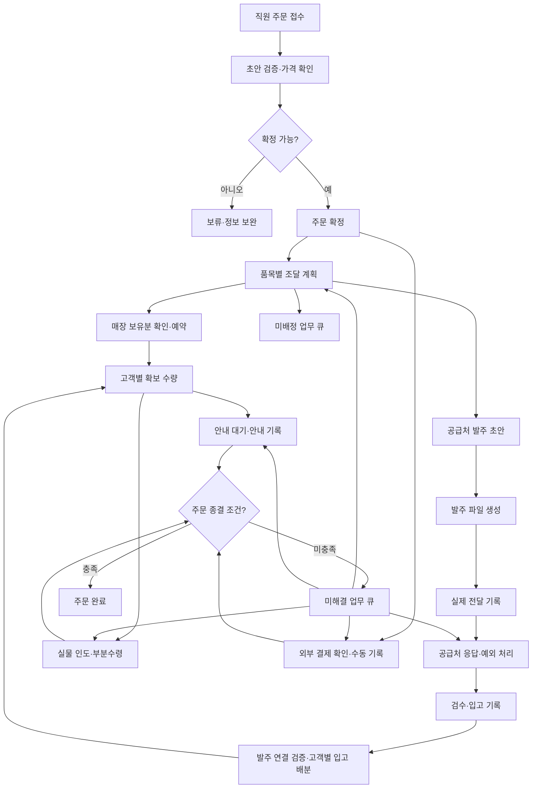

# Ordering Use Case 및 업무 프로세스 정의서 V1.3

> 기준: `Ordering Use Case V1.1`, `Ordering PRD V1.1` | 상태: **사용자 확정 정책 6건 반영 / 기타 미결정 유지** | 범위: 내부 운영 MVP P0, 고객·외부 연동 P1/P2

## 0. 문서 관리와 변경 원칙
- **[유지]** 기존 V1.0의 UC-01~20, PRD 요구사항 ID, P0/P1 분류를 보존한다.
- **[수정 제안]** 기존 UC의 조건·업무 규칙·실패 처리·테스트를 구체화한다. 승인되지 않은 제품 정책은 확정된 사실로 표현하지 않는다.
- **[신규 제안]** UC-21~25를 추가한다. P0 업무 완결에 필요한 공급처 관리·안내 템플릿·정정 및 미해결 업무 처리를 보강한다.
- **[확정: 사용자 정책]** YES24 API 도서 검색, 점주 주도 재고수량 관리, 카드·간편결제·계좌이체만 허용, 입고 후 고객 취소 물량은 공급처 반품 또는 매장 재고 편입.
- **[미결정]** 재고 조정 권한의 세부 설정, 공급처 반품 승인·비용·환불 시점, 주문번호 생성 시점, 부분입고 안내 기본값은 별도 결정한다.

## 1. 비판적 분석과 개선 결과
| 심각도 | 원본 V1.0의 문제 | 영향 | V1.1 조치 |
|---|---|---|---|
| 치명 | UC-05에서 초안 저장 후 확정 시 주문번호 부여로 읽히지만 ORD-003의 번호 부여 시점이 확정되지 않음 | 중복 주문·번호 정책 충돌 | 주문 ID와 표시 주문번호 분리, 생성 시점 결정항목으로 명시 |
| 치명 | UC-07 매장 보유분 예약에 가용 재고의 원천이 없음 | 없는 책을 확보로 안내 | 재고 검증 수준·예약/해제 이벤트·직원 실물 확인 조건 정의 |
| 치명 | UC-11 입고 배분이 발주 배분과 연결되어야 한다는 규칙이 선언적임 | 타 주문으로 잘못 귀속 | 동일 발주 품목의 유효 할당량 상한 및 예외 재배분 승인 규칙 |
| 높음 | UC-06 발주 전달 후 취소의 확정 시점·비용 책임 미정 | 물량·금전 분쟁 | 취소 요청, 공급처 취소 결과, 물량 처리, 고객 안내를 분리 |
| 높음 | UC-14 P0 단일 결제 기록과 정정·환불 예외 경계가 흐림 | 잔액 불일치 | P0 수동 결제 정정 및 환불 필요 큐, P1 환불 실행 UI 구분 |
| 높음 | UC-13/14의 순서가 도식에서 고정됨 | 선결제·후결제 흐름 왜곡 | 수령과 결제를 병렬 업무로 모델링 |
| 높음 | 완료 조건의 취소·보류·분쟁 처리 미흡 | 잘못된 완료 처리 | 품목 단위 종결, 잔액, 미해결 업무 기준 추가 |
| 중간 | SUP-001/002와 템플릿 관리가 독립 UC로 부족 | 기능 책임·테스트 누락 | UC-21/22 추가 |
| 중간 | 입고·수령·결제 정정의 일관된 절차 부족 | 원장 조용한 수정 | UC-23 정정·역거래 프로세스 추가 |
| 중간 | 장기 미수령·안내 실패·취소 후속 큐의 종료 기준 없음 | 누락·중복 대응 | UC-24 예외 큐 관리 추가 |
| 중간 | 개인정보 접근·다운로드의 상세 제어 부족 | 정보 노출 | UC-25 개인정보·보안 운영 추가 |
| 중간 | TC 16개로 경계·동시성·역할을 충분히 검증할 수 없음 | 출시 후 오류 | TC-17~36 추가 |

## 2. 행위자와 시스템 경계
| 행위자 | 허용 업무 | 핵심 제한 |
|---|---|---|
| Owner | 서점 개설·설정, 직원 권한, 민감 변경 승인, 운영 업무 | 자신의 활성 Membership 범위만 |
| Staff | 주문·고객·도서·발주·입고·배분·안내·수령·결제 기록 | Owner 승인 필요 작업은 직접 확정 불가 |
| Customer (P1) | 공개 주문·본인 조회·변경 요청 | 본인 확인 후 공개 정보만 |
| Platform Admin (P1) | 테넌트·장애·구독 지원 | 기본적으로 고객 원문 데이터 접근 금지 |
| 공급처 | 외부 채널을 통한 발주 접수·회신 | P0 앱 계정 없음; 직원이 회신을 기록 |
| YES24 도서정보 API | ISBN·도서명·저자 검색의 단일 기본 외부 검색 경로 | API 응답 범위·이용 약관·미등록 도서 처리 정책 검증 필요 |
| 외부 메시지 채널 | 직원이 직접 메시지 전송 | 복사·공유만으로 실제 발송 증명 불가 |

**시스템 경계:** P0는 카드·간편결제 승인, 은행 입금 확인 자동화, 환불 송금, 공급처 자동 주문, SNS 메시지 자동 발송을 수행하지 않는다. 단, **점주가 직접 관리하는 매장 재고 수량·예약·입출고 조정 원장**은 P0에 포함한다. 외부 결제는 증빙 또는 직원 확인 후 기록하며, 실제 결제수단은 카드·간편결제·계좌이체만 허용한다.

## 3. 전체 업무 흐름 (수정)

**주의:** 고객 안내와 수령의 순서도 상황에 따라 달라질 수 있다. 수령·결제는 병렬로 진행 가능하며 완료는 독립 업무의 집계 결과다. 다이어그램의 화살표는 대표 경로이지 모든 예외의 상태 전이표가 아니다.

## 4. 공통 Use Case 작성 규격
각 UC는 `ID / 우선순위 / 주 행위자 / 트리거 / 사전조건 / 정상 흐름 / 대체 흐름 / 오류·복구 / 사후조건 / 권한·수량 규칙 / 관련 PRD·화면 / 테스트`로 관리한다. 모든 P0 쓰기 작업은 **서버에서 인증·활성 소속·역할·동일 tenant_id 참조·상태·수량·멱등성**을 검증하고, 성공은 DB 커밋 이후 반환한다. 금액·수량 수정은 원본을 조용히 덮어쓰지 않는다.

## 5. P0 상세 Use Case — 수정본

### UC-01 회원가입·서점 생성
- **행위자/트리거:** Owner / 신규 서점 개설.
- **사전조건:** 인증 가능한 계정, 중지되지 않은 사용자, 서점 생성 정책 충족.
- **정상 흐름:** ① 로그인·이메일 검증 ② 서점 정보 입력 ③ 중복·필수값 검증 ④ Tenant와 Owner Membership 원자적 생성 ⑤ 생성 결과 확인.
- **대체·오류:** 이미 가입한 계정은 기존 계정으로 진행; 동일 요청 키 재시도는 동일 결과; 중간 실패 시 Tenant만 생성된 상태를 남기지 않는다.
- **사후조건/인수:** 활성 테넌트와 Owner 소속이 일관되게 존재; 타 테넌트 접근 불가.
- **추가 검증:** 초대 수락으로 가입한 직원이 임의로 기존 서점 Owner가 되지 못함.
- **연결:** AUTH-001/002/006/007, 온보딩, TC-01/14/17.

### UC-02 직원 초대·권한 관리
- **행위자:** Owner. **사전조건:** 해당 서점의 활성 Owner 소속.
- **정상 흐름:** ① 이메일·역할 입력 ② 만료 기한 있는 초대 발행 ③ 사용자 수락 ④ Membership 활성화 ⑤ 변경 감사 기록.
- **대체·오류:** 기존 계정 추가 소속 가능; 중복 초대 경고; 만료·재사용 초대 토큰 거부; 비활성화 직후 기존 세션 서버 요청 거부.
- **사후조건:** 권한 이력과 초대 상태 추적.
- **연결:** AUTH-003/004/006, 설정, TC-14/18.

### UC-03 고객 등록·조회·수정
- **행위자:** Staff. **사전조건:** 고객 관리 권한.
- **정상 흐름:** ① 이름·연락 수단 입력 ② 전화번호 정규화 ③ 동일 서점 중복 후보 표시 ④ 기존 고객 선택 또는 신규 생성 ⑤ 주문 연결.
- **대체·오류:** 연락처 없는 고객의 접수는 DEC-12 정책에 따라 제한; 동명이인·가족 공유 번호 자동 병합 금지; 다른 서점 고객은 검색 불가.
- **사후조건:** 서점 소유 고객 및 수정 이력.
- **연결:** CUS-001~005, 고객관리/O-03, TC-01/19.

### UC-04 YES24 API 도서 검색·도서 선택
- **행위자:** Staff. **트리거:** 주문 품목 선택.
- **정상 흐름:** ① ISBN/제목/저자 검색어 입력 ② 서버에서 YES24 API 호출 ③ 결과 목록과 출처 표시 ④ 도서 선택 ⑤ 서점의 판매가·재고 확인 ⑥ 주문 품목에 도서명·ISBN·단가·조회 시점 스냅샷 저장.
- **대체·오류:** YES24 API 실패·검색 결과 없음·ISBN 미등록 도서는 오류 및 미검색 사유를 표시하고 **수기 도서 등록으로 전환할 수 있다**. 다른 외부 도서 API로 자동 전환하지 않는다. 수기 등록 도서는 `source=MANUAL`, 등록자·등록시각·등록 사유를 남기고, ISBN이 없으면 내부 UUID로 식별한다. 확정 주문의 도서명·가격 스냅샷은 외부 메타데이터 갱신으로 자동 변경하지 않는다. 외부 메타데이터 변경으로 확정 주문 가격·서명 자동 변경 금지. API 이용권한·호출 제한·상업적 재사용 조건을 출시 전에 확인한다.
- **연결:** BOOK-001~005/007, O-03, TC-15/20.

### UC-05 고객 주문 등록·확정 **[수정]**
- **행위자:** Staff. **트리거:** 전화·방문·SNS 주문 접수.
- **사전조건:** 고객·품목·수량·가격·수령 방법 등 확정 필수정보 존재.
- **정상 흐름:** ① 초안 생성(내부 UUID) ② 고객·출처·품목·수량·단가·할인·수령 방법 입력 ③ 총액 및 동의 필요 항목 검증 ④ 주문 확정 트랜잭션 ⑤ 가격·품목 스냅샷 및 감사 기록 ⑥ 조달 대기 등록.
- **대체 흐름:** 필수 정보 미완료는 초안·보류; 주문번호 표시 부여 시점은 DEC-13에 따라 초안 또는 확정으로 확정하되 **내부 UUID와 분리**.
- **오류·복구:** 확정 멱등 키 재전송 시 기존 확정 결과 반환; 동시에 초안 수정/확정 충돌 시 버전 검증 후 재조회; 확정 이후 가격 덮어쓰기 금지.
- **사후조건:** 유효 주문 품목과 주문 스냅샷, 조달 대기 수량 존재.
- **연결:** ORD-001/003~007/012, PAY-006, O-03/O-04, TC-02/21.

### UC-06 주문 변경·취소 **[수정]**
- **행위자:** Staff; Owner 승인은 DEC-09에 따름.
- **사전조건:** 대상 주문 및 연결 발주·입고·배분·수령·결제 조회 가능.
- **정상 흐름:** ① 변경/취소 요청과 사유 입력 ② 영향 수량·금액·발주 전달 여부 분석 ③ 승인 필요 여부 판단 ④ 허용된 미이행 수량 변경 ⑤ 정정 이벤트 저장 ⑥ 후속 업무(공급처 취소·재배분·환불 필요·고객 안내) 생성.
- **대체 흐름:** 미전달 발주 배정 취소는 배정 해제 가능; 전달된 발주는 **공급처 취소 요청**만 생성하며 실제 공급처 취소 확정과 구분; 수령된 수량은 일반 취소가 아닌 반품/정정 프로세스로 이관.
- **오류·복구:** 미해결 공급처 물량·결제 차액이 있으면 단순 종결 차단; 원 주문·원 발주 기록 보존.
- **사후조건:** 주문 유효 수량과 미해결 후속 작업이 일관됨.
- **연결:** ORD-004/008/010/012, PO-010, O-04, TC-10/11/22.

### UC-07 조달 경로·수량 배정 **[수정]**
- **행위자:** Staff. **사전조건:** 확정 주문의 미배정 유효 수량 존재.
- **정상 흐름:** ① 품목별 미배정 수량 확인 ② 점주가 관리하는 매장 재고의 `on_hand - reserved` 가용 수량 조회 ③ 매장 보유분/신규 발주/기타 경로별 수량 지정 ④ 발주분 공급처 지정 ⑤ DB에서 활성 배정 합계와 재고 가용 수량 검증 ⑥ 재고 예약·조달 배정 이벤트를 하나의 트랜잭션으로 저장 ⑦ 미배정 잔량 표시.
- **대체 흐름:** 3권을 보유분 1권+공급처 2권 또는 공급처 X 2권+Y 1권으로 분리.
- **오류·복구:** 점주 등록 재고의 가용 수량을 초과하는 예약 금지. 재고 수량이 실제와 다르면 점주가 사유를 남기고 조정하며 이미 예약·인도된 수량을 침해하는 하향 조정은 차단하거나 예외 업무로 이관한다. 중복 예약·초과 배정 거부.
- **사후조건:** `active_sourcing_qty <= effective_order_qty`, 예약 해제 추적.
- **연결:** PO-001/009, O-04/O-06, TC-03/23.

### UC-08 공급처별 발주서 작성·전달 **[수정]**
- **행위자:** Staff. **사전조건:** 활성 공급처와 유효 조달 배정.
- **정상 흐름:** ① 공급처별 발주 대기 선택 ② 고객 주문별 배정 수량을 발주 품목에 연결 ③ 발주 초안 생성 ④ 파일 버전·내보내기 이력 기록 ⑤ 실제 외부 전달 ⑥ 전달 담당자·방식·시각·참조번호 기록.
- **대체 흐름:** 미전달 초안 수정·재출력; 동일 공급처 동일 ISBN 합산하되 도서 판형·에디션·단가 차이 확인.
- **오류·복구:** 파일 생성만으로 발주 전달 처리 금지; 발주 전달 후 변경은 원본 보존·변경 요청 이력; 발주 품목 수량을 초과하는 주문 배정 금지.
- **연결:** SUP-001/002, PO-002~006/009/010, O-05/O-06, TC-04/24.

### UC-09 공급처 응답·품절·지연 처리 **[수정]**
- **행위자:** Staff. **트리거:** 공급처 회신·예상 납기 변경.
- **정상 흐름:** ① 발주·회신 출처 선택 ② 공급처 확인/부분확정/품절/지연 수량과 사유 기록 ③ 영향받는 주문 품목 계산 ④ 대체 조달·고객 안내·취소 요청 업무 생성 ⑤ 후속 담당자 지정.
- **대체 흐름:** 일부만 확정; 다른 공급처로 재배정은 기존 발주 연결을 변경 이력으로 보존하고 중복 조달 방지.
- **오류·복구:** 회신 없는 발주를 공급처 확인 상태로 추정하지 않음; 품절 후에도 원 발주 수량·이력 유지.
- **연결:** PO-006/007/010, O-06, TC-25.

### UC-10 부분·전체 입고 등록 **[수정]**
- **행위자:** Staff. **사전조건:** 해당 서점 발주 품목 존재, 검수 권한.
- **정상 흐름:** ① 발주 선택 ② 차수·도착 품목·정상 수량 확인 ③ 기입고 및 잔량 확인 ④ 입고 트랜잭션 기록 ⑤ 미배분 정상 입고량 갱신.
- **대체 흐름:** 10권 중 6권·4권 차수별 입고; 파손·오배송은 정상 수량과 분리하고 P1 상세 반품 처리로 이관.
- **오류·복구:** 초과 입고 기본 차단, 승인 예외는 Owner·사유·후속 조달 목적 기록; 같은 요청 키 중복 처리 방지; 이미 인도된 수량을 침해하는 입고 취소 거부.
- **연결:** REC-001~004/009, O-07, TC-05/10/26.

### UC-11 입고 수량의 고객별 배분 **[강화]**
- **행위자:** Staff. **사전조건:** 정상 입고 잔량과 유효 발주→주문 배정 존재.
- **정상 흐름:** ① 입고 품목 선택 ② 같은 발주 품목에 연결된 고객 주문 품목만 제시 ③ 주문별 **미확보·미취소·발주 배정 잔량** 확인 ④ 수량 입력 ⑤ 서버 트랜잭션에서 입고 잔량·주문 잔량·해당 발주 배정 상한 검증 ⑥ Receipt Allocation 저장 ⑦ 확보 수량 및 안내 대기 갱신.
- **대체 흐름:** 고객 A 2/B 3/C 1 배분; 남은 수량 미배분으로 보존; 다른 고객으로 재배분하려면 기존 배분 해제의 유효성·안내·인도 영향을 확인하고 승인 이벤트 기록.
- **오류·복구:** 동시 1권 중복 배분 한 건만 성공; 타 발주 연결로 직접 배분 금지; 이미 수령한 배분의 단순 해제 차단.
- **사후조건:** `sum(receipt_allocation per receipt_item) <= net_accepted_qty`, `sum(receipt_allocation per order_item,po_item) <= active_order_po_allocation_qty`, 고객 확보량이 유효 미수령·미취소 한도를 넘지 않음.
- **연결:** REC-006~008, PO-009, O-07, TC-06~08/27/28.

### UC-12 고객 안내 및 결과 기록 **[수정]**
- **행위자:** Staff. **사전조건:** 안내 대상(입고 확보, 지연, 품절 등)과 연락 방법 존재.
- **정상 흐름:** ① 안내 대기 목록 ② 최신 고객 확보 수량·연락처 확인 ③ 템플릿 렌더링 ④ 직원이 외부 채널에서 발송 ⑤ 발송 **시도**·직원 확인 결과·채널·시각 기록 ⑥ 실패·재안내 큐 처리.
- **대체 흐름:** 부분입고 즉시 안내 또는 전량 확보 후 안내(DEC-05); 고객 연락 불가 시 다른 연락 수단 검토.
- **오류·복구:** 문구 복사만으로 발송 완료 금지; 외부 서비스 수신·읽음 상태 추정 금지; 배분 정정 시 기존 안내 내용과 현재 확보량 불일치 경고.
- **연결:** MSG-001~007/010, O-08, TC-12/29.

### UC-13 부분·전체 수령·정정 **[수정]**
- **행위자:** Staff. **사전조건:** 실물 인도 가능 수량 확인.
- **정상 흐름:** ① 주문·품목 선택 ② 확보·기수령·예약 보유분 확인 ③ 실물 인도 수량 입력 ④ 서버 검증 후 수령 거래 기록 ⑤ 미수령 잔량 갱신.
- **대체 흐름:** 3권 중 1권 선인도 후 2권; 결제는 수령 전·후 별도 기록 가능.
- **오류·복구:** 확보량 초과 인도 거부; 취소된 품목 인도 거부; 정정은 원 수령 참조 역거래·사유·승인 검증.
- **연결:** FUL-001/002/004, O-09, TC-09/30.

### UC-14 카드·간편결제·계좌이체 결제 기록·잔액 조회 **[수정]**
- **행위자:** Staff. **사전조건:** 외부 실제 거래 확인 및 기록 권한.
- **정상 흐름:** ① 주문 금액·조정·유효 결제·환불 기록 조회 ② **카드/간편결제/계좌이체 중 하나** 선택 ③ 실제 승인내역 또는 입금내역 확인 ④ 금액·시각·외부 참조·확인 담당자 입력 ⑤ 수동 기록 저장 ⑥ 잔액·미해결 결제 업무 갱신.
- **대체 흐름:** 선결제 또는 현장결제; P0 복수 결제 UI는 제공하지 않되, 선결제와 후속 잔액의 처리 가능 여부를 파일럿 전에 정책 확정.
- **오류·복구:** **현금 및 기타 결제수단 선택 금지**. 수동 기록이 카드·간편결제 승인이나 계좌이체 입금 확인을 자동 수행하지 않음; 중복 참조 경고·멱등 처리; 오기록은 삭제 대신 정정 이벤트; 취소로 환불 필요 시 P0에는 **환불 필요 업무 큐**를 생성하고 P1 환불 처리와 구분. 카드 취소, 간편결제 취소, 계좌이체 환급은 각각 원거래 참조와 실제 처리 결과를 기록한다.
- **연결:** PAY-001/002/006, O-09, TC-13/31.

### UC-15 대시보드·예외 업무 처리 **[수정]**
- **행위자:** Owner/Staff. **정상 흐름:** ① 활성 서점 선택 ② 주문 접수/발주 대기/공급처 지연/미배분 입고/안내 실패/미수령/미결제/취소 후속 집계 ③ 목록 클릭 ④ 같은 기준의 필터 목록 조회 ⑤ 담당 업무 처리.
- **오류·복구:** 집계와 목록 정의가 다르면 기준·조회 시각 표시; 타 서점 데이터 배제; 오류 업무를 단순 숨김으로 종결 금지.
- **연결:** DASH-001~005/008, O-01, TC-32.

### UC-16 검색·감사 이력·내보내기 **[수정]**
- **행위자:** Owner/Staff(권한별). **정상 흐름:** ① 주문번호·고객·기간·상태 검색 ② 타임라인 조회 ③ 내보내기 권한·필드 확인 ④ 필요한 데이터만 내보내기 ⑤ 내보내기 사유·행위자·시각 감사 기록.
- **오류·복구:** 타 테넌트 직접 ID 조회 차단; 개인정보 접근 제한; 대량 내보내기 실패 시 파일 접근 권한 및 만료 처리.
- **연결:** ORD-009/010, AUTH-006, O-02/O-04, TC-01/33.

## 6. 신규 P0 Use Case

### UC-21 공급처 등록·수정·비활성화 **[신규 제안]**
- **관련:** SUP-001/002, O-05, P0.
- **행위자:** Owner/허가된 Staff. **정상:** 공급처명·발주 채널·연락처·식별정보 입력 → 중복 후보 확인 → 저장 → 활성 공급처만 신규 발주 선택 가능.
- **대체·예외:** 기존 발주가 있는 공급처는 비활성화해도 과거 발주·입고 이력을 유지; 비활성 공급처로 새 발주 생성 차단; 재활성화는 권한 검증.
- **인수:** 공급처 비활성화가 과거 발주 데이터 삭제를 유발하지 않음. TC-34.

### UC-22 안내 템플릿 설정 **[신규 제안]**
- **관련:** MSG-001~004, O-08/설정, P0.
- **행위자:** Owner/허가된 Staff. **정상:** 주문접수·입고·지연·품절 템플릿 선택 → 허용 변수 입력 → 미리보기 → 저장 → 실제 안내 시 고객·주문 스냅샷으로 렌더링.
- **대체·예외:** 연락처·도서명 등 민감 변수의 외부 공개 제한; 잘못된 변수는 저장 차단 또는 안전한 대체 문구 표시; 템플릿 변경이 과거 발송 이력을 바꾸지 않음.
- **인수:** 발송 당시 사용한 템플릿 버전 또는 렌더링 문구 추적 가능. TC-35.

### UC-23 거래 정정·역거래 관리 **[신규 제안]**
- **관련:** REC-009, FUL-004, PAY-006, ORD-012, P0.
- **행위자:** 허가된 Staff, 고위험 정정은 Owner 승인(DEC-09).
- **정상:** 정정 대상 원거래 선택 → 정정 사유·수량·금액 입력 → 하위 거래(배분·안내·수령·결제) 영향 분석 → 허용 시 역거래 또는 보정 거래 기록 → 관련 상태 재계산.
- **오류:** 이미 인도된 입고 배분을 무효화하거나 유효 결제액을 음수로 만드는 정정은 일반 경로 차단; 원본 물리 삭제 금지.
- **인수:** 정정 전후 수량·금액을 원거래 참조로 재구성 가능. TC-10/36.

### UC-24 예외 업무 큐 생성·종결 **[신규 제안]**
- **관련:** DASH-008, PO-007/010, MSG-006/007, P0.
- **행위자:** Owner/Staff. **정상:** 품절·지연·취소 후속·미배분·안내 실패·장기 미수령·환불 필요 발생 → 원거래 링크와 사유로 업무 생성 → 담당자 확인 → 조치·근거 입력 → 해결 조건 검증 후 종결.
- **대체·오류:** 해결 전 임의 완료 처리 차단; 동일 원인 중복 큐는 식별·병합 정책 검토; 취소된 주문의 미해결 공급처 비용이 자동으로 사라지지 않음.
- **인수:** 큐의 건수와 미해결 원거래를 상호 추적 가능. TC-32/36.

### UC-25 개인정보·권한 보호 운영 **[신규 제안]**
- **관련:** AUTH-006, CUS-005, 개인정보·감사 요구, P0(접근통제)/P1(삭제·익명화 요청).
- **행위자:** Owner/허가된 Staff; Platform Admin은 P1.
- **정상:** 고객 연락처·배송지·내부 메모 접근 권한 검증 → 필요한 화면·내보내기 필드만 반환 → 열람/다운로드 등 정책상 필요한 중요 행위 감사.
- **대체·오류:** 테넌트 경계, 추측 가능한 ID, 비활성 직원, 잘못된 연관 tenant_id 요청 모두 거부; 마케팅 동의와 주문 안내 목적 분리.
- **인수:** RLS와 서버 검증을 각각 테스트; 클라이언트가 임의 tenant_id를 보내도 접근 불가. TC-01/14/33.

## 7. P1 Use Case (기존 범위 유지, 상세화 전 조건)
- **UC-17 고객 공개 주문:** 서점 공개 페이지 식별, 개인정보 동의, 서버 입력 검증, 요청 빈도 제한·멱등 키; 제출은 직원 확인 대기이며 자동 발주 아님. 공개 주문 P1 조정은 DEC-01 승인 필요.
- **UC-18 고객 본인 주문 조회·변경 요청:** OTP 등 본인 확인, 주문 존재 여부 비노출, 공개 필드만 반환, 요청과 실제 취소 승인 분리.
- **UC-19 공식 알림톡/SMS:** 계약·템플릿 승인, 서버 비밀키, 서명된 웹훅 검증, 중복 수신 멱등성, 사업자 접수/전달/읽음 구분.
- **UC-20 복수 결제·환불·배송:** 원 결제 참조 환불, 복수 결제 기록, 송장·발송 이력; PG/VAN 등을 통한 실제 카드·간편결제 승인·취소/환불 연동은 P2 확장 기능으로 설계한다.

## 8. 상태·수량·금액 불변 규칙

### 8.1 주문 및 조달
1. `ordered_qty > 0`, `0 <= cancelled_qty <= ordered_qty`, `effective_qty = ordered_qty - cancelled_qty`.
2. `active_sourcing_qty <= effective_qty`; 미배정 수량은 별도 업무 큐로 표시.
3. 발주 품목별 활성 고객 배정 합계는 발주 수량 이하. 서점 자체 재고 확보 목적의 잔여 발주는 별도 표시.
4. **고객별 실제 확보 수량**은 유효 `Receipt Allocation` + 점주 관리 재고에서 원자적으로 예약된 수량이다. `available_qty = on_hand_qty - reserved_qty`이며 `0 <= reserved_qty <= on_hand_qty`를 유지한다.
5. 발주 품목별 `receipt_allocation_qty <= net_accepted_receipt_qty`; 고객 주문 품목별 해당 발주 배분량도 초과할 수 없다.
6. `fulfilled_qty <= valid_secured_qty`이며 취소·반품·정정을 반영한다.
7. 수령된 수량을 침해하는 배분·입고·주문 취소는 단순 상태 변경으로 처리하지 않는다.
8. 동시 발주 배분·입고 배분·수령은 DB 잠금/조건부 갱신/제약과 트랜잭션으로 검증한다.

### 8.2 금액·완료
1. 주문 금액은 확정된 품목 가격·수량·할인·배송비(정책 적용 시)·승인된 가격 조정에 기반한다.
2. `remaining_amount = effective_order_total - net_valid_payment` (유효 환불은 순결제액에서 차감). 음수 잔액 발생 시 정책상 초과수납·환불 필요 업무를 생성한다.
3. 수동 결제 기록은 외부 실제 거래에 대한 직원 기록이지 PG 승인·은행 정산이 아니다.
4. 주문 **완료**는 모든 유효 품목의 수령/인도 종료, 결제 정책 충족, 미해결 필수 업무 없음이 충족될 때만 가능하다. 전량 취소 주문은 완료가 아닌 **취소 종결**로 구분한다.
5. 공급처 발주 취소 요청은 공급처가 실제 취소를 승인한 사실과 다르다.

### 8.3 주요 상태 전이
| 객체 | 전이 | 검증 | 실패/후속 |
|---|---|---|---|
| 주문 | 초안→확정 | 필수정보·가격 스냅샷·멱등성 | 보류 또는 수정 |
| 주문 | 확정→취소요청/취소종결 | 발주·입고·인도·결제 영향 | 공급처 취소·환불 필요 큐 |
| 발주 | 초안→전달 | 실제 전달 방식·시각·담당자 | 파일 출력만으로 전이 불가 |
| 발주 | 전달→공급처확인 | 응답 근거 | 자동 확정 금지 |
| 입고 | 미입고→부분/완료 | 정상 검수 수량·발주 잔량 | 초과입고 예외 승인 |
| 배분 | 미배분→고객확보 | 발주 연결·유효 주문량·순입고량 | 초과·중복 차단 |
| 안내 | 대기→발송시도→직원결과기록 | 대상·최신 확보량 | 복사만으로 완료 불가 |
| 수령 | 대기→부분/완료 | 유효 확보량·기수령량 | 초과 인도 차단 |
| 결제 | 미결제→수동기록 | 실제 거래 근거·중복 방지 | 정정 또는 환불 필요 큐 |
| 주문 | 처리중→완료 | 수령·결제·필수 후속 업무 종료 | 완료 보류 |

## 9. 교차 시나리오 및 테스트 명세
기존 **TC-01~16 유지**, 아래 TC-17~36을 추가한다. 테스트는 정상 결과뿐 아니라 실패 시 DB 원자성·감사 이력·권한 차단을 검증한다.

| ID | 시나리오 | 기대 결과 | UC |
|---|---|---|---|
| TC-01 | 다른 서점 주문 ID 직접 조회 | 정보 비노출·접근 차단 | 전체 |
| TC-02 | 같은 주문 확정 키 2회 | 주문 확정 1회 | 05 |
| TC-03 | 주문 3권, 공급처 X2/Y1 | 배정 합계 3 | 07 |
| TC-04 | 발주서 다운로드만 실행 | 전달 전 상태 유지 | 08 |
| TC-05 | 10권 발주, 6+4 입고 | 누적 정상 입고 10 | 10 |
| TC-06 | 6권 입고, A2/B3/C1 배분 | 합계 6, 미배분 0 | 11 |
| TC-07 | 마지막 1권 동시 배분 | 한 트랜잭션만 성공 | 11 |
| TC-08 | 입고 2권에 3권 배분 | 전부 거부·롤백 | 11 |
| TC-09 | 확보 3권을 1+2 수령 | 누적 수령 3 | 13 |
| TC-10 | 수령 3권인데 원 입고 1권 취소 | 직접 취소 거부 | 10/23 |
| TC-11 | 발주 전달 후 고객 취소 | 공급처 취소와 분리 | 06/09 |
| TC-12 | 문구 복사 후 결과 미기록 | 발송 완료 표시 금지 | 12 |
| TC-13 | 수동 결제 기록 | PG 승인·정산으로 표시 안 함 | 14 |
| TC-14 | 직원 비활성화 후 기존 세션 | API 거부 | 02/25 |
| TC-15 | 도서 API 오류 | 수기 등록 가능 | 04 |
| TC-16 | 고객 조회 OTP 실패(P1) | 주문 상세 비노출 | 18 |
| TC-17 | 테넌트 생성 도중 실패·재시도 | 고아 Tenant·중복 Membership 없음 | 01 |
| TC-18 | 만료·재사용 직원 초대 | 수락 거부, 권한 미부여 | 02 |
| TC-19 | 같은 이름/공유 전화번호 고객 | 자동 병합 없음 | 03 |
| TC-20 | 확정 후 도서 마스터 가격 변경 | 주문 가격 스냅샷 유지 | 04/05 |
| TC-21 | 주문 초안 동시 수정·확정 | 버전 충돌 탐지·원자적 확정 | 05 |
| TC-22 | 부분수령 이후 주문 전체 취소 | 단순 취소 차단·후속 처리 | 06 |
| TC-23 | 가용 보유분 1권 동시 예약 | 이중 확보 방지 | 07 |
| TC-24 | 발주 전달 후 파일 재출력 | 기존 전달 버전·변경 이력 유지 | 08 |
| TC-25 | 공급처 일부 품절 후 재조달 | 중복 발주 배정 없음, 후속 큐 | 09 |
| TC-26 | 입고 요청 재시도·중복 제출 | 같은 차수 중복 입고 없음 | 10 |
| TC-27 | 타 발주 품목의 입고를 고객에게 배분 | 관계 위반 거부 | 11 |
| TC-28 | 고객별 발주 배정 1권에 입고 2권 배분 | 1권 초과 거부 | 11 |
| TC-29 | 배분 변경 후 기존 안내 문구 | 최신 수량 경고·기존 발송 이력 보존 | 12 |
| TC-30 | 수령 마지막 1권 동시 인도 | 중복 수령 차단 | 13 |
| TC-31 | 결제 참조번호 중복·오기록 정정 | 중복 경고·원기록 추적 | 14/23 |
| TC-32 | 예외 업무 해결 전 완료 처리 | 완료 차단·업무 큐 추적 | 15/24 |
| TC-33 | Staff 개인정보 내보내기 권한 없음 | 다운로드 거부·감사 기록 | 16/25 |
| TC-34 | 과거 발주가 있는 공급처 비활성화 | 과거 이력 유지·신규 발주 차단 | 21 |
| TC-35 | 템플릿 변경 후 과거 안내 조회 | 과거 문구·버전 보존 | 22 |
| TC-36 | 입고 정정으로 이미 인도한 물량 침해 | 정정 차단·후속 업무 생성 | 23/24 |

## 10. 의사결정 기록 (확정 필요)
| ID | 항목 | 권장안 | 상태 |
|---|---|---|---|
| DEC-01 | 고객 공개 주문 첫 MVP 포함 | P1 후속 | 승인 필요 |
| DEC-02 | 보유분 예약·가용 수량 원천 | 점주가 재고수량을 등록·조정, 예약/해제 원장으로 가용 수량 관리 | **사용자 확정** |
| DEC-03 | Receipt Allocation | P0 필수 | 승인 필요 |
| DEC-04 | 전달된 발주 취소 | 요청·회신·물량 처리 분리 | 승인 필요 |
| DEC-05 | 부분입고 안내 | 직원 선택, 서점별 기본값 추후 | 미결정 |
| DEC-06 | 취소 시 환불·결제 처리 | 결제수단은 카드/간편결제/계좌이체만 허용; 실제 취소·환급 연동 및 시점은 미결정 | **결제수단 확정 / 환불 절차 미결정** |
| DEC-07 | 장기 미수령 경고 | 서점별 설정, 자동 취소 없음 | 미결정 |
| DEC-08 | 확정 후 가격 변경 동의 | 사유·고객 동의 이력 | 미결정 |
| DEC-09 | 민감 취소·정정 승인 권한 | 일반 Staff와 Owner 분리 | 미결정 |
| DEC-10 | 완료 판정 | 수령·결제 정책·미해결 업무 확인 | 승인 필요 |
| DEC-11 | 수령/결제 선후 | 독립 처리 | 승인 필요 |
| DEC-12 | 고객 최소정보·보유 정책 | 법률·운영 검토 | 미결정 |
| DEC-13 **신규** | 표시 주문번호 부여 시점 | 내부 UUID는 초안 생성, 표시번호는 확정 시 권장 | 승인 필요 |
| DEC-14 **신규** | P0 선결제 후 잔액·복수 결제 | 단일 기록 범위와 예외 처리 확정 | 승인 필요 |
| DEC-15 **신규** | 발주 배분 재할당 권한 | 기존 배분 이력 보존·Owner 승인 조건 정의 | 승인 필요 |
| DEC-16 **신규** | 미해결 예외 업무의 종결 기준 | 원인별 증빙·담당자·종결 조건 정의 | 승인 필요 |

## 11. 개발 추적성과 출시 차단 기준
- 각 UC는 `UC ID → PRD 요구 ID → 화면 → API/트랜잭션 → DB 테이블/제약 → RLS → TC ID`로 연결한다.
- **출시 차단:** 테넌트 격리, 직원 비활성화, 초과/중복 배분, 부분입고, 발주 전달 후 취소, 정정, 중복 결제 기록, 민감정보 내보내기, 백업·복구 테스트.
- **개발 순서:** DEC 승인 → 상태 전이/수량 원장 → 화면 FRD → DB/ERD/RLS → API → 자동화 테스트 → Bolt.new/Claude Code 구현 → 파일럿.
- **P1 착수 전:** UC-17~20을 P0와 동일한 상세 템플릿으로 확장하고 고객 인증·메시지 웹훅·환불·배송 정책을 확정한다.

## 12. 변경 이력
- **V1.0:** UC-01~20, 16개 교차 테스트 및 기본 상태 규칙 작성.
- **V1.1:** 원본 20개 UC의 업무 조건·실패 복구를 강화; UC-21~25 추가; TC-17~36 추가; 주문번호·보유분·배분 연결·취소 후속·결제 경계를 명시; 미결정 사항 DEC-13~16 추가.
- **승인 상태:** 본 V1.1은 PRD V1.1의 미확정 정책을 자동 승인하지 않는다.

## 13. 사용자 확정 운영 정책 및 추가 Use Case (V1.2)

### 13.1 정책 확정 사항
| 정책 ID | 확정 내용 | 구현 필수 조건 | 남은 확인 사항 |
|---|---|---|---|
| POL-BOOK-01 | 모든 외부 도서 검색은 YES24 API를 기본·단일 검색 경로로 사용 | 서버 측 API 어댑터, ISBN/제목/저자 검색, 출처/조회 시각, 장애 표시 | YES24 실제 제공 검색 범위·계약·이용 제한, 미등록 독립출판물 수기 등록 허용 확정; API 이용조건 |
| POL-INV-01 | 점주가 매장 보유 도서의 수량을 직접 등록·관리 | 초기 수량·증감 조정·예약·해제·인도·취소 후 재고 편입 원장 | Staff 조정 권한, 실사 주기, 마이너스 재고 허용 여부(기본 금지) |
| POL-PAY-01 | 카드·간편결제·계좌이체만 허용 | 세 수단 외 입력 거부, 외부 승인/입금 증빙과 내부 기록 분리 | 실제 카드·간편결제 승인 연동은 P2 확장 기능 확정; 사업자·간편결제 세부 종류는 미결정 |
| POL-CAN-01 | 입고된 고객 주문이 취소되면 공급처 반품 또는 매장 재고 보유 | 취소 물량의 최종 귀속 선택·수량 이력·후속 업무 | 반품 가능 여부·배송비·환불 시점·결정 권한 |

**용어:** `매장 재고 편입`은 고객 주문에 배분된 확보 수량을 해제하고 점주 관리 재고로 전환하는 행위다. `공급처 반품`은 반품 요청만으로 완료되지 않으며 공급처 수락·실제 출고·최종 확인을 구분한다. 출판사와 총판은 반품처 유형으로 구분한다.

### UC-26 점주 재고 도서 등록·수량 조정 [신규 P0]
- **주 행위자:** Owner. **트리거:** 매장 보유 도서 등록, 재고 조사, 재고 수량 변경.
- **사전조건:** 활성 서점과 도서 식별자. 도서 선택은 YES24 검색 결과를 우선 사용한다.
- **정상 흐름:** ① 도서 검색·선택 ② 매장 현재 보유 수량 입력(최초 등록) ③ 기존 수량·예약·가용 수량 확인 ④ 증가/감소 사유 입력 ⑤ `Stock Movement` 생성 ⑥ 가용 수량 재계산 ⑦ 재고 변경 감사 기록.
- **대체 흐름:** 재고 편입, 실사 차이, 파손·분실, 고객 주문 예약 해제 등 사유별 이동 유형을 구분한다. 주문 취소로 재고 편입하는 경우 UC-28을 사용한다.
- **오류·복구:** 수량 음수 금지; 예약량보다 작은 보유 수량으로 조정 금지; 동시 조정은 잠금·버전 검증; 이력 물리 삭제 금지.
- **사후조건:** `on_hand >= reserved >= 0`, `available = on_hand - reserved`. **연결:** POL-INV-01, UC-07, TC-37~39.

### UC-27 주문용 매장 재고 예약·해제·인도 [신규 P0]
- **주 행위자:** Staff(점주가 허용한 경우) / Owner.
- **정상 흐름:** ① 확정 주문의 조달 미배정 수량 조회 ② 매장 가용 수량 확인 ③ 주문 품목에 예약 ④ 고객 확보 수량 갱신 ⑤ 수령 시 예약 감소와 보유 수량 감소를 같은 트랜잭션에 반영.
- **대체 흐름:** 주문 취소 전 미인도 수량은 예약 해제해 가용 재고로 복귀. 이미 인도된 수량은 단순 예약 해제 불가.
- **오류·복구:** 두 주문이 마지막 1권을 동시에 예약할 경우 한 건만 성공. 예약 해제 중복 호출 방지. **연결:** POL-INV-01, UC-06/07/13, TC-40~41.

### UC-28 입고 후 고객 주문 취소 및 물량 처분 [신규 P0]
- **주 행위자:** Owner 또는 승인된 Staff.
- **사전조건:** 고객 주문 취소 요청, 해당 주문에 실제 입고·고객별 배분된 미인도 도서 존재.
- **정상 흐름:** ① 주문·입고·배분·기수령·결제 현황 확인 ② 미인도 취소 가능 수량 계산 ③ 고객 취소 사유 기록 ④ 취소 대상 확보량의 고객 귀속 해제 ⑤ **공급처 반품** 또는 **매장 재고 편입** 선택 ⑥ 선택 경로에 따라 후속 원장/업무 생성 ⑦ 고객 안내·환불 필요 여부 생성 ⑧ 물량 처리와 결제 후속 완료 여부에 따라 취소 종결.
- **공급처 반품 경로:** 반품 요청 → 공급처(출판사/총판) 수락 여부 확인 → 반품 대상 물량 별도 보관/표시 → 실제 반품 출고 → 반품 완료 확인. 거절 시 매장 재고 편입 또는 별도 예외 큐로 재판단.
- **매장 재고 편입 경로:** 기존 고객 배분 해제 → 해당 도서의 매장 재고 수량 증가 → 재고 원장에 `CANCEL_TO_STOCK` 사유와 원 입고·주문 참조 저장. **동일 물량이 입고 미배분 재고와 매장 재고에 동시에 잡히지 않도록** 한 번만 전환한다.
- **오류·복구:** 이미 고객에게 인도한 물량은 일반 취소 대상에서 제외하고 반품/교환 정책으로 이관; 공급처 반품 요청 상태를 반품 완료로 간주하지 않음; 반품과 재고 편입 동시 선택 금지; 재시도 중복 입고/편입 금지.
- **사후조건:** 취소 물량은 `반품 처리중/완료` 또는 `매장 재고 편입 완료` 중 정확히 하나의 처분 경로에 귀속. 환불 필요 시 금전 업무가 별도로 추적됨. **연결:** POL-CAN-01, UC-06/10/11/23/24, TC-42~46.

### UC-29 결제수단 제한 및 취소 후 환급 추적 [신규 P0/P1]
- **주 행위자:** Staff/Owner. **P0:** 결제 기록·환급 필요 업무. **P1:** 환불 처리 UI. **P2:** 실제 카드·간편결제 승인·취소/환불 연동 구현(사업자 계약·지원 범위 확인 후). 계좌이체는 입금 확인 연동 가능성 별도 검증.
- **정상 흐름:** ① 카드/간편결제/계좌이체 중 선택 ② 실제 거래 증빙 확인 ③ 금액·참조번호·결제 시각·확인자 기록 ④ 주문 잔액 갱신 ⑤ 취소 시 원 결제수단과 환급 필요 금액 확인 ⑥ 환급 완료 여부 및 증빙 기록(단계별 지원 범위 준수).
- **오류·복구:** 현금·포인트·상품권·기타 수단 금지; 카드/간편결제의 실제 승인 성공을 내부 기록만으로 추정 금지; 계좌이체는 입금 확인 전 결제 완료 표시 금지; 중복 환급 방지.
- **연결:** POL-PAY-01, UC-14/20/23, TC-47~49.

### 13.2 상태 및 데이터 변경 요구
- **추가 논리 엔터티:** `Store Stock`, `Stock Movement`, `Stock Reservation`, `Cancellation Disposition`, `Supplier Return`, `Supplier Return Item`.
- **Store Stock:** `tenant_id`, `book_id`, `on_hand_qty`, `reserved_qty`, `version`; 유일성 `(tenant_id, book_id)`는 도서 판형/에디션 식별을 고려해 최종 확정한다.
- **Stock Movement:** `movement_type`(INITIAL/ADJUST_IN/ADJUST_OUT/DELIVER/CANCEL_TO_STOCK 등), `qty_delta`, `reason`, `reference_type/id`, `actor_id`, `occurred_at`; 입출고 및 조정의 단일 근거.
- **Stock Reservation:** 주문 품목, 예약량, 해제량, 인도량, 유효 상태; 주문당 중복 예약·과다 인도 차단.
- **Cancellation Disposition:** 주문 품목, 원 입고 배분 참조, 취소 수량, 처분 경로(`RETURN_TO_SUPPLIER`/`KEEP_IN_STOCK`), 처리 상태, 승인자, 사유.
- **Supplier Return:** 공급처 유형(출판사/총판), 요청·수락·출고·완료 시각, 반품 수량, 반품 참조번호, 거절 사유.
- **결제:** `payment_method`는 `CARD`, `EASY_PAY`, `BANK_TRANSFER`로 제한. `payment_status`는 `PENDING_VERIFICATION`, `CONFIRMED`, `VOIDED` 등을 구분하며 실제 외부 승인/입금 확인과 내부 기록을 혼동하지 않는다.
- **수량 불변식:** `on_hand >= reserved >= 0`; 취소된 미인도 입고 배분 수량 = 공급처 반품 처분 수량 + 재고 편입 처분 수량 + 미결정 처분 대기 수량. 반품 완료와 재고 편입 완료의 중복 귀속 금지.
- **정합성:** 주문 취소·고객별 배분 해제·처분 경로 생성·재고 편입은 동일 DB 트랜잭션 또는 실패 복구 가능한 상태 기계로 관리한다. 실제 외부 반품은 비동기 후속 업무다.

### 13.3 추가 검증 시나리오
| 테스트 ID | 검증 내용 | 기대 결과 |
|---|---|---|
| TC-37 | 점주가 도서 재고 5권 최초 등록 | 보유 5, 예약 0, 가용 5 및 원장 기록 |
| TC-38 | 보유 5·예약 3 상태에서 보유 2로 조정 | 예약량 침해로 거부 또는 별도 예외 처리 |
| TC-39 | 재고 조정 동시 요청 | 유실 업데이트 없이 정합성 유지 |
| TC-40 | 마지막 재고 1권을 두 주문이 동시 예약 | 정확히 1건만 성공 |
| TC-41 | 예약 2권 중 1권 인도, 1권 취소 | 보유·예약·가용 수량과 인도 이력 일치 |
| TC-42 | 입고된 주문 2권 취소 후 재고 보유 | 고객 귀속 해제, 매장 재고 +2, 중복 편입 없음 |
| TC-43 | 입고된 주문 2권 취소 후 공급처 반품 | 반품 요청→수락→출고→완료 구분, 재고 미편입 |
| TC-44 | 공급처 반품 거절 | 재고 편입 또는 예외 재처리, 임의 완료 금지 |
| TC-45 | 취소 처분 요청 중복 제출 | 재고 편입·반품 요청 중복 없음 |
| TC-46 | 이미 인도된 도서 취소 | 일반 취소 차단, 별도 반품/교환 절차 |
| TC-47 | 현금·기타 결제수단 입력 | 서버·UI 모두 거부 |
| TC-48 | 계좌이체 미확인 | 결제 완료 상태 금지 |
| TC-49 | 카드·간편결제 수동 기록 후 주문 취소 | 원거래 참조 환급 필요 업무 생성, 승인 취소 완료로 오인 금지 |
| TC-50 | YES24 API 오류 또는 미검색 | 오류/미검색 표시, 다른 외부 API 자동 사용 금지, 수기 등록 가능; 다른 외부 API 자동 전환 금지 |

### 13.4 기존 의사결정 변경 및 남은 정책
| ID | 내용 | V1.2 상태 |
|---|---|---|
| DEC-02 | 점주 주도 재고수량 관리·예약·해제 | **확정** |
| DEC-06 | 카드/간편결제/계좌이체 한정 | **수단 확정**, P2 실제 승인·취소/환불 연동 방향 확정; P0/P1 수동 환급 절차 상세 미결정 |
| DEC-17 | YES24 API 단일 기본 도서 검색 경로 | **확정**, 미검색·ISBN 없는 도서 수기 등록 허용; API 범위 확인 필요 |
| DEC-18 | 입고 후 취소 물량: 공급처 반품 또는 재고 보유 | **확정**, 반품 거절·비용·결정 권한 미결정 |
| DEC-19 | 점주 재고 초기 수량·수정 권한 | 점주 직접 관리 **확정**, Staff 위임 범위 미결정 |
| DEC-20 | 현금·기타 결제수단 제외 | **확정** |

## 14. 변경 이력 추가
- **V1.2:** 사용자 확정 정책 4건 반영. UC-04/07/14 개정, UC-26~29 추가, TC-37~50 추가, 재고 원장·취소 물량 처분·결제수단 제한 규칙 추가. 기존 V1.1의 다른 미결정 정책은 유지.

---

# V1.3 추가 확정 정책 및 Use Case 개정 (2026-11-21)

> **적용 우선순위:** 본 V1.3 부록은 V1.2의 충돌하는 미결정 문구보다 우선한다. 기존 UC 번호는 유지하고 UC-30을 추가한다. 아래 확정사항 외 기존 미결정 항목은 유지한다.

## A. 사용자 확정 정책
| 정책 ID | 상태 | 확정 내용 | 단계 |
|---|---|---|---|
| POL-BOOK-02 | 확정 | YES24 API에 검색되지 않는 독립출판물, ISBN 미등록 도서는 직원이 수기로 등록할 수 있다 | P0 |
| POL-PAY-02 | 확정 | 결제수단은 카드·간편결제·계좌이체만 허용한다. P0는 외부 결제 결과의 수동 기록, P2 확장 기능은 실제 카드·간편결제 승인 및 취소/환불 연동을 목표로 한다 | P0/P2 |

## B. UC-04 개정 — YES24 검색 및 수기 등록
- **행위자:** Owner/Staff.
- **사전조건:** 활성 테넌트 소속, 도서 등록 권한.
- **기본 흐름:** ① ISBN·제목·저자로 YES24 검색 ② 검색 결과 선택 ③ 도서 메타데이터와 출처 저장 ④ 서점별 가격·재고 확인 ⑤ 주문 시점 스냅샷 생성.
- **대체 흐름 A(미검색):** 검색 결과가 없으면 `수기 등록` 선택 → 도서명(필수), 저자·출판사·ISBN(있으면), 판매가(필수), 등록 사유 입력 → 중복 후보 확인 → 서점 도서로 등록 → 주문에 사용.
- **대체 흐름 B(API 장애):** 장애 안내 → 수기 등록을 허용하되 `API_UNAVAILABLE` 출처 사유 기록. 다른 외부 API로 자동 전환하지 않음.
- **검증:** ISBN 없는 도서는 내부 식별자 UUID를 사용. ISBN 입력 시 형식 검사와 동일 서점 중복 후보 경고. **수기 등록 도서는 YES24에서 검증된 도서로 표시하지 않음.** 추후 YES24 정보와 연결하더라도 기존 주문 스냅샷은 불변.
- **연결:** BOOK-001/002/004/005/007, UC-04, UC-30, TC-51~54.

## C. UC-30 신규 — 독립출판물 수기 등록 및 도서정보 보완 [P0]
- **행위자:** Owner/Staff.
- **트리거:** YES24 미검색, ISBN 없음, YES24 API 일시 장애.
- **사전조건:** 도서 등록 권한 및 중복 후보 검색 완료.
- **정상 흐름:** ① 수기 등록 선택 ② 필수 도서명·판매가와 선택 서지 입력 ③ ISBN 유무 검증 ④ 출처 `MANUAL`, 등록 사유·담당자·시각 기록 ⑤ 서점별 도서 등록 ⑥ 고객 주문 또는 매장 재고 등록에 연결.
- **예외:** 필수값 누락 차단; ISBN 중복 후보 표시하되 자동 병합 금지; 도서정보 수정은 감사 기록; 외부 검색 결과와 추후 매칭 시 담당자 확인 필요.
- **사후조건:** YES24 미검색 도서도 주문·발주·입고·재고 관리에서 동일한 내부 도서 식별자로 사용 가능.
- **인수 기준:** ISBN 없이 등록 가능; 수기 등록 출처 표시; API 장애에도 업무 지속; 기존 주문 스냅샷 불변.

## D. UC-14 / UC-20 / UC-29 개정 — 결제 단계 분리
| 단계 | 기능 | 범위·제약 |
|---|---|---|
| P0 | 결제수단 선택 및 실제 거래 결과 수동 기록 | `CARD`, `EASY_PAY`, `BANK_TRANSFER`만 허용. 외부 카드단말기·간편결제 앱의 승인내역 또는 계좌 입금내역을 직원이 확인 후 기록. 내부 저장만으로 결제 승인 성공 처리 금지 |
| P1 | 복수·부분결제 및 환급 업무 UI | 원 결제 참조, 취소·환급 필요금액 및 수동 환급 결과 추적. 상세 환급 절차는 별도 확정 |
| P2 확장 | 실제 카드·간편결제 승인·취소·환불 API 연동 | 계약된 PG/VAN/결제사업자 서버 API·SDK 활용. 서버 측 승인 요청, 결과 검증, 웹훅 서명 검증, 중복 방지, 거래 대사 및 장애 복구 필수 |
| P2 검토 | 계좌이체 자동 입금 확인 | 은행·오픈뱅킹·가상계좌 등 지원 여부 및 계약 확인 후 결정. **계좌이체를 카드처럼 승인하는 것으로 표현하지 않음** |

### 실제 승인 연동의 최소 처리 흐름(P2)
1. 직원이 결제 대상 주문·금액·허용 수단을 선택한다.
2. 서버가 주문 금액과 잔액을 재계산하고 결제 시도를 고유 식별자로 생성한다.
3. 승인 가능한 결제사업자의 인증·승인 절차를 수행한다. API 키·비밀값은 서버에만 보관한다.
4. 서버가 승인 응답 또는 검증된 웹훅을 수신하고, 금액·통화·주문 참조·중복 여부를 검증한다.
5. 승인 성공 시에만 확정 결제 원장에 반영하고 주문 잔액을 갱신한다. 승인 실패·타임아웃은 미확정 상태로 보존하여 조회·대사 후 재처리한다.
6. 취소·환불은 원 승인거래 참조와 사업자 처리 결과를 검증해 반영한다. 동일 요청 재전송은 멱등 처리한다.
7. 사업자 거래 내역과 내부 결제 원장을 정기 대사하고 불일치는 예외 업무 큐에 생성한다.

**미확정:** PG/VAN 업체, 지원 간편결제 종류, 단말기 연동 방식, 수수료·정산, 계좌 자동 확인 방식, 부분취소 지원 범위. 특정 사업자의 API 기능을 검증 없이 확정하지 않는다.

## E. 추가 테스트 시나리오
| TC ID | 시나리오 | 기대 결과 |
|---|---|---|
| TC-51 | YES24 미검색 독립출판물 수기 등록 | ISBN 없이 주문 등록 가능, `MANUAL` 출처 저장 |
| TC-52 | YES24 API 장애 | 수기 등록 경로 제공, 다른 API 자동 호출 없음 |
| TC-53 | 수기 등록 ISBN 중복 후보 | 경고 후 담당자 판단, 자동 병합 금지 |
| TC-54 | 수기 도서의 외부정보 후속 매칭 | 기존 확정 주문 도서·가격 스냅샷 변경 없음 |
| TC-55 | P0 현금·기타 결제 입력 | UI 및 서버에서 거부 |
| TC-56 | P2 승인 성공 응답 중복/웹훅 재전송 | 결제 원장 한 번만 반영 |
| TC-57 | P2 승인 타임아웃 | 임의 성공 처리 금지, 거래 조회·대사 대기 |
| TC-58 | P2 금액 불일치·위조 웹훅 | 승인 반영 거부 및 감사 기록 |
| TC-59 | P2 원 승인 없는 취소·환불 요청 | 처리 거부 및 사유 기록 |
| TC-60 | 계좌이체 입금 미확인 | 결제 완료 처리 금지 |

## F. 변경 이력 및 문서 동기화
- **V1.3:** YES24 미검색 독립출판물 수기 등록을 P0 확정, UC-04 수정 및 UC-30 추가. 카드·간편결제·계좌이체만 허용하는 기존 결정을 유지하고 **P2에서 실제 결제 승인·취소/환불 연동 구현 방향**을 확정. TC-51~60 추가.
- **추적성:** PRD BOOK-001/002/007 및 PAY-001/003/004/005/006, UC-04/14/20/29/30, 도서관리·결제 화면, 향후 DB/API/보안 테스트에 동일 변경을 반영해야 한다.
- **참고:** 기존 PRD에서 PAY-005는 P2 PG 연동으로 정의되어 있으므로 V1.3 정책과 일치한다. 결제사업자 선택과 계약 조건은 추후 검증 대상이다.
