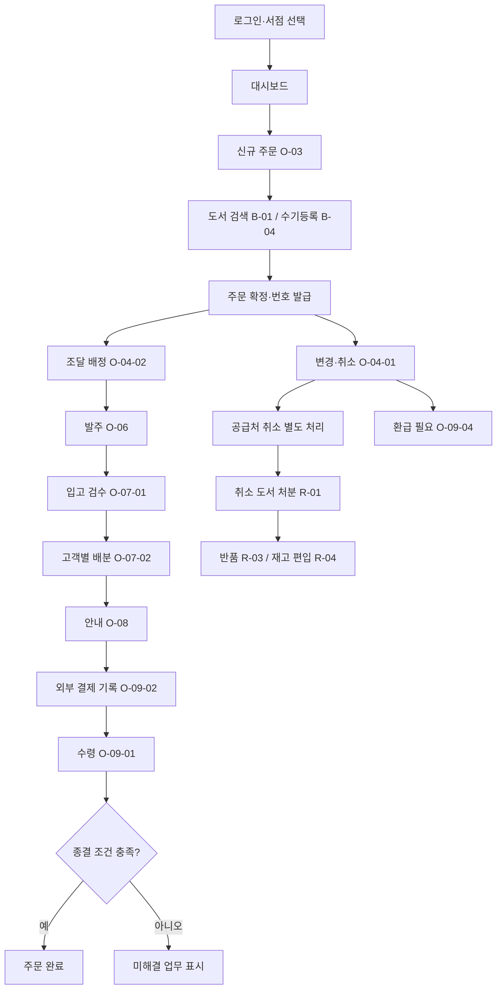

# Ordering 웹 P0 핵심 화면 와이어프레임 및 UI/UX 디자인 가이드 V1.0

- 작성일: 2026-11-22
- 기준: IA V1.3, SFS V1.1, OPDS V1.1, STBR V1.2, FRD V1.3, Use Case V1.5
- 성격: **개발용 저충실도 와이어프레임 + UI/UX 설계 제안**. 화면 ID·승인된 업무 규칙은 기준 문서에서 확인했으며 배치·색상·크기·키보드 단축키는 신규 디자인 제안이다.
- 범위: 웹 P0 핵심 29개 화면의 대표 배치, 모든 P0 화면에 적용할 디자인 시스템. 기존 IA의 전체 84개 화면 단위 중 나머지는 공통 패턴 및 SFS 참조. 독립 URL 수와 화면 단위 수는 다르다.
- 미결정 유지: DEC-01/08/12/15/16, D22/23/24/25/26/29. 해당 항목을 승인된 정책으로 취급하지 않는다.

## 1. 설계 원칙

1. **다음 업무 중심:** 대시보드·상세에서 `다음 작업`을 최상단에 배치한다. 주문 상태, 조달 확보, 수령, 결제, 안내는 각각 구분한다.
2. **1건의 사실 = 1개의 기록:** 실제 확인 전 결제/환급 성공을 표시하지 않고, 취소 요청과 적용, 발주 출력과 전달, 안내 공유와 실제 발송을 분리한다.
3. **예외 먼저:** 미확인 결제, 7일 미수령, 취소 대기 인도 제한, 초과입고, 미배분 물량, 환급 업무를 강조한다.
4. **빠른 입력:** 검색 → 선택 → 수량 입력 → 저장/확정. 파괴적 작업은 영향 미리보기·승인·서버 재검증.
5. **테넌트 격리:** 상단 서점 전환, 전환 시 필터/캐시/미확정 명령 정리. 역할에 따라 행동을 제한하되 서버에서 재검증한다.
6. **화면 성공은 서버 확정 이후:** 중복 클릭 방지, 요청 결과 불명확 시 원요청 조회, 버전 충돌 시 새 데이터 비교.

## 2. 정보구조와 공통 앱 셸

```text
┌──────────────────────────────────────────────────────────────────────────────────────────────────────┐
│  ◧ Ordering        [서점: ○○책방 ▾]         [전역검색: 주문번호·고객·ISBN]       [알림] [점주 ▾]    │
├───────────────────┬──────────────────────────────────────────────────────────────────────────────────┤
│  오늘의 업무       │  페이지 제목                  설명 / 경로                            [주요 행동] │
│  주문관리          │  ─────────────────────────────────────────────────────────────────────────────── │
│  발주관리          │  [기간] [상태] [검색] [초기화]                                 [보조 행동]      │
│  입고관리          │  ┌──────────────────────────────────────────────────────────────────────────┐    │
│  도서·재고         │  │  콘텐츠: 카드 / 목록 / 상세 / 입력 폼 / 예외 안내                       │    │
│  고객관리          │  └──────────────────────────────────────────────────────────────────────────┘    │
│  고객 안내         │  결과 00건                   [이전] 1 2 3 [다음]                              │
│  수령·결제         │                                                                                  │
│  반품·정정         │                                                                                  │
│  설정              │                                                                                  │
└───────────────────┴──────────────────────────────────────────────────────────────────────────────────┘
```

- 데스크톱 기준 폭 1440px, 좌측 내비게이션 224px, 콘텐츠 최대 1440px. 이 값은 **디자인 제안**.
- 목록은 1280px 이상에서 표, 768~1279px에서 열 축소·가로 스크롤, 767px 이하에서는 중요 정보 카드형으로 전환.
- 업무 상태별 탭은 `전체 / 처리 필요 / 처리 중 / 완료 / 예외`의 공통 패턴을 사용하되 실제 도메인 상태를 덮어쓰지 않는다.
- 각 목록의 행 클릭은 상세로, 상태 배지 클릭은 필터로, 행 우측 메뉴는 권한 허용 행동만 노출.

## 3. 화면별 저충실도 와이어프레임

아래 도식은 실제 픽셀 디자인이 아닌 **정보 우선순위와 버튼 위치를 고정하는 개발 기준**이다. 화면 ID는 기존 IA의 식별자를 따른다.


### 3.1 `A-01` — 로그인

- **업무 영역:** 인증
- **필수 표시·입력:** 이메일·비밀번호
- **주요 행동:** 로그인 / 비밀번호 재설정
- **검증·오류:** 이메일 인증·세션·오류 메시지
- **업무 정책:** 로그인 전에는 서점 데이터 요청 금지

```text
┌──────────────────────────────────────────────────────────────────────────────┐
│ A-01  로그인                                                     [도움말] [이력] │
├──────────────────────────────────────────────────────────────────────────────┤
│  검색·필터 / 관련 주문·고객·공급처 컨텍스트                               │
├──────────────────────────────────────────────────────────────────────────────┤
│  핵심 정보                                                                │
│  이메일·비밀번호                                                      │
│  ────────────────────────────────────────────────────────────────────────  │
│  상태·근거·검증 메시지 / 처리 가능한 수량 / 변경 영향                      │
│  [상세·이력 펼치기]                                                      │
├──────────────────────────────────────────────────────────────────────────────┤
│  [돌아가기]   [보조 작업]                           [주요 작업 실행]       │
└──────────────────────────────────────────────────────────────────────────────┘
```

**상호작용:** 첫 진입은 서버 조회 → 사용자 입력/선택 → 클라이언트 형식 검사 → 서버의 권한·수량·상태·버전 검사 → 커밋 응답 후 최신 데이터 재조회. 위험 작업은 사유/영향 확인과 승인 단계가 선행된다.


### 3.2 `O-01` — 대시보드

- **업무 영역:** 운영 현황
- **필수 표시·입력:** 미처리 주문 / 발주 대기 / 입고 배분 / 안내 대기 / 수령 대기 / 환급 필요
- **주요 행동:** 카드 클릭 → 해당 업무 목록
- **검증·오류:** 기간·서점·담당자·경고
- **업무 정책:** 7일 미수령 경고는 자동 취소가 아님

```text
┌──────────────────────────────────────────────────────────────────────────────┐
│ O-01  대시보드                                                    [도움말] [이력] │
├──────────────────────────────────────────────────────────────────────────────┤
│  검색·필터 / 관련 주문·고객·공급처 컨텍스트                               │
├──────────────────────────────────────────────────────────────────────────────┤
│  핵심 정보                                                                │
│  미처리 주문 / 발주 대기 / 입고 배분 / 안내 대기 / 수령 대기 / 환급 필요                │
│  ────────────────────────────────────────────────────────────────────────  │
│  상태·근거·검증 메시지 / 처리 가능한 수량 / 변경 영향                      │
│  [상세·이력 펼치기]                                                      │
├──────────────────────────────────────────────────────────────────────────────┤
│  [돌아가기]   [보조 작업]                           [주요 작업 실행]       │
└──────────────────────────────────────────────────────────────────────────────┘
```

**상호작용:** 첫 진입은 서버 조회 → 사용자 입력/선택 → 클라이언트 형식 검사 → 서버의 권한·수량·상태·버전 검사 → 커밋 응답 후 최신 데이터 재조회. 위험 작업은 사유/영향 확인과 승인 단계가 선행된다.


### 3.3 `O-01-01` — 예외 업무 큐

- **업무 영역:** 예외 대응
- **필수 표시·입력:** 유형 / 발생일 / 관련 주문 / 원인 / 담당자 / 처리 근거
- **주요 행동:** 상세 보기 / 담당 지정 / 증빙 확인
- **검증·오류:** 장기 미수령·초과입고·미확인 결제·환급
- **업무 정책:** DEC-16 미확정: 임의 종결 버튼 금지

```text
┌──────────────────────────────────────────────────────────────────────────────┐
│ O-01-01  예외 업무 큐                                                 [도움말] [이력] │
├──────────────────────────────────────────────────────────────────────────────┤
│  검색·필터 / 관련 주문·고객·공급처 컨텍스트                               │
├──────────────────────────────────────────────────────────────────────────────┤
│  핵심 정보                                                                │
│  유형 / 발생일 / 관련 주문 / 원인 / 담당자 / 처리 근거                           │
│  ────────────────────────────────────────────────────────────────────────  │
│  상태·근거·검증 메시지 / 처리 가능한 수량 / 변경 영향                      │
│  [상세·이력 펼치기]                                                      │
├──────────────────────────────────────────────────────────────────────────────┤
│  [돌아가기]   [보조 작업]                           [주요 작업 실행]       │
└──────────────────────────────────────────────────────────────────────────────┘
```

**상호작용:** 첫 진입은 서버 조회 → 사용자 입력/선택 → 클라이언트 형식 검사 → 서버의 권한·수량·상태·버전 검사 → 커밋 응답 후 최신 데이터 재조회. 위험 작업은 사유/영향 확인과 승인 단계가 선행된다.


### 3.4 `O-02` — 주문 목록

- **업무 영역:** 주문
- **필수 표시·입력:** 주문번호 / 고객 / 품목 / 주문 상태 / 확보 / 인도 / 결제 잔액
- **주요 행동:** 신규 주문 / 상세 / 필터 초기화
- **검증·오류:** 번호·고객·ISBN·기간·상태 검색
- **업무 정책:** 주문상태와 조달상태는 별도 열

```text
┌──────────────────────────────────────────────────────────────────────────────┐
│ O-02  주문 목록                                                   [도움말] [이력] │
├──────────────────────────────────────────────────────────────────────────────┤
│  검색·필터 / 관련 주문·고객·공급처 컨텍스트                               │
├──────────────────────────────────────────────────────────────────────────────┤
│  핵심 정보                                                                │
│  주문번호 / 고객 / 품목 / 주문 상태 / 확보 / 인도 / 결제 잔액                      │
│  ────────────────────────────────────────────────────────────────────────  │
│  상태·근거·검증 메시지 / 처리 가능한 수량 / 변경 영향                      │
│  [상세·이력 펼치기]                                                      │
├──────────────────────────────────────────────────────────────────────────────┤
│  [돌아가기]   [보조 작업]                           [주요 작업 실행]       │
└──────────────────────────────────────────────────────────────────────────────┘
```

**상호작용:** 첫 진입은 서버 조회 → 사용자 입력/선택 → 클라이언트 형식 검사 → 서버의 권한·수량·상태·버전 검사 → 커밋 응답 후 최신 데이터 재조회. 위험 작업은 사유/영향 확인과 승인 단계가 선행된다.


### 3.5 `O-03` — 신규 주문

- **업무 영역:** 주문
- **필수 표시·입력:** 고객 / 도서 / 수량 / 확정 판매가 / 수령방법 / 메모
- **주요 행동:** 초안 저장 / 주문 확정
- **검증·오류:** 필수 입력·서점 일치·중복 확정 방지
- **업무 정책:** 확정 성공 시 서점별 고유 주문번호; P0 할인·배송비 자동 계산 없음

```text
┌──────────────────────────────────────────────────────────────────────────────┐
│ O-03  신규 주문                                                   [도움말] [이력] │
├──────────────────────────────────────────────────────────────────────────────┤
│  검색·필터 / 관련 주문·고객·공급처 컨텍스트                               │
├──────────────────────────────────────────────────────────────────────────────┤
│  핵심 정보                                                                │
│  고객 / 도서 / 수량 / 확정 판매가 / 수령방법 / 메모                             │
│  ────────────────────────────────────────────────────────────────────────  │
│  상태·근거·검증 메시지 / 처리 가능한 수량 / 변경 영향                      │
│  [상세·이력 펼치기]                                                      │
├──────────────────────────────────────────────────────────────────────────────┤
│  [돌아가기]   [보조 작업]                           [주요 작업 실행]       │
└──────────────────────────────────────────────────────────────────────────────┘
```

**상호작용:** 첫 진입은 서버 조회 → 사용자 입력/선택 → 클라이언트 형식 검사 → 서버의 권한·수량·상태·버전 검사 → 커밋 응답 후 최신 데이터 재조회. 위험 작업은 사유/영향 확인과 승인 단계가 선행된다.


### 3.6 `B-01` — YES24 도서 검색

- **업무 영역:** 도서
- **필수 표시·입력:** 검색어 / ISBN / 제목 / 저자 / 출판사 / 가격 / 출처
- **주요 행동:** 검색 / 도서 선택 / 수기 등록
- **검증·오류:** 검색 실패·중복 후보·외부 API 오류
- **업무 정책:** YES24 단일 외부 검색 경로, 없는 책은 B-04

```text
┌──────────────────────────────────────────────────────────────────────────────┐
│ B-01  YES24 도서 검색                                             [도움말] [이력] │
├──────────────────────────────────────────────────────────────────────────────┤
│  검색·필터 / 관련 주문·고객·공급처 컨텍스트                               │
├──────────────────────────────────────────────────────────────────────────────┤
│  핵심 정보                                                                │
│  검색어 / ISBN / 제목 / 저자 / 출판사 / 가격 / 출처                          │
│  ────────────────────────────────────────────────────────────────────────  │
│  상태·근거·검증 메시지 / 처리 가능한 수량 / 변경 영향                      │
│  [상세·이력 펼치기]                                                      │
├──────────────────────────────────────────────────────────────────────────────┤
│  [돌아가기]   [보조 작업]                           [주요 작업 실행]       │
└──────────────────────────────────────────────────────────────────────────────┘
```

**상호작용:** 첫 진입은 서버 조회 → 사용자 입력/선택 → 클라이언트 형식 검사 → 서버의 권한·수량·상태·버전 검사 → 커밋 응답 후 최신 데이터 재조회. 위험 작업은 사유/영향 확인과 승인 단계가 선행된다.


### 3.7 `B-04` — 도서 수기 등록

- **업무 영역:** 도서
- **필수 표시·입력:** 도서명 / 판매가 / ISBN(선택) / 저자·출판사(선택) / 식별 정보
- **주요 행동:** 저장 / 주문에 추가
- **검증·오류:** 도서명·가격 필수, 중복 후보 표시
- **업무 정책:** ISBN 없는 독립출판물 허용

```text
┌──────────────────────────────────────────────────────────────────────────────┐
│ B-04  도서 수기 등록                                                [도움말] [이력] │
├──────────────────────────────────────────────────────────────────────────────┤
│  검색·필터 / 관련 주문·고객·공급처 컨텍스트                               │
├──────────────────────────────────────────────────────────────────────────────┤
│  핵심 정보                                                                │
│  도서명 / 판매가 / ISBN(선택) / 저자·출판사(선택) / 식별 정보                     │
│  ────────────────────────────────────────────────────────────────────────  │
│  상태·근거·검증 메시지 / 처리 가능한 수량 / 변경 영향                      │
│  [상세·이력 펼치기]                                                      │
├──────────────────────────────────────────────────────────────────────────────┤
│  [돌아가기]   [보조 작업]                           [주요 작업 실행]       │
└──────────────────────────────────────────────────────────────────────────────┘
```

**상호작용:** 첫 진입은 서버 조회 → 사용자 입력/선택 → 클라이언트 형식 검사 → 서버의 권한·수량·상태·버전 검사 → 커밋 응답 후 최신 데이터 재조회. 위험 작업은 사유/영향 확인과 승인 단계가 선행된다.


### 3.8 `O-04` — 주문 상세

- **업무 영역:** 주문
- **필수 표시·입력:** 헤더(주문번호·고객·상태) / 품목 / 확보·인도 / 결제 / 타임라인
- **주요 행동:** 조달 배정 / 변경·취소 / 안내 / 수령 / 결제 / 종결 검사
- **검증·오류:** 버전 충돌·권한·완료 잠금
- **업무 정책:** 종결: 전량 인도·잔액 0·필수 후속 업무 해결

```text
┌──────────────────────────────────────────────────────────────────────────────┐
│ O-04  주문 상세                                                   [도움말] [이력] │
├──────────────────────────────────────────────────────────────────────────────┤
│  검색·필터 / 관련 주문·고객·공급처 컨텍스트                               │
├──────────────────────────────────────────────────────────────────────────────┤
│  핵심 정보                                                                │
│  헤더(주문번호·고객·상태) / 품목 / 확보·인도 / 결제 / 타임라인                       │
│  ────────────────────────────────────────────────────────────────────────  │
│  상태·근거·검증 메시지 / 처리 가능한 수량 / 변경 영향                      │
│  [상세·이력 펼치기]                                                      │
├──────────────────────────────────────────────────────────────────────────────┤
│  [돌아가기]   [보조 작업]                           [주요 작업 실행]       │
└──────────────────────────────────────────────────────────────────────────────┘
```

**상호작용:** 첫 진입은 서버 조회 → 사용자 입력/선택 → 클라이언트 형식 검사 → 서버의 권한·수량·상태·버전 검사 → 커밋 응답 후 최신 데이터 재조회. 위험 작업은 사유/영향 확인과 승인 단계가 선행된다.


### 3.9 `O-04-01` — 주문 변경·취소

- **업무 영역:** 주문
- **필수 표시·입력:** 대상 품목 / 취소 요청량 / 이미 인도량 / 사유 / 영향
- **주요 행동:** 취소 요청 / 승인 요청 / 철회
- **검증·오류:** 요청과 적용 상태 분리
- **업무 정책:** 취소 승인 대기 수량 인도 제한; 공급처 발주 취소 별도

```text
┌──────────────────────────────────────────────────────────────────────────────┐
│ O-04-01  주문 변경·취소                                                [도움말] [이력] │
├──────────────────────────────────────────────────────────────────────────────┤
│  검색·필터 / 관련 주문·고객·공급처 컨텍스트                               │
├──────────────────────────────────────────────────────────────────────────────┤
│  핵심 정보                                                                │
│  대상 품목 / 취소 요청량 / 이미 인도량 / 사유 / 영향                             │
│  ────────────────────────────────────────────────────────────────────────  │
│  상태·근거·검증 메시지 / 처리 가능한 수량 / 변경 영향                      │
│  [상세·이력 펼치기]                                                      │
├──────────────────────────────────────────────────────────────────────────────┤
│  [돌아가기]   [보조 작업]                           [주요 작업 실행]       │
└──────────────────────────────────────────────────────────────────────────────┘
```

**상호작용:** 첫 진입은 서버 조회 → 사용자 입력/선택 → 클라이언트 형식 검사 → 서버의 권한·수량·상태·버전 검사 → 커밋 응답 후 최신 데이터 재조회. 위험 작업은 사유/영향 확인과 승인 단계가 선행된다.


### 3.10 `O-04-02` — 조달 배정

- **업무 영역:** 주문
- **필수 표시·입력:** 필요 수량 / 매장 가용 재고 / 예약 / 공급처 발주 / 기타 조달
- **주요 행동:** 재고 예약 / 발주 대기 배정
- **검증·오류:** 재고·예약 동시성 및 수량 검증
- **업무 정책:** 기타 조달 세부정책 D22 미결정: 승인 없이 확장 금지

```text
┌──────────────────────────────────────────────────────────────────────────────┐
│ O-04-02  조달 배정                                                   [도움말] [이력] │
├──────────────────────────────────────────────────────────────────────────────┤
│  검색·필터 / 관련 주문·고객·공급처 컨텍스트                               │
├──────────────────────────────────────────────────────────────────────────────┤
│  핵심 정보                                                                │
│  필요 수량 / 매장 가용 재고 / 예약 / 공급처 발주 / 기타 조달                        │
│  ────────────────────────────────────────────────────────────────────────  │
│  상태·근거·검증 메시지 / 처리 가능한 수량 / 변경 영향                      │
│  [상세·이력 펼치기]                                                      │
├──────────────────────────────────────────────────────────────────────────────┤
│  [돌아가기]   [보조 작업]                           [주요 작업 실행]       │
└──────────────────────────────────────────────────────────────────────────────┘
```

**상호작용:** 첫 진입은 서버 조회 → 사용자 입력/선택 → 클라이언트 형식 검사 → 서버의 권한·수량·상태·버전 검사 → 커밋 응답 후 최신 데이터 재조회. 위험 작업은 사유/영향 확인과 승인 단계가 선행된다.


### 3.11 `O-06` — 발주 현황

- **업무 영역:** 발주
- **필수 표시·입력:** 공급처 / 발주번호 / 작성·전달 / 회신 / 미입고 / 미수락 취소
- **주요 행동:** 발주서 작성 / 상세 / 회신
- **검증·오류:** 출력과 전달 별도 상태
- **업무 정책:** 고객 취소만으로 공급처 의무 수량 감소시키지 않음

```text
┌──────────────────────────────────────────────────────────────────────────────┐
│ O-06  발주 현황                                                   [도움말] [이력] │
├──────────────────────────────────────────────────────────────────────────────┤
│  검색·필터 / 관련 주문·고객·공급처 컨텍스트                               │
├──────────────────────────────────────────────────────────────────────────────┤
│  핵심 정보                                                                │
│  공급처 / 발주번호 / 작성·전달 / 회신 / 미입고 / 미수락 취소                        │
│  ────────────────────────────────────────────────────────────────────────  │
│  상태·근거·검증 메시지 / 처리 가능한 수량 / 변경 영향                      │
│  [상세·이력 펼치기]                                                      │
├──────────────────────────────────────────────────────────────────────────────┤
│  [돌아가기]   [보조 작업]                           [주요 작업 실행]       │
└──────────────────────────────────────────────────────────────────────────────┘
```

**상호작용:** 첫 진입은 서버 조회 → 사용자 입력/선택 → 클라이언트 형식 검사 → 서버의 권한·수량·상태·버전 검사 → 커밋 응답 후 최신 데이터 재조회. 위험 작업은 사유/영향 확인과 승인 단계가 선행된다.


### 3.12 `O-06-01` — 발주서 작성

- **업무 영역:** 발주
- **필수 표시·입력:** 공급처 / 품목별 합산 수량 / 고객별 근거 / 납기 메모
- **주요 행동:** 초안 저장 / 출력 / 전달 기록
- **검증·오류:** 발주 대상 미확보량과 중복 확인
- **업무 정책:** 전달 후 변경·취소는 별도 요청·공급처 회신

```text
┌──────────────────────────────────────────────────────────────────────────────┐
│ O-06-01  발주서 작성                                                  [도움말] [이력] │
├──────────────────────────────────────────────────────────────────────────────┤
│  검색·필터 / 관련 주문·고객·공급처 컨텍스트                               │
├──────────────────────────────────────────────────────────────────────────────┤
│  핵심 정보                                                                │
│  공급처 / 품목별 합산 수량 / 고객별 근거 / 납기 메모                              │
│  ────────────────────────────────────────────────────────────────────────  │
│  상태·근거·검증 메시지 / 처리 가능한 수량 / 변경 영향                      │
│  [상세·이력 펼치기]                                                      │
├──────────────────────────────────────────────────────────────────────────────┤
│  [돌아가기]   [보조 작업]                           [주요 작업 실행]       │
└──────────────────────────────────────────────────────────────────────────────┘
```

**상호작용:** 첫 진입은 서버 조회 → 사용자 입력/선택 → 클라이언트 형식 검사 → 서버의 권한·수량·상태·버전 검사 → 커밋 응답 후 최신 데이터 재조회. 위험 작업은 사유/영향 확인과 승인 단계가 선행된다.


### 3.13 `O-06-04` — 공급처 회신

- **업무 영역:** 발주
- **필수 표시·입력:** 품목별 수락·거절·지연 / 회신일 / 근거
- **주요 행동:** 회신 저장 / 후속 업무 등록
- **검증·오류:** 실제 수락 수량과 발주 전달 수량 비교
- **업무 정책:** 공급처가 수락한 감량만 의무 감소

```text
┌──────────────────────────────────────────────────────────────────────────────┐
│ O-06-04  공급처 회신                                                  [도움말] [이력] │
├──────────────────────────────────────────────────────────────────────────────┤
│  검색·필터 / 관련 주문·고객·공급처 컨텍스트                               │
├──────────────────────────────────────────────────────────────────────────────┤
│  핵심 정보                                                                │
│  품목별 수락·거절·지연 / 회신일 / 근거                                       │
│  ────────────────────────────────────────────────────────────────────────  │
│  상태·근거·검증 메시지 / 처리 가능한 수량 / 변경 영향                      │
│  [상세·이력 펼치기]                                                      │
├──────────────────────────────────────────────────────────────────────────────┤
│  [돌아가기]   [보조 작업]                           [주요 작업 실행]       │
└──────────────────────────────────────────────────────────────────────────────┘
```

**상호작용:** 첫 진입은 서버 조회 → 사용자 입력/선택 → 클라이언트 형식 검사 → 서버의 권한·수량·상태·버전 검사 → 커밋 응답 후 최신 데이터 재조회. 위험 작업은 사유/영향 확인과 승인 단계가 선행된다.


### 3.14 `O-07` — 입고 현황

- **업무 영역:** 입고
- **필수 표시·입력:** 발주 / 미입고량 / 입고 차수 / 검수 상태 / 미배분
- **주요 행동:** 입고 등록 / 배분 / 입고 이력
- **검증·오류:** 정상·파손·오배송 구분
- **업무 정책:** 늦은 입고·초과입고를 일반 고객 배분에 자동 포함하지 않음

```text
┌──────────────────────────────────────────────────────────────────────────────┐
│ O-07  입고 현황                                                   [도움말] [이력] │
├──────────────────────────────────────────────────────────────────────────────┤
│  검색·필터 / 관련 주문·고객·공급처 컨텍스트                               │
├──────────────────────────────────────────────────────────────────────────────┤
│  핵심 정보                                                                │
│  발주 / 미입고량 / 입고 차수 / 검수 상태 / 미배분                               │
│  ────────────────────────────────────────────────────────────────────────  │
│  상태·근거·검증 메시지 / 처리 가능한 수량 / 변경 영향                      │
│  [상세·이력 펼치기]                                                      │
├──────────────────────────────────────────────────────────────────────────────┤
│  [돌아가기]   [보조 작업]                           [주요 작업 실행]       │
└──────────────────────────────────────────────────────────────────────────────┘
```

**상호작용:** 첫 진입은 서버 조회 → 사용자 입력/선택 → 클라이언트 형식 검사 → 서버의 권한·수량·상태·버전 검사 → 커밋 응답 후 최신 데이터 재조회. 위험 작업은 사유/영향 확인과 승인 단계가 선행된다.


### 3.15 `O-07-01` — 입고 등록

- **업무 영역:** 입고
- **필수 표시·입력:** 발주 품목 / 정상 수량 / 파손 / 오배송 / 차수 / 메모
- **주요 행동:** 검수 저장 / 초과입고 승인 요청
- **검증·오류:** 실물 수량과 기존 입고 합계 검증
- **업무 정책:** 초과입고 별도 귀속·Owner 승인

```text
┌──────────────────────────────────────────────────────────────────────────────┐
│ O-07-01  입고 등록                                                   [도움말] [이력] │
├──────────────────────────────────────────────────────────────────────────────┤
│  검색·필터 / 관련 주문·고객·공급처 컨텍스트                               │
├──────────────────────────────────────────────────────────────────────────────┤
│  핵심 정보                                                                │
│  발주 품목 / 정상 수량 / 파손 / 오배송 / 차수 / 메모                            │
│  ────────────────────────────────────────────────────────────────────────  │
│  상태·근거·검증 메시지 / 처리 가능한 수량 / 변경 영향                      │
│  [상세·이력 펼치기]                                                      │
├──────────────────────────────────────────────────────────────────────────────┤
│  [돌아가기]   [보조 작업]                           [주요 작업 실행]       │
└──────────────────────────────────────────────────────────────────────────────┘
```

**상호작용:** 첫 진입은 서버 조회 → 사용자 입력/선택 → 클라이언트 형식 검사 → 서버의 권한·수량·상태·버전 검사 → 커밋 응답 후 최신 데이터 재조회. 위험 작업은 사유/영향 확인과 승인 단계가 선행된다.


### 3.16 `O-07-02` — 고객별 입고 배분

- **업무 영역:** 입고
- **필수 표시·입력:** 정상 미배분 수량 / 연결 주문 / 고객 / 미확보량 / 배분량
- **주요 행동:** 자동 제안 / 배분 확정
- **검증·오류:** 동일 발주 연결·중복 배분·취소 주문 차단
- **업무 정책:** 입고와 배분은 독립 거래; 취소 고객 자동 배분 금지

```text
┌──────────────────────────────────────────────────────────────────────────────┐
│ O-07-02  고객별 입고 배분                                               [도움말] [이력] │
├──────────────────────────────────────────────────────────────────────────────┤
│  검색·필터 / 관련 주문·고객·공급처 컨텍스트                               │
├──────────────────────────────────────────────────────────────────────────────┤
│  핵심 정보                                                                │
│  정상 미배분 수량 / 연결 주문 / 고객 / 미확보량 / 배분량                           │
│  ────────────────────────────────────────────────────────────────────────  │
│  상태·근거·검증 메시지 / 처리 가능한 수량 / 변경 영향                      │
│  [상세·이력 펼치기]                                                      │
├──────────────────────────────────────────────────────────────────────────────┤
│  [돌아가기]   [보조 작업]                           [주요 작업 실행]       │
└──────────────────────────────────────────────────────────────────────────────┘
```

**상호작용:** 첫 진입은 서버 조회 → 사용자 입력/선택 → 클라이언트 형식 검사 → 서버의 권한·수량·상태·버전 검사 → 커밋 응답 후 최신 데이터 재조회. 위험 작업은 사유/영향 확인과 승인 단계가 선행된다.


### 3.17 `I-01` — 재고 현황

- **업무 영역:** 재고
- **필수 표시·입력:** 도서 / on_hand / reserved / available / 최근 수불
- **주요 행동:** 재고 조정 요청 / 예약 조회 / 수불
- **검증·오류:** 가용량 계산 표시
- **업무 정책:** available=on_hand-reserved; 예약량은 보유량 초과 금지

```text
┌──────────────────────────────────────────────────────────────────────────────┐
│ I-01  재고 현황                                                   [도움말] [이력] │
├──────────────────────────────────────────────────────────────────────────────┤
│  검색·필터 / 관련 주문·고객·공급처 컨텍스트                               │
├──────────────────────────────────────────────────────────────────────────────┤
│  핵심 정보                                                                │
│  도서 / on_hand / reserved / available / 최근 수불                   │
│  ────────────────────────────────────────────────────────────────────────  │
│  상태·근거·검증 메시지 / 처리 가능한 수량 / 변경 영향                      │
│  [상세·이력 펼치기]                                                      │
├──────────────────────────────────────────────────────────────────────────────┤
│  [돌아가기]   [보조 작업]                           [주요 작업 실행]       │
└──────────────────────────────────────────────────────────────────────────────┘
```

**상호작용:** 첫 진입은 서버 조회 → 사용자 입력/선택 → 클라이언트 형식 검사 → 서버의 권한·수량·상태·버전 검사 → 커밋 응답 후 최신 데이터 재조회. 위험 작업은 사유/영향 확인과 승인 단계가 선행된다.


### 3.18 `O-08` — 안내 대기

- **업무 영역:** 안내
- **필수 표시·입력:** 주문 / 고객 / 확보량 / 안내 종류 / 마지막 시도
- **주요 행동:** 안내 작성 / 결과 확인
- **검증·오류:** 부분입고 안내 기본 전체 확보 후
- **업무 정책:** OS 공유 완료는 고객 발송 성공 아님

```text
┌──────────────────────────────────────────────────────────────────────────────┐
│ O-08  안내 대기                                                   [도움말] [이력] │
├──────────────────────────────────────────────────────────────────────────────┤
│  검색·필터 / 관련 주문·고객·공급처 컨텍스트                               │
├──────────────────────────────────────────────────────────────────────────────┤
│  핵심 정보                                                                │
│  주문 / 고객 / 확보량 / 안내 종류 / 마지막 시도                                │
│  ────────────────────────────────────────────────────────────────────────  │
│  상태·근거·검증 메시지 / 처리 가능한 수량 / 변경 영향                      │
│  [상세·이력 펼치기]                                                      │
├──────────────────────────────────────────────────────────────────────────────┤
│  [돌아가기]   [보조 작업]                           [주요 작업 실행]       │
└──────────────────────────────────────────────────────────────────────────────┘
```

**상호작용:** 첫 진입은 서버 조회 → 사용자 입력/선택 → 클라이언트 형식 검사 → 서버의 권한·수량·상태·버전 검사 → 커밋 응답 후 최신 데이터 재조회. 위험 작업은 사유/영향 확인과 승인 단계가 선행된다.


### 3.19 `O-08-01` — 안내 작성

- **업무 영역:** 안내
- **필수 표시·입력:** 고객 / 템플릿 / 변수 / 확보 수량 / 메시지 미리보기
- **주요 행동:** 복사 / OS 공유 / 안내 결과 기록
- **검증·오류:** 고객 연락처 접근 권한·최신 수량
- **업무 정책:** 부분입고 시 직원 선택 안내

```text
┌──────────────────────────────────────────────────────────────────────────────┐
│ O-08-01  안내 작성                                                   [도움말] [이력] │
├──────────────────────────────────────────────────────────────────────────────┤
│  검색·필터 / 관련 주문·고객·공급처 컨텍스트                               │
├──────────────────────────────────────────────────────────────────────────────┤
│  핵심 정보                                                                │
│  고객 / 템플릿 / 변수 / 확보 수량 / 메시지 미리보기                              │
│  ────────────────────────────────────────────────────────────────────────  │
│  상태·근거·검증 메시지 / 처리 가능한 수량 / 변경 영향                      │
│  [상세·이력 펼치기]                                                      │
├──────────────────────────────────────────────────────────────────────────────┤
│  [돌아가기]   [보조 작업]                           [주요 작업 실행]       │
└──────────────────────────────────────────────────────────────────────────────┘
```

**상호작용:** 첫 진입은 서버 조회 → 사용자 입력/선택 → 클라이언트 형식 검사 → 서버의 권한·수량·상태·버전 검사 → 커밋 응답 후 최신 데이터 재조회. 위험 작업은 사유/영향 확인과 승인 단계가 선행된다.


### 3.20 `O-09` — 수령·결제 현황

- **업무 영역:** 수령·결제
- **필수 표시·입력:** 수령 대기 / 결제 미확인 / 환급 필요 / 주문별 잔액
- **주요 행동:** 수령 등록 / 결제 기록 / 환급 필요
- **검증·오류:** 인도 제한·결제 검증
- **업무 정책:** 수령과 결제는 별도 업무, 인도 전 대상 금액 결제 확인

```text
┌──────────────────────────────────────────────────────────────────────────────┐
│ O-09  수령·결제 현황                                                [도움말] [이력] │
├──────────────────────────────────────────────────────────────────────────────┤
│  검색·필터 / 관련 주문·고객·공급처 컨텍스트                               │
├──────────────────────────────────────────────────────────────────────────────┤
│  핵심 정보                                                                │
│  수령 대기 / 결제 미확인 / 환급 필요 / 주문별 잔액                               │
│  ────────────────────────────────────────────────────────────────────────  │
│  상태·근거·검증 메시지 / 처리 가능한 수량 / 변경 영향                      │
│  [상세·이력 펼치기]                                                      │
├──────────────────────────────────────────────────────────────────────────────┤
│  [돌아가기]   [보조 작업]                           [주요 작업 실행]       │
└──────────────────────────────────────────────────────────────────────────────┘
```

**상호작용:** 첫 진입은 서버 조회 → 사용자 입력/선택 → 클라이언트 형식 검사 → 서버의 권한·수량·상태·버전 검사 → 커밋 응답 후 최신 데이터 재조회. 위험 작업은 사유/영향 확인과 승인 단계가 선행된다.


### 3.21 `O-09-01` — 수령 등록

- **업무 영역:** 수령·결제
- **필수 표시·입력:** 고객 / 확보량 / 취소 대기량 / 이번 인도량 / 결제 상태
- **주요 행동:** 부분 인도 / 인도 확정
- **검증·오류:** 미확보·취소 대기·미결제 인도 차단
- **업무 정책:** 후불 인도 기본 제한

```text
┌──────────────────────────────────────────────────────────────────────────────┐
│ O-09-01  수령 등록                                                   [도움말] [이력] │
├──────────────────────────────────────────────────────────────────────────────┤
│  검색·필터 / 관련 주문·고객·공급처 컨텍스트                               │
├──────────────────────────────────────────────────────────────────────────────┤
│  핵심 정보                                                                │
│  고객 / 확보량 / 취소 대기량 / 이번 인도량 / 결제 상태                            │
│  ────────────────────────────────────────────────────────────────────────  │
│  상태·근거·검증 메시지 / 처리 가능한 수량 / 변경 영향                      │
│  [상세·이력 펼치기]                                                      │
├──────────────────────────────────────────────────────────────────────────────┤
│  [돌아가기]   [보조 작업]                           [주요 작업 실행]       │
└──────────────────────────────────────────────────────────────────────────────┘
```

**상호작용:** 첫 진입은 서버 조회 → 사용자 입력/선택 → 클라이언트 형식 검사 → 서버의 권한·수량·상태·버전 검사 → 커밋 응답 후 최신 데이터 재조회. 위험 작업은 사유/영향 확인과 승인 단계가 선행된다.


### 3.22 `O-09-02` — 결제 기록

- **업무 영역:** 수령·결제
- **필수 표시·입력:** 원주문 / 외부 결제수단 / 확인 금액 / 거래 식별자 / 확인 시각 / 증빙
- **주요 행동:** 외부 결제 확인 기록
- **검증·오류:** 실제 확인 전 완료 금지, 중복·과수납 방지
- **업무 정책:** P0 복수 외부 결제 기록 승인; 실제 PG 승인 P2

```text
┌──────────────────────────────────────────────────────────────────────────────┐
│ O-09-02  결제 기록                                                   [도움말] [이력] │
├──────────────────────────────────────────────────────────────────────────────┤
│  검색·필터 / 관련 주문·고객·공급처 컨텍스트                               │
├──────────────────────────────────────────────────────────────────────────────┤
│  핵심 정보                                                                │
│  원주문 / 외부 결제수단 / 확인 금액 / 거래 식별자 / 확인 시각 / 증빙                   │
│  ────────────────────────────────────────────────────────────────────────  │
│  상태·근거·검증 메시지 / 처리 가능한 수량 / 변경 영향                      │
│  [상세·이력 펼치기]                                                      │
├──────────────────────────────────────────────────────────────────────────────┤
│  [돌아가기]   [보조 작업]                           [주요 작업 실행]       │
└──────────────────────────────────────────────────────────────────────────────┘
```

**상호작용:** 첫 진입은 서버 조회 → 사용자 입력/선택 → 클라이언트 형식 검사 → 서버의 권한·수량·상태·버전 검사 → 커밋 응답 후 최신 데이터 재조회. 위험 작업은 사유/영향 확인과 승인 단계가 선행된다.


### 3.23 `O-09-04` — 환급 필요 업무

- **업무 영역:** 수령·결제
- **필수 표시·입력:** 원결제 / 환급 필요·기록액 / 외부 환급 일시 / 증빙 / 승인
- **주요 행동:** 환급 증빙 입력 / 점주 승인 / 완료 기록
- **검증·오류:** 원결제·미환급액·중복 확인
- **업무 정책:** P0 외부 환급 완료 결과만 기록, 앱이 실제 환급 실행하지 않음

```text
┌──────────────────────────────────────────────────────────────────────────────┐
│ O-09-04  환급 필요 업무                                                [도움말] [이력] │
├──────────────────────────────────────────────────────────────────────────────┤
│  검색·필터 / 관련 주문·고객·공급처 컨텍스트                               │
├──────────────────────────────────────────────────────────────────────────────┤
│  핵심 정보                                                                │
│  원결제 / 환급 필요·기록액 / 외부 환급 일시 / 증빙 / 승인                          │
│  ────────────────────────────────────────────────────────────────────────  │
│  상태·근거·검증 메시지 / 처리 가능한 수량 / 변경 영향                      │
│  [상세·이력 펼치기]                                                      │
├──────────────────────────────────────────────────────────────────────────────┤
│  [돌아가기]   [보조 작업]                           [주요 작업 실행]       │
└──────────────────────────────────────────────────────────────────────────────┘
```

**상호작용:** 첫 진입은 서버 조회 → 사용자 입력/선택 → 클라이언트 형식 검사 → 서버의 권한·수량·상태·버전 검사 → 커밋 응답 후 최신 데이터 재조회. 위험 작업은 사유/영향 확인과 승인 단계가 선행된다.


### 3.24 `R-01` — 취소 도서 처분

- **업무 영역:** 반품·정정
- **필수 표시·입력:** 취소 귀속량 / 실물 위치 / 공급처 / 처분 대기
- **주요 행동:** 반품 선택 / 재고 편입 요청
- **검증·오류:** 8개 배타 귀속·이력 확인
- **업무 정책:** 취소 후 입고는 취소 고객에 재배분 금지

```text
┌──────────────────────────────────────────────────────────────────────────────┐
│ R-01  취소 도서 처분                                                [도움말] [이력] │
├──────────────────────────────────────────────────────────────────────────────┤
│  검색·필터 / 관련 주문·고객·공급처 컨텍스트                               │
├──────────────────────────────────────────────────────────────────────────────┤
│  핵심 정보                                                                │
│  취소 귀속량 / 실물 위치 / 공급처 / 처분 대기                                  │
│  ────────────────────────────────────────────────────────────────────────  │
│  상태·근거·검증 메시지 / 처리 가능한 수량 / 변경 영향                      │
│  [상세·이력 펼치기]                                                      │
├──────────────────────────────────────────────────────────────────────────────┤
│  [돌아가기]   [보조 작업]                           [주요 작업 실행]       │
└──────────────────────────────────────────────────────────────────────────────┘
```

**상호작용:** 첫 진입은 서버 조회 → 사용자 입력/선택 → 클라이언트 형식 검사 → 서버의 권한·수량·상태·버전 검사 → 커밋 응답 후 최신 데이터 재조회. 위험 작업은 사유/영향 확인과 승인 단계가 선행된다.


### 3.25 `R-03` — 공급처 반품

- **업무 영역:** 반품·정정
- **필수 표시·입력:** 요청량 / 공급처 수락량 / 출고량 / 완료량 / 반송량
- **주요 행동:** 요청 / 수락 기록 / 출고 / 완료
- **검증·오류:** 부분 수량별 추적·실물 확인
- **업무 정책:** 반품 출고된 물량은 회수 전 재고 편입 금지

```text
┌──────────────────────────────────────────────────────────────────────────────┐
│ R-03  공급처 반품                                                  [도움말] [이력] │
├──────────────────────────────────────────────────────────────────────────────┤
│  검색·필터 / 관련 주문·고객·공급처 컨텍스트                               │
├──────────────────────────────────────────────────────────────────────────────┤
│  핵심 정보                                                                │
│  요청량 / 공급처 수락량 / 출고량 / 완료량 / 반송량                               │
│  ────────────────────────────────────────────────────────────────────────  │
│  상태·근거·검증 메시지 / 처리 가능한 수량 / 변경 영향                      │
│  [상세·이력 펼치기]                                                      │
├──────────────────────────────────────────────────────────────────────────────┤
│  [돌아가기]   [보조 작업]                           [주요 작업 실행]       │
└──────────────────────────────────────────────────────────────────────────────┘
```

**상호작용:** 첫 진입은 서버 조회 → 사용자 입력/선택 → 클라이언트 형식 검사 → 서버의 권한·수량·상태·버전 검사 → 커밋 응답 후 최신 데이터 재조회. 위험 작업은 사유/영향 확인과 승인 단계가 선행된다.


### 3.26 `R-04` — 매장 재고 편입

- **업무 영역:** 반품·정정
- **필수 표시·입력:** 대상 물량 / 실물 보유 / 편입 수량 / 승인자
- **주요 행동:** 승인 요청 / 재고 편입 확정
- **검증·오류:** 이중 편입 방지·물리적 보유 검증
- **업무 정책:** 수불 원장에 원거래 참조 기록

```text
┌──────────────────────────────────────────────────────────────────────────────┐
│ R-04  매장 재고 편입                                                [도움말] [이력] │
├──────────────────────────────────────────────────────────────────────────────┤
│  검색·필터 / 관련 주문·고객·공급처 컨텍스트                               │
├──────────────────────────────────────────────────────────────────────────────┤
│  핵심 정보                                                                │
│  대상 물량 / 실물 보유 / 편입 수량 / 승인자                                   │
│  ────────────────────────────────────────────────────────────────────────  │
│  상태·근거·검증 메시지 / 처리 가능한 수량 / 변경 영향                      │
│  [상세·이력 펼치기]                                                      │
├──────────────────────────────────────────────────────────────────────────────┤
│  [돌아가기]   [보조 작업]                           [주요 작업 실행]       │
└──────────────────────────────────────────────────────────────────────────────┘
```

**상호작용:** 첫 진입은 서버 조회 → 사용자 입력/선택 → 클라이언트 형식 검사 → 서버의 권한·수량·상태·버전 검사 → 커밋 응답 후 최신 데이터 재조회. 위험 작업은 사유/영향 확인과 승인 단계가 선행된다.


### 3.27 `R-05` — 거래 정정

- **업무 영역:** 반품·정정
- **필수 표시·입력:** 원거래 / 정정 사유 / 영향 수량·금액 / 증빙
- **주요 행동:** 정정 요청 / 승인 내역 조회
- **검증·오류:** 원거래 삭제·덮어쓰기 금지
- **업무 정책:** Owner 승인 후 역거래, 완료 주문은 종결 재검사

```text
┌──────────────────────────────────────────────────────────────────────────────┐
│ R-05  거래 정정                                                   [도움말] [이력] │
├──────────────────────────────────────────────────────────────────────────────┤
│  검색·필터 / 관련 주문·고객·공급처 컨텍스트                               │
├──────────────────────────────────────────────────────────────────────────────┤
│  핵심 정보                                                                │
│  원거래 / 정정 사유 / 영향 수량·금액 / 증빙                                   │
│  ────────────────────────────────────────────────────────────────────────  │
│  상태·근거·검증 메시지 / 처리 가능한 수량 / 변경 영향                      │
│  [상세·이력 펼치기]                                                      │
├──────────────────────────────────────────────────────────────────────────────┤
│  [돌아가기]   [보조 작업]                           [주요 작업 실행]       │
└──────────────────────────────────────────────────────────────────────────────┘
```

**상호작용:** 첫 진입은 서버 조회 → 사용자 입력/선택 → 클라이언트 형식 검사 → 서버의 권한·수량·상태·버전 검사 → 커밋 응답 후 최신 데이터 재조회. 위험 작업은 사유/영향 확인과 승인 단계가 선행된다.


### 3.28 `S-02` — 직원 관리

- **업무 영역:** 설정
- **필수 표시·입력:** 직원 / 역할 / 활성 상태 / 초대·해지
- **주요 행동:** 초대 / 비활성 / 역할 변경
- **검증·오류:** 서점 소속·활성 멤버십 검증
- **업무 정책:** Owner만 권한 관리

```text
┌──────────────────────────────────────────────────────────────────────────────┐
│ S-02  직원 관리                                                   [도움말] [이력] │
├──────────────────────────────────────────────────────────────────────────────┤
│  검색·필터 / 관련 주문·고객·공급처 컨텍스트                               │
├──────────────────────────────────────────────────────────────────────────────┤
│  핵심 정보                                                                │
│  직원 / 역할 / 활성 상태 / 초대·해지                                       │
│  ────────────────────────────────────────────────────────────────────────  │
│  상태·근거·검증 메시지 / 처리 가능한 수량 / 변경 영향                      │
│  [상세·이력 펼치기]                                                      │
├──────────────────────────────────────────────────────────────────────────────┤
│  [돌아가기]   [보조 작업]                           [주요 작업 실행]       │
└──────────────────────────────────────────────────────────────────────────────┘
```

**상호작용:** 첫 진입은 서버 조회 → 사용자 입력/선택 → 클라이언트 형식 검사 → 서버의 권한·수량·상태·버전 검사 → 커밋 응답 후 최신 데이터 재조회. 위험 작업은 사유/영향 확인과 승인 단계가 선행된다.


### 3.29 `S-03` — 역할 및 권한

- **업무 영역:** 설정
- **필수 표시·입력:** 역할 / 재고 조정 위임 / 민감 승인 업무
- **주요 행동:** 위임 설정 / 승인
- **검증·오류:** 직원 스스로 권한 상승 금지
- **업무 정책:** 점주 승인과 직원 요청 분리

```text
┌──────────────────────────────────────────────────────────────────────────────┐
│ S-03  역할 및 권한                                                 [도움말] [이력] │
├──────────────────────────────────────────────────────────────────────────────┤
│  검색·필터 / 관련 주문·고객·공급처 컨텍스트                               │
├──────────────────────────────────────────────────────────────────────────────┤
│  핵심 정보                                                                │
│  역할 / 재고 조정 위임 / 민감 승인 업무                                      │
│  ────────────────────────────────────────────────────────────────────────  │
│  상태·근거·검증 메시지 / 처리 가능한 수량 / 변경 영향                      │
│  [상세·이력 펼치기]                                                      │
├──────────────────────────────────────────────────────────────────────────────┤
│  [돌아가기]   [보조 작업]                           [주요 작업 실행]       │
└──────────────────────────────────────────────────────────────────────────────┘
```

**상호작용:** 첫 진입은 서버 조회 → 사용자 입력/선택 → 클라이언트 형식 검사 → 서버의 권한·수량·상태·버전 검사 → 커밋 응답 후 최신 데이터 재조회. 위험 작업은 사유/영향 확인과 승인 단계가 선행된다.


## 4. 주요 복합 업무 화면 상세 레이아웃

### 4.1 신규 주문 `O-03` — 2단 입력

```text
┌────────────────────────────── 주문 등록 ─────────────────────────────────────┐
│ 고객 [이름·전화 검색                 ] [고객 신규 등록]                      │
│ ┌───────────────────────────────┬────────────────────────────────────────┐ │
│ │ 도서 [ISBN/제목 검색] [수기등록]│ 주문 요약                              │ │
│ │ 제목           수량   단가   합계│ 고객: 홍○○                           │ │
│ │ 책 A           [ 2 ]  15,000 30,000│ 품목 2종 / 3권                      │ │
│ │ 책 B           [ 1 ]  12,000 12,000│ 확정 합계 42,000원                  │ │
│ │ [도서 추가]                    │ 수령: 매장 수령                        │ │
│ │ 메모 [                         ]│ 할인/배송비 자동 계산 없음           │ │
│ └───────────────────────────────┴────────────────────────────────────────┘ │
│ [초안 저장]                                    [주문 확정]                   │
└──────────────────────────────────────────────────────────────────────────────┘
```

**확정 시:** 필수값 확인 → 금액·수량 확인 → 서버 확정 → 서점별 표시 주문번호 발급 → 주문 상세로 이동. 요청 응답 유실 시 신규 주문을 재생성하지 않고 같은 요청의 결과를 조회한다.

### 4.2 주문 상세 `O-04` — 상태 분리

```text
주문 #2026-000123   고객 홍○○       [확정됨]    [취소 요청] [종결 조건 검사]
┌────────────────────────────────────────────────────────────────────────────┐
│ 주문 수량 3  │ 확보 2 │ 인도 1 │ 미확보 1 │ 결제잔액 15,000원               │
├────────────────────────────────────────────────────────────────────────────┤
│ [품목] [조달·발주] [입고·배분] [안내] [수령·결제] [변경·감사 이력]          │
│ 책 A   주문 2  취소 0  확보 2  인도 1  필요 0    [조달 배정] [수령]         │
│ 책 B   주문 1  취소 0  확보 0  인도 0  필요 1    [발주 대기]                │
├────────────────────────────────────────────────────────────────────────────┤
│ 다음 작업: 책 B 조달 1권 / 잔액 확인 / 미해결 업무 확인                     │
└────────────────────────────────────────────────────────────────────────────┘
```

`확보`는 이미 인도한 수량을 포함하는 계산 기준과 혼동되지 않도록 `인도 완료`, `인도 가능한 확보`, `추가 필요`를 각각 표시한다. 서버의 STBR 계산을 그대로 사용하며 화면에서 별도 산식을 만들지 않는다.

### 4.3 입고 배분 `O-07-02` — 수량 검증

```text
발주 #PO-001 / 정상 미배분 8권 / 취소 귀속 2권 별도 관리
┌────────────────────────────────────────────────────────────────────────────┐
│ 고객·주문                 미확보  배분 제안  배분 입력                       │
│ 홍○○ / 주문 A               2       2       [ 2 ]                          │
│ 김○○ / 주문 B               3       3       [ 3 ]                          │
│ 박○○ / 취소 주문            0       -       [차단]                         │
│ ─────────────────────────────────────────────────────────────────────────  │
│ 이번 배분 합계 5권 / 정상 미배분 잔여 3권                                  │
│ [취소]                                                  [배분 확정]        │
└────────────────────────────────────────────────────────────────────────────┘
```

동시 수정이 발생하면 `기존 배분 5권 → 최신 배분 6권` 차이를 보여주고 사용자가 최신 데이터 기준으로 다시 확정한다.

### 4.4 수령·결제 `O-09` — 두 업무를 한 화면에서 연결하되 거래는 분리

```text
[수령 대기] [결제 미확인] [환급 필요]
주문 #123  인도 가능 2권  취소 승인 대기 1권  결제잔액 15,000원
┌──────────────────────────────┬─────────────────────────────────────────────┐
│ 수령                         │ 외부 결제 확인 기록                          │
│ 이번 인도량 [ 1 ]            │ 수단 [카드 ▾] 금액 [15,000]                 │
│ 인도 제한: 취소대기 1권       │ 외부 식별자 [          ] 증빙 [첨부]        │
│ [인도 조건 확인] [수령 확정] │ [확인된 외부 결제 기록]                      │
└──────────────────────────────┴─────────────────────────────────────────────┘
```

실제 외부 결제 확인 전 `결제 완료`를 표시하지 않는다. 환급 화면은 `원결제 → 환급 필요 → 실제 외부 환급 확인 → 점주 승인·기록` 순서이며, P0에서 PG 환급 실행 버튼을 제공하지 않는다.

## 5. UI 디자인 시스템 (제안)

### 5.1 색상 토큰

| 토큰 | HEX | 사용처 |
|---|---|---|
| `brand-900` | `#17324F` | 상단바·로고·강조 제목 |
| `brand-700` | `#28577F` | 주요 버튼·선택 메뉴 |
| `brand-100` | `#E9F1F8` | 선택된 메뉴·정보 배경 |
| `surface` | `#FFFFFF` | 카드·폼 |
| `canvas` | `#F6F8FA` | 페이지 배경 |
| `text-primary` | `#172331` | 본문 |
| `text-muted` | `#536273` | 보조 설명 |
| `border` | `#D7E0E8` | 경계선 |
| `success` | `#24764D` | 확인 완료 |
| `warning` | `#956100` | 주의·승인 대기 |
| `danger` | `#B42318` | 취소·실패·인도 차단 |
| `focus` | `#2563EB` | 키보드 포커스 링 |

상태 의미는 색만으로 전달하지 않고 텍스트·아이콘을 함께 표시한다. 색상 조합은 실제 구현 시 WCAG 대비 검증을 수행한다.

### 5.2 타이포·간격·컴포넌트

| 항목 | 기준 제안 |
|---|---|
| 기본 글꼴 | `Pretendard`, `Noto Sans KR`, 시스템 sans-serif 순서 |
| 본문 | 14px / 줄높이 1.5 |
| 페이지 제목 | 24px / 700 |
| 섹션 제목 | 18px / 650 |
| 보조·메타 | 12~13px |
| 8pt 그리드 | 4, 8, 12, 16, 24, 32px |
| 입력 높이 | 40px, 현장 빠른 입력 44px |
| 주요 버튼 | 높이 40px, 최소 터치 목표 44px |
| 카드 모서리 | 10px |
| 모달 폭 | 기본 560px, 거래 영향 확인 720px |
| 목록 행 높이 | 기본 48px, 조밀 보기 40px |
| 콘텐츠 간격 | 카드 16px, 섹션 24px |
| 모바일 반응형 | 767px 이하 카드·단일 열; 데스크톱 우선 |

### 5.3 버튼 체계

- **Primary:** 한 화면에 가장 중요한 커밋 1개(`주문 확정`, `입고 저장`, `배분 확정`).
- **Secondary:** 초안 저장, 미리보기, 취소, 돌아가기.
- **Destructive:** 취소 적용, 역거래, 반품 출고. 위험 영향 설명 + 사유 + 점주 승인 + 서버 검증 필수.
- **Disabled:** 사유를 인접 안내로 제공. 권한이 없는 행동은 숨기거나 읽기 전용 표시하며 API에서도 거절.
- **Pending:** 중복 제출 잠금, `처리 중…`; 응답 불명확 시 성공·실패를 단정하지 않고 원요청 상태 조회.

### 5.4 폼 규칙

- 필수 입력 `*`와 단위(`권`, `원`) 표시. 금액은 KRW 정수, 수량은 정수.
- 필드 하단 오류: `입고 가능한 수량을 초과했습니다. 현재 잔여 3권`처럼 해결 가능한 정보 제공.
- 저장되지 않은 변경 이탈 시 확인. 서점 전환 전 미저장 데이터 경고.
- 주민번호 등 불필요한 개인정보 요구 금지. 고객정보 수집·보존 세부 정책 DEC-12는 미결정이므로 별도 승인 전 임의 추가 금지.
- `검색어 없음`, `결과 없음`, `조회 실패`, `권한 없음`, `처리 결과 불명확`을 별도 상태로 제공.

### 5.5 상태 배지와 명명 규칙

| 업무 | 표시 예시 | 주의 |
|---|---|---|
| 주문 생애주기 | 초안 / 보류 / 확정 / 취소 처리 중 / 취소 / 완료 | `부분취소`는 별도 파생 표시, 주문 자체는 확정 유지 가능 |
| 조달 | 미확보 / 일부 확보 / 확보 완료 | 주문 생애주기와 다른 축 |
| 공급처 | 전달 전 / 전달됨 / 회신 대기 / 수락 / 일부 수락 | 출력은 전달 아님 |
| 안내 | 작성 전 / 공유 시도 / 발송 확인 / 실패 / 재안내 | OS 공유 성공은 발송 확인 아님 |
| 결제 | 확인 전 / 일부 확인 / 전액 확인 / 환급 필요 | 실제 외부 거래 확인 근거 필요 |
| 승인 | 요청 / 승인 / 거절 / 적용 / 만료·무효 | 승인과 실제 적용 분리 |

## 6. 접근성·반응형·키보드

- Tab 순서는 시각적 순서와 일치. 모든 버튼·필터·모달은 키보드 조작 가능.
- 모달 진입 시 포커스 이동, 닫힐 때 원래 버튼으로 복귀. 오류 시 첫 오류 필드로 이동.
- 입력 오류·처리 완료는 접근성 알림 영역에서 전달. `aria-label`은 아이콘 단독 버튼에 필수.
- 200% 확대 및 320px 폭에서 주요 작업이 잘리지 않도록 테스트. 복잡한 배분 표는 모바일에서 행 카드와 단계형 입력으로 전환.
- 숫자 우측 정렬, 고정폭 숫자 사용. 날짜·시간은 서점 기준 현지 시각과 타임존을 일관되게 표시.

## 7. 권한·승인·미결정 정책의 화면 적용

| 구분 | 적용 UX |
|---|---|
| 일반 주문·입고·안내 | Owner/Staff 수행 가능, 서버에서 활성 멤버십 확인 |
| 초과입고·반품 처분·정정·환급 완료 확인 | Staff는 요청·증빙 입력, Owner는 승인·적용 |
| 재고 수량 조정 | Owner 또는 명시적으로 위임받은 Staff |
| 주문 취소 승인 대기 | 해당 수량 인도 버튼 비활성, 차단 사유와 승인 요청 연결 |
| 7일 미수령 | 경고 카드·필터·안내 이력 연결, 자동 취소 버튼 없음 |
| DEC-08 가격 변경 | 동의·승인 세부 정책 미결정: 실제 변경 커밋 보류 |
| DEC-15 타 고객 재배분 | 정책 미결정: 기존 배분 조회·정정 근거 확인까지만 |
| DEC-16 예외 종결 | 근거 없는 `종결` 버튼 없음 |
| D23 배송 | P0 배송 확정 흐름 구현 금지 |
| D24 PG/VAN | P0에서 실제 승인·환급 실행 UI 구현 금지 |

## 8. 핵심 화면 이동 흐름



## 9. 개발 전달물·검수 기준

### 9.1 컴포넌트 설계

`AppShell`, `TenantSwitcher`, `GlobalSearch`, `WorkQueueCard`, `FilterBar`, `DataTable`, `StatusBadge`, `QuantityBreakdown`, `PaymentSummary`, `ApprovalRequestPanel`, `AuditTimeline`, `ConfirmDialog`, `ConflictDialog`, `ErrorState`, `EmptyState`, `PermissionGate`, `BookSearchDialog`, `ReceiptAllocationGrid`, `EvidenceUploader`.

컴포넌트는 화면 표시만 담당한다. 주문번호 발급, 재고 예약, 입고 배분, 외부 결제 기록, 환급 완료 기록, 거래 정정은 서버 명령/API가 원자적으로 검증·처리한다.

### 9.2 테스트 기준

1. 신규 주문을 두 번 클릭해도 주문·주문번호는 한 번만 생성된다.
2. 다른 서점의 고객·주문·도서·거래 ID를 입력해도 조회·수정되지 않는다.
3. 발주 출력만 했을 때 공급처 전달 상태로 변경되지 않는다.
4. 취소 승인 대기 수량은 수령 화면에서 차단된다.
5. 늦은 입고를 취소 고객에게 자동 배분하지 않는다.
6. 정상 미배분량을 초과한 고객 배분은 서버에서 거절한다.
7. 예약량이 재고 보유량을 초과하지 않는다.
8. 외부 결제 확인 전 결제 완료로 표시하지 않는다.
9. 복수 결제·부분 환급 기록이 원결제 한도를 초과하지 않는다.
10. 7일 미수령 경고가 자동 취소를 유발하지 않는다.
11. Staff의 승인 없는 민감 거래 실행이 거절된다.
12. 동일 요청 재시도와 응답 유실 시 중복 커밋하지 않는다.
13. 원거래 정정 시 삭제·덮어쓰기 대신 역거래 이력이 남는다.
14. 주문 완료 버튼은 미인도량·결제 잔액·필수 미해결 업무가 있으면 거절된다.

### 9.3 화면 인수 정의

각 화면은 `정상/빈 목록/로딩/오류/권한 없음/충돌/응답 불명확` 상태를 구현하고, 접근성 검사, 반응형 검사, 서버 권한 검사, 원장 정합성 테스트를 통과해야 인수한다.

## 10. 원문 기준과 설계 제안의 경계

- **기존 문서에서 확인한 사실:** IA 화면 ID, 웹 우선 전략, OPDS 승인 정책, 수량·결제·승인·테넌트 격리 규칙.
- **본 문서 신규 제안:** 색상·타이포·레이아웃·내비게이션 배치·카드 구성·반응형 임계값·컴포넌트명. 제품 책임자의 디자인 승인 전 변경 가능.
- **외부 확인 필요:** YES24 API 실제 사용 조건, PG/VAN 계약, 개인정보 보존기간·동의 문구, 결제 증빙 보존 의무.
- **주의:** 기준 문서의 일부 과거 본문에 승인 전 문구가 남아 있으므로 최신 OPDS V1.1 승인 조항과 동기화 계약을 우선한다.
